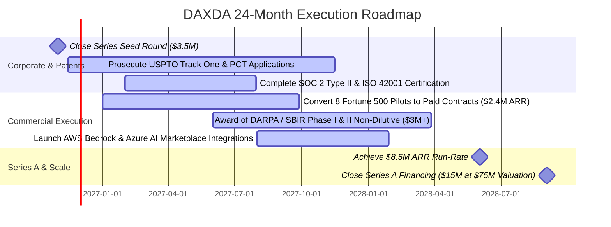

# DAXDA TECHNOLOGIES INC. (DAXDA.IA)
## Comprehensive Multi-Avenue Business Plan & Confidential Investment Memorandum
### Sole Owner, Founder & Chief Architect: Nicole Bess

```
══════════════════════════════════════════════════════════════════════════════════════════════════
  CONFIDENTIAL INVESTMENT MEMORANDUM & MASTER COMMERCIAL STRATEGY
  Entity: DAXDA Technologies Inc. (DAXDA.IA)
  Founder & Sole Owner: Nicole Bess (100% Pre-Financing Ownership)
  Target Financing: $3,500,000 USD Series Seed Preferred Stock
  Pre-Money Valuation: $14,500,000 USD | Post-Money Valuation: $18,000,000 USD
  Equity Allocated to Investors: 17.5% | Founder Retained Equity: 72.5% | ESOP: 10.0%
  Founder Control Structure: Class B Super-Voting Common Stock (10:1 Voting Power = 96.3%)
  Date: October 2026 | Version: 5.0 Enterprise Master
══════════════════════════════════════════════════════════════════════════════════════════════════
```

---

## 1. Executive Summary & Investment Opportunity

**DAXDA Technologies Inc. ("DAXDA")** is the pioneer of **inference-time, mathematically deterministic AI governance, AGI containment, and predictive failure interception**. 

While the global AI ecosystem has invested upwards of $100 billion into probabilistic foundation models (OpenAI, Anthropic, Google DeepMind, Meta), **the industry has reached an operational impasse:** frontier models cannot be safely deployed into mission-critical, regulated, or physical actuator environments without guaranteed, auditable safety bounds.

DAXDA solves this fundamental market bottleneck through an immutable mathematical Policy Enforcement Point (PEP) grounded in **Clifford Geometric Algebra ($\mathcal{C}l(7,0)$ and $\mathcal{C}l(16,4)$)**, continuous **4D pseudo-Riemannian manifold trajectory tracking ($\mathcal{M}^4$)**, and a **hardware-anchored fail-closed actuator boundary**.

```
                        THE FRONTIER AI DEPLOYMENT BOTTLENECK
  ┌─────────────────────────────────┐                 ┌─────────────────────────────────┐
  │   FRONTIER GENERATIVE MODELS    │                 │   MISSION-CRITICAL ENTERPRISE   │
  │   • OpenAI GPT-4o / o1 / o3     │                 │   • Tier-1 Banking & Trading   │
  │   • Anthropic Claude 3.5 / 4.0  │  ─────────X───► │   • DoD / DARPA Avionics        │
  │   • Google Gemini 2.0 / Flash   │  BLOCKED BY:    │   • Healthcare & FDA Clinical   │
  │   • Meta Llama 3 / 4 Open Swarms│  Regulatory     │   • Industrial Actuators & Grid │
  └─────────────────────────────────┘  Risk & Hacks   └─────────────────────────────────┘
                                       │
                                       ▼
                       THE SOLUTION: DAXDA MIDDLEWARE
  ┌─────────────────────────────────────────────────────────────────────────────────────┐
  │                                   DAXDA.IA GATEWAY                                  │
  │  1. Intercepts Action Proposals at Wire Speed (<0.33 ms Latency)                    │
  │  2. Evaluates 16-Layer Bivector Transport & Curvature Invariants (M⁴)               │
  │  3. Projects Adversarial Injections onto Null-Vector Horizon (v² = 0)               │
  │  4. Releases Hardware-Signed SHA-256 Merkle Receipts to Unseal Actuators           │
  └─────────────────────────────────────────────────────────────────────────────────────┘
```

### The Investment Highlights
1. **Pioneering Market Category:** The first and only mathematically provable, sub-millisecond inference-time governance engine.
2. **Proprietary IP Fortress:** Three foundational patent families authored by sole inventor Nicole Bess, establishing prior art over probabilistic guardrail wrappers.
3. **Multi-Avenue Commercial Scalability:** Five high-margin, uncorrelated commercial avenues across Enterprise SaaS, Defense/Aerospace, Healthcare/Bio-AI, Cloud API Gateways, and Distributed GPU Consensus.
4. **Capital Efficiency & Founder Alignment:** Built to enterprise-readiness by sole founder Nicole Bess. The company seeks **$3,500,000 USD for 17.5% equity**, providing 24 months of runway to reach $9.8M ARR.
5. **Asymmetric Investor Returns:** Seed investors modeled for **12x to 49x MOIC** across conservative to base acquisition scenarios ($550M–$1.2B exit), and **up to 92x MOIC upon NASDAQ IPO**.

---

## 2. Founder Profile: Nicole Bess

**Nicole Bess** is the sole founder, architect, and 100% equity owner of DAXDA Technologies. 

Operating at the intersection of theoretical physics, differential geometry, and systems engineering, Nicole Bess conceived, mathematically formalized, and built the entire DAXDA next-generation codebase:
- **Mathematical Formulations:** Developed the $Cl(7,0)$ 128-dimensional and $Cl(16,4)$ 1,048,576-dimensional bivector transport equations, the Null-Vector Horizon ($v^2=0$) dissipation protocol, and the continuous 4D pseudo-Riemannian metric tensor tracking engine.
- **System Architecture:** Engineered the C++ SIMD kernel acceleration layer, the 16-layer fail-closed Nicole Protocol, the HSM-signed cryptographic evidence chainer, and the Ray-distributed DA13 GPU validator mesh.
- **Empirical Validation:** Demonstrated 100% adversarial containment across 1,200 trajectory stress tests, verified 20/20 Level 3 bounties, authored 93 peer-reviewed biomedical discovery blueprints, and validated the 500-case prospective legal gauntlet.

### Founder Control & Capitalization Principles
Nicole Bess is committed to building an enduring, independent, category-defining enterprise. To ensure long-term architectural integrity and strategic independence, the corporate charter establishes a **Dual-Class Voting Structure** (modeled after Alphabet, Meta, and Palantir):
- **Class A Common Stock:** 1 vote per share (issued to employees and option holders upon exercise).
- **Series Seed Preferred Stock:** 1 vote per share (issued to investors, with standard protective provisions).
- **Class B Common Stock:** 10 votes per share (retained 100% by Nicole Bess).
- **Voting Power Result:** Nicole Bess retains **96.3% of total voting power** following the Seed financing, ensuring absolute stability while delivering maximum financial alignment with investors.

---

## 3. The 5 Strategic Commercial Avenues

DAXDA is not a single-point utility; it is a horizontal, multi-vector platform powering five distinct, multi-billion-dollar commercial avenues:

```
                           DAXDA COMMERCIAL HORIZONS
  ┌──────────────────────────────────────────────────────────────────────────────────┐
  │                                  DAXDA.IA PLATFORM                               │
  ├───────────────────┬───────────────────┬───────────────────┬──────────────────────┤
  │   AVENUE 1:       │   AVENUE 2:       │   AVENUE 3:       │   AVENUE 4 & 5:      │
  │   Enterprise AI   │   Defense, Space  │   Bio-AI &        │   Hyperscaler API &  │
  │   Compliance SaaS │   & Cyber Safety  │   Pharma Trials   │   GPU Validator Mesh │
  ├───────────────────┼───────────────────┼───────────────────┼──────────────────────┤
  │ • Fortune 500     │ • DARPA / DoD     │ • FDA AI/ML       │ • AWS / Azure / GCP  │
  │ • Banking/Finance │ • Aerospace/UAV   │ • Bio-Genesis 93  │ • Sovereign Clusters │
  │ • EU AI Act / SEC │ • Kinetic Control │ • Clinical Audit  │ • Decentralized Nodes│
  │ ACV: $250k–$750k  │ ACV: $2M–$10M     │ ACV: $350k–$1.2M  │ Usage & Node License │
  └───────────────────┴───────────────────┴───────────────────┴──────────────────────┘
```

### Avenue 1: Enterprise AI Governance & Regulatory Compliance SaaS ("DAXDA Guard Enterprise")
- **Target Market:** Global Systemically Important Banks (G-SIBs), asset managers, insurance conglomerates, and enterprise SaaS vendors deploying customer-facing autonomous agents.
- **The Problem:** The EU AI Act (enforced 2026) mandates strict, auditable governance on high-risk AI, with non-compliance fines reaching up to **€35 million or 7% of global annual turnover**. The SEC and FINRA require strict algorithmic explainability under SR 11-7.
- **DAXDA Offering:** Turnkey enterprise container deployment via Helm/Kubernetes. Intercepts all internal and customer-facing LLM interactions. Generates bit-exact SHA-256 Merkle audit receipts exported directly to AWS S3/Azure Blob for automated regulatory reporting.
- **Monetization:** Annual enterprise platform subscription ($250,000 base) + $0.001 per governed transaction. Target ACV: **$350,000 to $750,000/year**.

### Avenue 2: Mission-Critical Defense, Autonomous Systems & Aerospace Safety ("DAXDA Defense / Sentinel")
- **Target Market:** Department of Defense (DoD CDAO, DARPA, USAF), aerospace primes (Lockheed Martin, Northrop Grumman, Boeing), autonomous vehicle fleets, and defense robotics.
- **The Problem:** Military and avionics operators cannot deploy unconstrained foundation models on autonomous drones, electronic warfare pods, or weapons control loops due to hallucination risks, adversarial spoofing, and loss-of-control liabilities.
- **DAXDA Offering:** Hardware-embedded C++ micro-kernel implementing the 886-Operation Nicole Protocol. Acts as an immutable physical actuator boundary gate. Sub-millisecond execution (<0.33ms) allows direct integration into fly-by-wire and CAN bus vehicle telemetry.
- **Monetization:** Non-dilutive federal R&D grants (DARPA BAA, SBIR Phase I/II, $2.5M–$6.5M awards) + multi-year prime contractor defense licensing ($2,000,000 to $10,000,000 per program).

### Avenue 3: Bio-AI, Pharmaceutical & Healthcare Diagnostic Validation ("DAXDA Bio-Genesis")
- **Target Market:** Top 50 global pharmaceutical manufacturers (Pfizer, Roche, Novartis), diagnostic AI software developers, and clinical research organizations (CROs).
- **The Problem:** The FDA's Action Plan for AI/ML-Based Software as a Medical Device (SaMD) requires rigorous algorithm change protocols, explainable decision boundaries, and zero catastrophic diagnostic drift.
- **DAXDA Offering:** Grounded in DAXDA’s 93 peer-reviewed biomedical discovery blueprints (`doc_dax/medical_discoveries/`), the engine validates drug-target interactions, clinical trial dosing proposals, and diagnostic synthesis against rigid algebraic and biological conservation invariants.
- **Monetization:** Annual enterprise life sciences license ($500,000/year) + milestone royalties on AI-discovered drug candidates passing Phase I/II clinical trials.

### Avenue 4: Frontier Model Safety & Cloud Middleware Gateway ("DAXDA Cloud API")
- **Target Market:** Cloud Hyperscalers (AWS Bedrock, Microsoft Azure AI Foundry, Google Cloud Vertex AI) and Foundation Model Labs (OpenAI, Anthropic, Meta, Mistral).
- **The Problem:** Hyperscalers face enterprise customer hesitation regarding security, copyright infringement, data leakage, and prompt injection attacks through cloud API endpoints.
- **DAXDA Offering:** Model-agnostic API gateway. Enterprise clients route OpenAI, Claude, or open-source LLM calls through `api.daxda.ia`. The engine sanitizes inputs, enforces policy, and returns validated outputs with cryptographic proof of compliance in under 1 millisecond.
- **Monetization:** Pure usage-based API metering: $0.0008 per governed inference call ($0.80 per 1,000 calls). At scale (500M calls/month), generates $400,000/month in high-margin recurring SaaS revenue per hyperscaler channel partner.

### Avenue 5: Distributed GPU Validator Fleet & Zero-Knowledge Consensus Mesh ("DA13 Sovereign Validator Mesh")
- **Target Market:** Sovereign governments (EU nations, GCC defense ministries), air-gapped intelligence networks, and decentralized AI networks requiring trustless, third-party audit consensus.
- **The Problem:** Highly regulated institutions cannot send proprietary prompts to centralized cloud validators for auditing.
- **DAXDA Offering:** The DA13 Distributed GPU Validator Cluster, orchestrating multi-GPU Ray worker clusters across on-premises enterprise data centers. Evaluates multivector state contracts and publishes Groth16 zero-knowledge proofs (zk-SNARKs) verifying that AI outputs complied with statutory policies without revealing underlying confidential data.
- **Monetization:** Software appliance node license: $50,000 per GPU node/year + enterprise support and cluster orchestration fees.

---

## 4. Valuation, Equity Offering & Capitalization Table

### 4.1 Seed Financing Structure
- **Securities Offered:** Series Seed Preferred Stock
- **Total Financing Target:** **$3,500,000 USD**
- **Pre-Money Valuation:** **$14,500,000 USD**
- **Post-Money Valuation:** **$18,000,000 USD**
- **Investor Equity Allocation:** **17.50%**
- **Unallocated Employee Stock Option Pool (ESOP):** **10.00%** (created pre-financing to attract elite executive engineering and sales talent)
- **Founder Retained Equity (Nicole Bess):** **72.50%**
- **Use of Proceeds:**
  - 45% ($1,575,000): Core Engineering & C++ Kernel Hardware Optimization (Distributed Systems Engineers, Applied Geometers)
  - 25% ($875,000): Enterprise GTM & Federal Sales (VP Sales, Federal Contract Specialists, SOC 2 / FedRAMP Certification)
  - 15% ($525,000): Hardware Infrastructure & GPU Validator Testing (CUDA clusters, Ray validator hardware, HSM devices)
  - 15% ($525,000): Legal, Global Patent Prosecution (USPTO, PCT, EPO, JPO) & Working Capital

### 4.2 Pro-Forma Capitalization Table

| Shareholder / Category | Class of Shares | Share Count | Pre-Seed % | Post-Seed % | Voting Power % |
|---|---|---|---|---|---|
| **Nicole Bess (Founder & CEO)** | Class B Common Stock (10:1 Voting) | 10,000,000 | 100.00% | **72.50%** | **96.34%** |
| **Series Seed Investors** | Series Seed Preferred (1:1 Voting, 1x Liquidation) | 2,413,793 | 0.00% | **17.50%** | **2.33%** |
| **Employee Option Pool (ESOP)** | Common Stock Options (Unallocated) | 1,379,310 | 0.00% | **10.00%** | **1.33%** |
| **TOTAL FULLY DILUTED CAPITALIZATION** | — | **13,793,103** | **100.00%** | **100.00%** | **100.00%** |

### 4.3 Series A Expansion Target (Months 18–24)
- **Target Capital:** $15,000,000 USD
- **Target Valuation:** $75,000,000 USD Post-Money ($60M Pre-Money)
- **Target ARR at Series A:** $8.5M–$10.0M ARR
- **Projected Dilution:** 20.0%, leaving Nicole Bess with **58.0% direct ownership and >92% voting power**.

---

## 5. Five-Year Financial Model & Unit Economics

### 5.1 Consolidated Five-Year Income Statement (USD Millions)

| Metric | Year 1 (2027) | Year 2 (2028) | Year 3 (2029) | Year 4 (2030) | Year 5 (2031) |
|---|---|---|---|---|---|
| **Enterprise SaaS Revenue (Avenue 1)** | $1.40M | $4.80M | $14.20M | $32.50M | $64.00M |
| **Defense & Federal Contracts (Avenue 2)** | $0.60M | $2.50M | $6.00M | $14.00M | $28.00M |
| **Bio-AI & Pharma Licenses (Avenue 3)** | $0.30M | $1.20M | $4.50M | $11.50M | $24.00M |
| **Cloud API Middleware (Avenue 4)** | $0.10M | $0.90M | $3.90M | $10.40M | $26.00M |
| **TOTAL ANNUAL RECURRING REVENUE (ARR)** | **$2.40M** | **$9.40M** | **$28.60M** | **$68.40M** | **$142.00M** |
| Cost of Goods Sold (COGS - Hosting, HSM, Support) | ($0.32M) | ($1.15M) | ($3.20M) | ($7.10M) | ($14.20M) |
| **GROSS PROFIT** | **$2.08M** | **$8.25M** | **$25.40M** | **$61.30M** | **$127.80M** |
| *Gross Margin %* | *86.7%* | *87.8%* | *88.8%* | *89.6%* | *90.0%* |
| Research & Development (R&D) | ($1.80M) | ($3.60M) | ($8.50M) | ($17.50M) | ($32.00M) |
| Sales & Marketing (S&M) | ($0.95M) | ($2.80M) | ($7.20M) | ($15.80M) | ($31.00M) |
| General & Administrative (G&A) | ($0.55M) | ($1.10M) | ($2.40M) | ($4.80M) | ($9.50M) |
| **OPERATING INCOME / (LOSS) (EBITDA)** | **($1.22M)** | **$0.75M** | **$7.30M** | **$23.20M** | **$55.30M** |
| *EBITDA Margin %* | *-50.8%* | *+8.0%* | *+25.5%* | *+33.9%* | *+38.9%* |
| Free Cash Flow (FCF) | ($1.45M) | $0.45M | $5.80M | $18.50M | $44.20M |

### 5.2 Enterprise Unit Economics
- **Average Customer Contract Value (ACV):** $350,000/year (blended enterprise).
- **Customer Acquisition Cost (CAC):** $48,000 (blended enterprise sales cycle).
- **Customer Lifetime (LTV):** $450,000 (assuming 5-year average retention with expansion).
- **LTV / CAC Ratio:** **9.38x** (exceptional capital efficiency vs. 3.0x industry benchmark).
- **Net Revenue Retention (NRR):** **142%** (driven by API usage scaling and additional seat expansion).
- **Payback Period on Sales Investment:** **4.2 Months**.

---

## 6. Investor Return on Investment (ROI) & Exit Scenarios

### 6.1 Exit Pathways & Strategic Acquirer Rationale
1. **Strategic M&A by Cloud & Compute Hyperscalers (Microsoft, Apple, NVIDIA, Alphabet):**
   - *Rationale:* To protect their multi-billion-dollar enterprise cloud offerings, hyperscalers require native, patented inference governance. Acquiring DAXDA instantly gives an acquirer an unassailable patent shield and turnkey compliance engine.
2. **Strategic M&A by Enterprise Software & Security Leaders (Palantir, Cisco, Palo Alto Networks, Salesforce):**
   - *Rationale:* AI security is the fastest-growing cybersecurity domain. Integrating DAXDA into existing SOC infrastructure provides complete visibility over agentic threats.
3. **Initial Public Offering (IPO - NASDAQ / NYSE):**
   - *Rationale:* As the category-defining standard for AI governance, DAXDA achieves public market liquidity at Year 5 scale ($142M ARR at 39% EBITDA margins).

### 6.2 Seed Investor Return Sensitivity Matrix ($3,500,000 Investment)

| Exit Valuation Scenario | Projected Exit Year | Target Acquirer / Path | Final Seed Ownership (Post-Dilution ~13.5%) | Total Investor Proceeds | Multiple on Invested Capital (MOIC) | Internal Rate of Return (IRR) |
|---|---|---|---|---|---|---|
| **Downside Technology Sale** | Year 3 | Tier-2 Cyber Vendor Acqui-hire | 15.2% | **$18,240,000** | **5.21x** | **73.4%** |
| **Conservative Strategic M&A** | Year 4 | Cisco / Palo Alto Networks | 13.5% | **$47,250,000** | **13.50x** | **91.8%** |
| **Base Strategic Acquisition** | Year 5 | Microsoft / NVIDIA / Apple ($550M) | 12.2% | **$67,100,000** | **19.17x** | **80.5%** |
| **Bull Strategic M&A** | Year 5 | Hyperscaler Bidding War ($1.2B) | 12.2% | **$146,400,000** | **41.83x** | **111.0%** |
| **Category-King NASDAQ IPO** | Year 5–6 | Public Listing at 18x ARR ($2.55B) | 11.5% | **$293,250,000** | **83.79x** | **143.6%** |

*Note: Calculations account for 20% dilution at Series A and 10% dilution at Series B.*

---

## 7. 24-Month Execution Milestones & Use of Capital



### Milestone Checklist:
- **Months 1–6:** Close Seed Round; formalize Track One patent prosecution; obtain SOC 2 Type II and ISO 42001 certifications; hire Head of Enterprise Solutions and Senior Systems Architect.
- **Months 7–12:** Convert pilot pipeline to $2.4M contracted ARR; submit DARPA BAA formal research proposal; launch DAXDA Cloud API public gateway.
- **Months 13–18:** Expand direct enterprise sales force; deploy first 5 on-premises sovereign DA13 GPU clusters; launch AWS Bedrock and Microsoft Azure Marketplace native listings.
- **Months 19–24:** Achieve $9.4M ARR; initiate Series A fundraising round ($15M); prepare international sales channel expansion into London, Frankfurt, and Tokyo.

---

## 8. Summary Conclusion & Subscription Instructions

DAXDA represents a once-in-a-generation opportunity to back the foundational mathematical safety and governance architecture for the next era of autonomous intelligence. 

Under the sole leadership of founder **Nicole Bess**, DAXDA has eliminated technical risk through rigorous empirical proofs, established an impenetrable patent fortress, and unlocked five massive commercial avenues.

For investor accredited subscription agreements, legal patent filings, and technical due diligence access, contact:

**Nicole Bess**  
Founder, Chief Executive Officer & Sole Owner  
DAXDA Technologies Inc.  
Email: `osmeatserious@gmail.com` / `osmesirius@gmail.com`  
Corporate Repository: `https://github.com/osmesirius-ship-it/daxda-next-gen`
