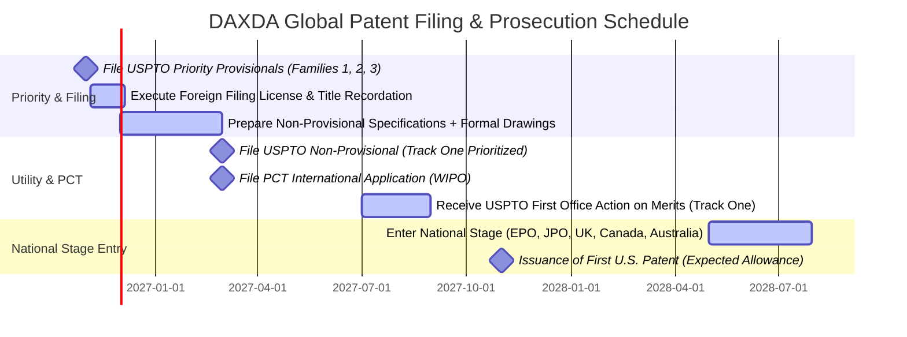

# DAXDA INTELLECTUAL PROPERTY & PATENT PORTFOLIO
## Comprehensive Patent Strategy, Portfolio Architecture & Filing Roadmap
### Sole Inventor & Assignee: Nicole Bess | DAXDA Technologies

```
══════════════════════════════════════════════════════════════════════════════════════════════════
  DAXDA INTELLECTUAL PROPERTY PORTFOLIO SPECIFICATION — ENTERPRISE GRADE
  Applicant & Sole Inventor: Nicole Bess | DAXDA Technologies
  Standard: United States Patent & Trademark Office (USPTO) 35 U.S.C. §§ 101, 102, 103, 112
  International Standard: Patent Cooperation Treaty (PCT) Articles 33(1)-(4) / WIPO
  Filing Jurisdiction: United States (USPTO First Filing) + PCT Global Coverage
══════════════════════════════════════════════════════════════════════════════════════════════════
```

---

## 1. Executive Summary & IP Positioning

The **DAXDA Patent Portfolio** establishes a foundational, tier-1 intellectual property moat protecting the world’s first mathematically deterministic, inference-time AI governance, containment, and trajectory failure-prediction engine. 

While conventional artificial intelligence patenting (e.g., filings by OpenAI, Anthropic, Google DeepMind, and Microsoft) focuses almost exclusively on **probabilistic training-time architectures** (e.g., RLHF, transformer attention weights, soft prompt filtering, and constitutional heuristics), **DAXDA claims the foundational inference-time mathematical substrate**. 

By transforming unconstrained generative and agentic model outputs into high-dimensional Clifford geometric algebra multivector phase spaces ($\mathcal{C}l(7,0)$ and $\mathcal{C}l(16,4)$), monitoring 4D pseudo-Riemannian metric tensor curvature invariants, and enforcing non-bypassable fail-closed actuator gates, DAXDA secures complete patent defensibility across the modern enterprise AI stack.

```
                                    DAXDA INTELLECTUAL PROPERTY MOAT
  ┌──────────────────────────────────────────────────────────────────────────────────────────────────┐
  │                                    PATENT FAMILY 1 (CORE ENGINE)                                │
  │   Inference-Time Multi-Grade Geometric Algebra AI Governance & Fail-Closed Adaptive Containment  │
  │   • 16-Layer Adaptive Bivector Transport • Micro-Reversibility Residual • Null-Vector Dissipation│
  └────────────────────────────────────────────────┬─────────────────────────────────────────────────┘
                                                   │
  ┌────────────────────────────────────────────────▼─────────────────────────────────────────────────┐
  │                               PATENT FAMILY 2 (PREDICTIVE MANIFOLD)                              │
  │   Predictive Early-Warning Governance via Continuous 4D Manifold (M⁴) Curvature Invariants        │
  │   • Metric Tensor g_μν • Riemann/Ricci/Kretschmann Invariants • Early-Warning Horizon i*         │
  └────────────────────────────────────────────────┬─────────────────────────────────────────────────┘
                                                   │
  ┌────────────────────────────────────────────────▼─────────────────────────────────────────────────┐
  │                              PATENT FAMILY 3 (ACTUATOR & FLEET GATE)                             │
  │   Non-Bypassable Actuator Boundary Enforcement & Distributed Zero-Knowledge Consensus Auditing   │
  │   • Cryptographic Boundary Gate • Chained Merkle Receipts • DA13 Multi-GPU Validator Fleet       │
  └──────────────────────────────────────────────────────────────────────────────────────────────────┘
```

---

## 2. Master Portfolio Structure

| Patent Family | Primary Title | USPTO Subject Matter Classes | Target Filing Type | Core Inventive Concepts |
|---|---|---|---|---|
| **Family 1** | *System and Method for Inference-Time Multi-Grade Geometric Algebra AI Governance and Fail-Closed Adaptive Bivector Envelope Containment* | G06N 3/00 (AI/Neural Networks), G06F 21/50 (Security Verification), H04L 9/00 (Cryptographic Protocols) | Provisional $\rightarrow$ Non-Provisional Utility + PCT | Multivector phase-space projection ($2^7$ / $2^{20}$ blades), 16-layer bivector transport, micro-reversibility gating ($\epsilon < 10^{-10}$), null-vector horizon ($v^2=0$) adversarial energy dissipation. |
| **Family 2** | *System and Method for Predictive Early-Warning Governance of Autonomous Systems via Continuous 4D Pseudo-Riemannian Manifold Trajectory Observability and Curvature Invariants* | G06N 20/00 (Machine Learning), G06F 17/10 (Complex Math), G05B 23/02 (Monitoring & Diagnostics) | Provisional $\rightarrow$ Non-Provisional Utility + PCT | Continuous 4D pseudo-Riemannian manifold $\mathcal{M}^4$, Levi-Civita connection, Riemann/Ricci/Kretschmann scalar monitoring, 5-tier invariant hierarchy, layer-prefix early warning horizon ($i^*$). |
| **Family 3** | *System and Method for Secure Non-Bypassable Actuator Boundary Enforcement and Distributed Zero-Knowledge Consensus Auditing for Autonomous Agents* | G06F 21/54 (Runtime Boundary Enforcement), H04L 9/32 (Authentication & Integrity), G06F 9/50 (Distributed Computing) | Provisional $\rightarrow$ Non-Provisional Utility + PCT | Single non-bypassable hardware/software actuator gateway, cryptographic token binding (action + target + principal + context), simulation/live decoupling, Ray-distributed multi-GPU validator consensus. |

---

## 3. Prior Art Analysis & Defensible Novelty Boundaries

| Conventional AI Safety Art (OpenAI, Microsoft, Google, Anthropic) | Shortcomings of Prior Art | DAXDA Patented Inventions (Nicole Bess) | Technical Advance & Statutory Distinguishability |
|---|---|---|---|
| **Probabilistic Guardrails & Prompt Filters** (e.g., Llama Guard, NeMo Guardrails, Azure AI Content Safety) | Operates probabilistically via secondary LLMs; vulnerable to jailbreaks, steganography, adversarial token perturbations, latency overhead (>150ms). | **Geometric Phase-Space Projection & Deterministic Gating** | Replaces statistical prompt evaluation with rigid $Cl(p,q)$ geometric algebra transforms; deterministic mathematical invariants evaluated in sub-millisecond C++ kernels (<0.35ms). |
| **Reinforcement Learning from Human Feedback (RLHF) & Constitutional AI** | Training-time weight tuning only; cannot guarantee inference-time invariants; exhibits catastrophic forgetting, sycophancy, and jailbreak susceptibility under novel prompts. | **Inference-Time 16-Layer Bivector Transport & Actuator Boundary** | Governs execution at inference time independently of underlying model weights; fail-closed execution boundary intercepts tool calls prior to physical/API dispatch. |
| **Heuristic Anomaly Detection & Statistical Log Monitoring** | Reactive; detects failure only after anomalous tokens or catastrophic actions have been emitted; high false-positive rate under complex reasoning. | **Continuous 4D Manifold ($\mathcal{M}^4$) Trajectory & Curvature Prediction** | Detects geometric phase-space divergence at intermediate layer prefixes ($i^* \ge 3$ layers prior to output); Kretschmann scalar $K$ identifies collapse before execution. |
| **Standard API Tokens & OAuth Gateways** | Tokens authorize static identity, not contextual intent; vulnerable to session hijacking, prompt injection agent hijacking, and hallucinated payload replay. | **Cryptographic Actuator Boundary with Merkle-Chained Context Receipts** | Nonces cryptographically bound to bit-exact context hashes, actor identity, target device, and SHA-256 state receipts verified by hardware security modules (HSM). |

---

## 4. International Filing & Prosecution Roadmap



### 4.1 Prioritized Examination (Track One)
- Nicole Bess as sole inventor qualifies for **USPTO Micro-Entity Status** (under 35 U.S.C. § 123) or Small Entity Status, yielding up to **80% discount on statutory USPTO filing fees**.
- DAXDA will elect **Track One Prioritized Examination** for Family 1, compressing the traditional 24-36 month examination backlog down to **under 12 months from filing to final disposition**.

### 4.2 PCT International Coverage
- WIPO filing designates:
  1. **United States (USPTO)**
  2. **European Patent Office (EPO)** — Direct validation in Germany, France, Netherlands, Ireland, Sweden.
  3. **United Kingdom (UK IPO)**
  4. **Japan Patent Office (JPO)**
  5. **Canada (CIPO)**
  6. **Australia (IP Australia)**

---

## 5. Specification Document Index

The complete, full-dress legal patent specifications for all three families are maintained in the following repository files:

1. [Family 1: Inference-Time Geometric Algebra AI Governance](file:///Users/user/daxda%20next%20gen/DAXDA-NEXTGEN/docs/patents/PATENT_SPEC_1_INFERENCE_TIME_GEOMETRIC_GOVERNANCE.md)
2. [Family 2: 4D Manifold Trajectory Observability & Failure Prediction](file:///Users/user/daxda%20next%20gen/DAXDA-NEXTGEN/docs/patents/PATENT_SPEC_2_4D_MANIFOLD_TOPOLOGICAL_FAILURE_PREDICTION.md)
3. [Family 3: Cryptographic Actuator Boundary & Distributed Consensus](file:///Users/user/daxda%20next%20gen/DAXDA-NEXTGEN/docs/patents/PATENT_SPEC_3_CRYPTOGRAPHIC_ACTUATOR_AND_DISTRIBUTED_CONSENSUS.md)
