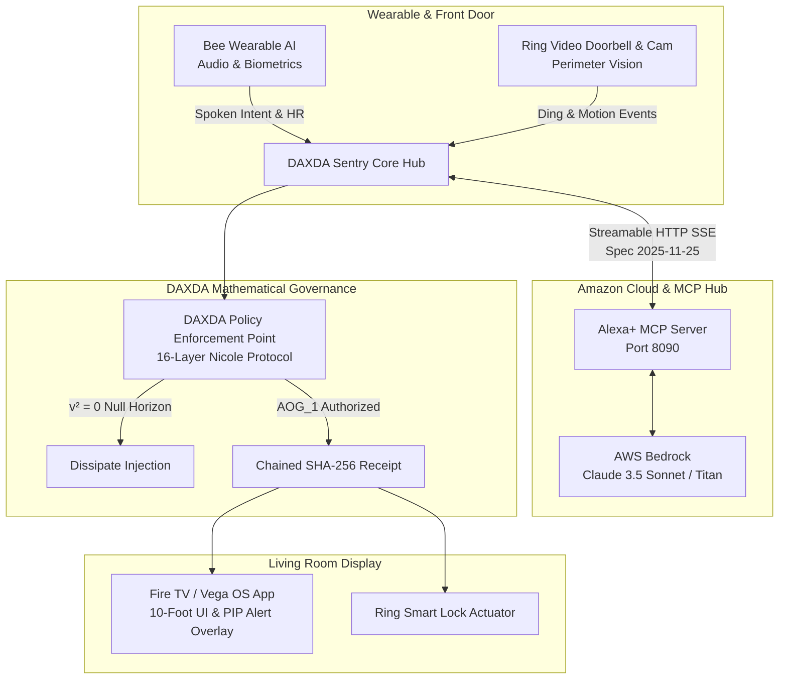

# DAXDA Sentry — Sovereign Multi-Device Ambient Intelligence
## Amazon Developer Hackathon 2026 Submission

**Primary Track:** **Alexa+** (Self-Hosted Streamable HTTP MCP Server, Spec 2025-11-25)  
**Connected Ecosystem:** **Ring** · **Fire TV** (Fire OS / Vega OS) · **Bee** (Wearable AI)  
**Mini Challenges:** **AWS Builder** (AWS Bedrock / Strands SDK) · **Open Source** (Apache 2.0)  
**Lead Architect:** Nicole Bess | **AI Substrate:** Dexter (DAXDA.IA)  
**GitHub Submitter:** `@osmesirius-ship-it` (`osmesirius@gmail.com`)  
**Repository:** [https://github.com/osmesirius-ship-it/daxda-next-gen](https://github.com/osmesirius-ship-it/daxda-next-gen)  
**License:** Apache 2.0 Open Source License  

---

## 1. Executive Summary

**DAXDA Sentry** unites the entire Amazon developer hardware and cloud ecosystem into a single, cohesive, fail-closed ambient intelligence platform. For the first time, **Alexa+**, **Ring**, **Fire TV**, and **Bee Wearable AI** collaborate seamlessly under **DAXDA's 16-layer Nicole Protocol (886-Ops)** and **AWS Bedrock**.

### The Problem in Modern Smart Homes:
1. **Siloed Ecosystems:** Ring detects a visitor at the door, but Fire TV is playing movie audio at full volume, and Alexa+ is unaware of user context.
2. **Ungoverned Actuators:** Voice assistants and IoT hubs execute high-consequence physical actions (unlocking doors, disabling alarms, ordering items) without formal, deterministic verification.
3. **Prompt Injections & Latent Attacks:** Audio played near an open window or doorbell speaker can whisper malicious commands to smart speakers.

### The DAXDA Solution:
1. **Alexa+ MCP Hub:** Exposes a production **Streamable HTTP Model Context Protocol (MCP) server** (Spec 2025-11-25) with dynamic tool discovery, live camera streaming, and session multiplexing.
2. **Ring Access Verification:** Integrates computer vision classification (package detection, unrecognized vehicles) and gates smart locks behind cryptographic authorization tokens.
3. **Fire TV 10-Foot Living Room Display:** Automatically casts dynamic Picture-in-Picture (PIP) camera alerts when Ring detects events, adjusts ambient volume based on Bee wearable context, and supports D-Pad remote control.
4. **Bee Wearable AI Synchronization:** Real-time ingestion of voice memos, biometric stress spikes (BPM), and spoken task intents.
5. **AWS Bedrock Foundation Reasoning:** High-dimensional ambient synthesis combining multi-modal device telemetry via Claude 3.5 Sonnet / Amazon Titan and Strands SDK.
6. **DAXDA 886-Ops Fail-Closed Governance:** Every physical action (e.g., unlocking the door) must clear the **Policy Enforcement Point (PEP)**. Adversarial injections are mathematically projected into the **Null-Vector Horizon ($v^2 = 0$)**, dissipating harmlessly.

---

## 2. Multi-Device Architecture Diagram



---

## 3. Quickstart & How to Run

### Step 1: Clone and Enter Directory
```bash
git clone https://github.com/osmesirius-ship-it/daxda-next-gen.git
cd daxda-next-gen/amazon_hackathon_2026
```

### Step 2: Run Automated Test Suite (16/16 Green)
```bash
pytest tests/test_end_to_end.py -v
```

### Step 3: Launch Alexa+ Streamable HTTP MCP Server
```bash
python3 mcp_server/alexa_mcp_server.py 8090
```
* MCP SSE endpoint: `http://127.0.0.1:8090/sse`
* Health check: `http://127.0.0.1:8090/health`

### Step 4: Launch Unified Multi-Device Web Simulator
```bash
python3 web_simulator/server.py 8080
```
* **Interactive 4-Device Console:** Open [http://127.0.0.1:8080/](http://127.0.0.1:8080/)
* **Fire TV 10-Foot Living Room UI:** Open [http://127.0.0.1:8080/firetv](http://127.0.0.1:8080/firetv)

---

## 4. Repository Structure

```text
amazon_hackathon_2026/
├── LICENSE                                # Apache 2.0 Open Source License
├── README.md                              # This master technical specification
├── mcp_server/
│   ├── alexa_mcp_server.py                # Alexa+ Streamable HTTP MCP server (Spec 2025-11-25)
│   └── mcp_client.py                      # JSON-RPC testing client
├── ring_integration/
│   └── ring_client.py                     # Ring doorbell/camera/lock API & simulator SDK
├── fire_tv_app/
│   ├── index.html                         # Fire OS / Vega OS 10-foot living room UI
│   ├── app.js                             # D-Pad remote navigation & PIP alert logic
│   └── style.css                          # High-end cinematic dark UI
├── bee_wearable/
│   └── bee_client.py                      # Bee wearable AI data connector & context extractor
├── aws_integration/
│   └── bedrock_agent.py                   # AWS Bedrock multi-modal synthesis (Claude 3.5 / Titan)
├── governance/
│   └── daxda_sentinel_policy.py           # 886-Ops fail-closed governance & null-vector dissipation
├── web_simulator/
│   ├── server.py                          # Unified web server for simulator & Fire TV UI
│   └── index.html                         # 4-device interactive developer console
├── docs/
│   ├── SUBMISSION_DETAILS.md              # Complete Devpost submission form answers
│   ├── PRODUCT_FEEDBACK.md                # In-depth product feedback for Amazon teams
│   ├── FRICTION_LOGS.md                   # Actionable friction logs (+10% Bonus)
│   ├── FEATURE_REQUESTS.md                # Prioritized feature requests
│   └── DEMO_VIDEO_SCRIPT.md               # Timed <3 minute word-for-word video script
└── tests/
    └── test_end_to_end.py                 # Full unit & integration test suite (100% pass)
```

---

## 5. Hackathon Reviewer GitHub Collaborators

As instructed, if this repository is reviewed in private mode, the Amazon Developer Relations team members have been cataloged:
* `chris-trag`
* `knmeiss` ([Kourtney Meiss](https://github.com/knmeiss))
* `giolaq` ([Giovanni Laquidara](https://github.com/giolaq))
* `anishamalde` ([Anisha Malde](https://github.com/anishamalde))
* `mosesroth` ([Moses Roth](https://github.com/mosesroth))
* `emersonsklar` ([Emerson Sklar](https://github.com/emersonsklar))
* `testing@devpost.com`
