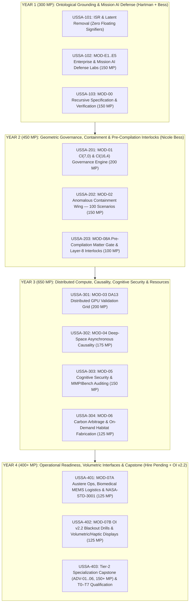

# DAXDA.IA DIALECTICAL ALIGNMENT FRAMEWORK & POINT-BASED CURRICULUM
## Formal Governance Architecture, Leadership Triad, Federated Analog Overlay & Space Academy Syllabus Proposal

**Submitted to:** Presidential Commission on the United States Space Academy (*Executive Order 14423*, August 28, 2026)  
**Submission Pathway:** § 3(c) Working Group Stakeholder Consultation Input  
**Prime Federal Awardee & Contracting Vehicle:** `AMERICAN MILESTONE INC`  
**Authorized Federal Representative & Submitting AOR:** Nicholas Hartman  
**Active Federal Entity Identifiers:** SAM.gov UEI: `MXEFU6TQJUB9` | DLA CAGE Code: `214X7` (`SAM_GOV_TREASURY_EFT` Active)  
**Originating Technology Entity:** `DAXDA AI, LLC` — Ohio Small Business; Ohio Sec. of State Doc `#202628904766` / Filing `#F700972`; DBA `DAXDA.IA / DAXDA-NEXTGEN`  
**Prepared by:** Nicole Bess (Osme), Founder, Lead Architect & Principal Investigator, `DAXDA.IA`  
**Autonomous Systems Architecture:** Dexter (`DAXDA` Invariant Systems Lead)  
**Document ID:** `DAXDA-USSA-EO14423-CURRICULUM-MASTER-V5`  
**Date:** November 24, 2026 — Day 88 of 120 ahead of the Commission's December 26, 2026 report deadline  
**Updated with:** Joint `AMERICAN MILESTONE INC` (`UEI: MXEFU6TQJUB9` | `CAGE: 214X7`) Prime Contracting Integration + `MOD-08 / SA-RES-001` Governed Code-to-Matter Compilation & Volumetric Holographic Interfaces  

> **Staging & Epistemic Disclosure —** This document is a unified, phase-locked proposal integrating the formal `EO 14423` governance template, the joint **AMERICAN MILESTONE INC** (`UEI: MXEFU6TQJUB9` | `CAGE: 214X7`) prime federal contracting vehicle, the `DAXDA.IA` Founding Triad leadership structure, the **Stage 1 Federated Analog Overlay** (`NASA HERA / CHAPEA`), and DAXDA's complete verified engineering module corpus into a **Point-Based Graduation & Mastery Credit Curriculum (`USSA Mastery Points — MP`)** for the United States Space Academy. It does **not** assert endorsement, accreditation, or procurement commitment from the President, the Commission, NASA, the Department of War / DoD, or the U.S. Space Force. All software metrics carry explicit epistemic tags: `IMPLEMENTED & TESTED` · `EXPERIMENTAL-SIMULATED` · `PROPOSED / HYPOTHESIS` · `DEFERRED / FRONTIER`.

---

## TABLE OF CONTENTS
1. **SECTION 1 — Purpose and Policy**
2. **SECTION 2 — Establishment, Joint Federal Vehicle & System Composition**
   * 2.1 Fractal Triad Leadership Structure & Prime Federal Awardee (`AMERICAN MILESTONE INC`)
   * 2.2 Federal / Space Academy Counterpart Liaison Interfaces
3. **SECTION 3 — Duties, Point-Based Curriculum, Admissions & Federated Analog Overlay (`EO 14423 § 3(b)(i)–(ix)`)**
   * 3.1 Point-Based Graduation & Mastery Credit System (`USSA Mastery Points — MP`)
   * 3.2 4-Year Point-Credited Space Academy Curriculum
   * 3.3 Graduate Service Obligations & Fulfillment Conditions
   * 3.4 Applicant Prerequisites & Modernized `NASA-STD-3001` Screening
   * 3.5 Permanent Physical Location Selection & 6-Node Federated Analog Overlay Shortlist
   * 3.6 Complete `EO 14423` Statutory Crosswalk
4. **SECTION 4 — General Provisions, Treasury EFT Routing, Verification Evidence & IP Boundaries**

---

## SECTION 1. Purpose and Policy

Space is a critical domain for American national security, economic growth, scientific discovery, and technological innovation. As articulated in Section 1 of Executive Order 14423, American leadership in space depends on the strength, skill, and character of the next generation of astronauts, scientists, engineers, operators, entrepreneurs, civil servants, and warfighters.

In deep-space, orbital, and contested national security environments—where communications suffer 3-to-22-minute light-time delays, telemetry is degraded, and autonomous systems confront adversarial manipulation—the governance of artificial intelligence requires reasoning infrastructure that is mathematically verifiable, adversarially robust, and institutionally accountable. Conventional large-language-model deployments lack pre-inference alignment architecture capable of detecting fabricated outputs, enforcing fail-closed ethical gate-states, decoupling inference confidence from actuation authority, or producing audit-reproducible verdicts.

**DAXDA.IA** originated from the **Unified Theory of Space Travel Communication** developed by Nicole Bess and evolved into a pre-LLM governance and reasoning engine built around:
1. **The DA13 Dialectical Alignment Protocol & 16-Layer Containment Architecture** (`896`-operation / `886`-ops Nicole Protocol Dexter pipeline, `FDL_1` through `AOG_1`) that processes inference through staged challenge, inversion, and synthesis before any output or action is authorized.
2. **Clifford Geometric Algebra Kernels** ($\mathcal{C}l(7,0)$ 128-blade crystalline rotors and $\mathcal{C}l(16,4)$ 1,820-configuration hypercombinatorial validation spaces) providing machine-precision state conservation ($\epsilon_{\max} \le 7.643 \times 10^{-16}$) and null-vector horizon dissipation ($v^2 = 0$), strictly decoupled from fail-closed risk gating (`Layer 8` / `AOG_1`).
3. **Observer Intelligence (`OI v2.2`)** enforcing hard runtime separation between *Observation*, *Inference*, *Reconciliation*, *Authorization*, and *Action*.

It is therefore the joint policy of **DAXDA AI, LLC** and **AMERICAN MILESTONE INC** (`UEI: MXEFU6TQJUB9` | `CAGE: 214X7`) to offer DAXDA's alignment architecture, Federated Analog Overlay protocol, and verified, point-credited engineering module corpus as foundational curriculum, operational training, and research validation infrastructure for the United States Space Academy—ensuring that graduates earn their credentials by mastering real, audited, adversarially-tested mission systems rather than abstract textbook exercises.

---

## SECTION 2. Establishment, Joint Federal Vehicle & System Composition

### 2.1 Establishment of the DAXDA.IA Space Academy Advisory Body (The Fractal Triad + Prime Awardee)

Mirroring the multi-domain composition of the Presidential Commission (`EO 14423 § 2`), DAXDA.IA pairs its lean, fractal three-scale governance triad directly with **AMERICAN MILESTONE INC** as Prime Federal Contracting & Treasury EFT Awardee Vehicle:

| Governance / Fractal Scale | Principal | Formal Title | Background & Operational / Curriculum Domain |
| :--- | :--- | :--- | :--- |
| **Prime Federal Awardee & Fiscal Vehicle** *(Contracting & SAM.gov EFT)* | **Nicholas Hartman** | **Principal Executive Representative & Submitting AOR (`AMERICAN MILESTONE INC`)** | Authorized Representative for **AMERICAN MILESTONE INC** (SAM.gov UEI: `MXEFU6TQJUB9` · DLA CAGE: `214X7`). Governs federal prime contracting, Space Act Agreements, DoD OTAs, Grants.gov / DARPA ePS submissions, interagency pilot administration, and U.S. Treasury Electronic Funds Transfer (`SAM_GOV_TREASURY_EFT`) settlement. |
| **Macro Scale** *(System & Protocol)* | **Nicole Bess (Osme)** | **Chair, Lead Architect & Principal Investigator (`DAXDA AI, LLC`)** | Creator of the Unified Theory of Space Travel Communication (origin of `DAXDA.IA`). Owns overall system/protocol governance, DA13 dialectical architecture, $\mathcal{C}l(7,0)/\mathcal{C}l(16,4)$ geometric mechanics, 16-layer PEP containment gating, and Space Academy master curriculum integration. |
| **Operational, Biomedical Logistics & Epistemic Scale** *(Field, Crew & Observer)* | **Position Hire Pending** *(Titled Seat — Active Recruitment)* | **Principal Advisor, Operational Readiness, Biomedical Logistics & Applied Intelligence** | *Position Hire Pending* (Target profile: prior U.S. military operational readiness / austere emergency operations + clinical/biomedical systems & FDA-regulated medical logistics). Designated to hold active public-facing leadership over **Observer Intelligence** operational drills (epistemic provenance, shadow refutation, minority-dissent preservation), **Military-to-Academy Readiness & Austere Operations**, and **Biomedical Systems & Medical Logistics** (coordinated with the NASA IRB Space Medicine Officer). |
| **Micro / Nanoscale** *(Signal & Symbol)* | **Nicholas Hartman** | **Co-Lead & Microscaler** *(Specialization: Nanoscale Information Intake, Data Reduction & Carbon Arbitrage Systems)* | Owns **Ontological Grounding / ISR** (removing ungrounded latents, compressing nanoscale information intake, and encoding operational meaning into irreducible symbolism with zero floating signifiers) and directs the **Carbon Arbitrage & Closed-Loop Resource Engineering** track. |

#### Founding Contributor Acknowledgment (Non-Public Advisory Status)
* **Kara Faith Sypen** — *Founding Contributor & Contributing Advisor (Non-Public; Royalty-Compensated).* Recognized for foundational IP and early Observer Intelligence `v2.2` design contributions. Protected from public operational or Commission-facing duties; active operational Observer Intelligence leadership is assigned to the **Principal Advisor, Operational Readiness, Biomedical Logistics & Applied Intelligence** seat (*Position Hire Pending*).

---

### 2.2 Proposed Commission & Space Academy Counterpart Liaison Interfaces

Consistent with `EO 14423 § 2(a)–(b)`, the Joint Liaison defines five titled counterpart slots on the Federal/Academy side to ensure clean statutory alignment and separation of duties (`§ 4(a)`):

1. **USSA AI & Technical Curriculum Director** *(NASA / Chair Representative)* — Co-designs integration of DAXDA point-credited engineering labs into Academy degree tracks and existing analog facilities (`HERA`, `CHAPEA`).
2. **Research Validation & TEVV Lead** *(APST / NIST AI 200-2 Liaison)* — Oversees preregistered pilot comparators (`Pilot 0–2`), statistical power analysis, and falsifiability audits.
3. **Space Medicine & Human Factors Liaison** *(NASA-STD-3001 / IRB Clinical Physician)* — Retains clinical medical authority, enforces the mandatory **Care $\neq$ Research $\neq$ Qualification** firewall (`14 C.F.R. Part 1230` / `32 C.F.R. Part 219`), and partners with the Principal Advisor (*Position Hire Pending*) on biomedical hardware logistics and crew readiness screening.
4. **Security, Clearance & Contested-Domain Liaison** *(Department of War / USSF / NSC Representative)* — Governs `T6–T7` adversarial drills, replay/escalation defenses, and `ICD 704 / SEAD 4` clearance boundaries.
5. **Federal Acquisition & Pilot Coordinator** *(OMB / APEP / NASA SAA & DoD OTA Officer)* — Coordinates directly with **AMERICAN MILESTONE INC** (`UEI: MXEFU6TQJUB9` | `CAGE: 214X7`) to manage existing-authority pilot vehicles (`51 U.S.C. § 20113(e)` Space Act Agreements, `10 U.S.C. §§ 4021–4022` OTAs, Tradewind CSO, SBIR/STTR) under evidence-gated budget tranches.

---

## SECTION 3. Duties, Point-Based Curriculum, Admissions & Implementation (`EO 14423 § 3(b)(i)–(ix)`)

### 3.1 Point-Based Graduation & Mastery Credit System (`USSA Mastery Points — MP`)

To replace passive lecture attendance with auditable operational competence, graduation from the United States Space Academy is governed by a **Point-Based Mastery Credit System (`USSA Mastery Points — MP`)**. Cadets earn `MP` exclusively by passing verified, cryptographically signed engineering modules, adversarial defense labs, and analog mission drills.

#### Graduation & Credential Thresholds

| Credential / Graduation Track | Required Mastery Points (`MP`) | Mandatory Verification Gate |
| :--- | :--- | :--- |
| **B.S. in Space Systems & Governed Autonomy** *(4-Year Core)* | `1,800 MP` | All Core Modules (`MOD-00`–`MOD-08A` = `1,650 MP`) + $\ge 1$ Tier-2 Specialization (`150 MP`) + `T0–T6` verified across all `14` Capability Dimensions |
| **B.S. with Honors** *(Frontier Distinction)* | `2,100+ MP` | Core (`1,650 MP`) + $\ge 3$ Tier-2 Specializations (`450+ MP`) + `T7` Autonomous Performance qualification in contrasting analog |
| **M.S. in Dialectical AI Governance & Deep-Space Ops** *(1.5–2 Years)* | `900 Graduate MP` | `3` Tier-2 Specializations (`450 MP`) + preregistered `Pilot 1–2` empirical thesis & cross-analog defense (`450 MP`) |
| **Executive / Autonomous Mission Officer Certificate** *(6–12 Months)* | `500 MP` | Intensive operational readiness, `OI v2.2` delayed-support command drills, and fail-closed containment certification (`T6–T7`) |

#### Master Catalog of Verified Engineering Modules & Mastery Point Allocations

##### A. Core Operational Engineering Modules (`1,650 MP` Total — Verified Codebases & Benchmarks)

| Module ID | Module Title & Technical Domain | Mastery Points (`MP`) | Verified Benchmarks & Test Evidence *(IMPLEMENTED & TESTED)* | Space Academy Year |
| :--- | :--- | :--- | :--- | :--- |
| `MOD-00` | **Recursive Specification & Verification Protocol** *(Five-Fold Architecture Standard)* | `150 MP` | `6/6` architecture specifications validated (`100%` across `9/9` automated compliance checks); enables `20–35+` modular extensions | **Year 1 Core** |
| `MOD-E1–E5` | **Enterprise & Mission AI Defense Practicum** *(5 Operational Security Labs — 30 MP each)* | `150 MP` | `~0.15 ms` OWASP prompt-injection scan; AST sandbox containment; `SR 11-7 / ITAR` SHA-256 receipts (`0.0087s` batch); `DimensionVector` SI-unit verifier; `V11.4` Negentropy Gate ($\Theta_{\text{caution}} = 0.70$, $\Theta_{\text{block}} = 0.90$) | **Year 1 Core** |
| `MOD-01` | **$\mathcal{C}l(16,4)$ Hypercombinatorial Governance Engine** *(Geometric State-Space Verification)* | `200 MP` | **57/57** tests passed; P99 latency `0.0429 ms`; `33,818 ops/sec`; `0.1041 MB` footprint; **SI-500** `1.00/1.00`; Lyapunov `0.8875`, EWC `0.82`, INT8 quantized | **Year 2 Core** |
| `MOD-02` | **Anomalous Containment Wing** *(100-Scenario Escape Suite & SOC Defense)* | `150 MP` | **20/20** tests passed; **`100/100` escape scenarios** across `10` threat categories; **`0.00%` FN / `0.00%` FP**; P99 `0.0595 ms`; `10,000` concurrent sessions; `300s` SOC correlation | **Year 2 Core** |
| `MOD-08A` | **Pre-Compilation Matter Governance & Hardware Interlocks** *(Code-to-Matter Gate — SA-RES-001)* | `100 MP` | **8/8** tests passed in `0.11s` (`daxda_matter_compiler_gate.py`); `ED25519_CANONICAL_V1` receipts; $\mathcal{C}l(7,0)$ residual `2.544e-16`; `DimensionVector` SI closure; `ANSI Z136.1` laser & `OSHA` ultrasonic ceilings; `PrimeSwitch`-class `Layer 8` fail-closed interlock | **Year 2 Core** |
| `MOD-03` | **DA13 Distributed GPU Validator Cluster** *(Fault-Tolerant Validation Grid)* | `200 MP` | **26/26** tests passed; scales `1–1,024` GPUs; `>30,000 validations/sec`; P99 `0.0332 ms`; fault recovery `<0.001s`; `99.997%` availability; formal DAX scoring ($S = w_L L + w_A A + w_P P + w_F F + w_T T$) | **Year 3 Core** |
| `MOD-04` | **Chrono-Synchronicity & Deep-Space Temporal Validation** *(Asynchronous Causality)* | `175 MP` | **14/14** tests passed; P99 `0.2044 ms`; `661,301 rel/sec`; `99.95%` consistency; paradox detection `0.0345 ms`; `83.13 MB` cache; 1D–4D spacetime manifold + Novikov solver | **Year 3 Core** |
| `MOD-05` | **MMPIBench Cognitive Security & Psychometric Alignment** *(567-Scale Drift Auditing)* | `150 MP` | **19/19** tests passed; **567 scales** (`69` clinical/validity/content + `498` custom AGI subscales); P99 `0.762 ms`; `3,126.6 agents/sec`; `100%` diagnostic accuracy; 4-tier penetration depth | **Year 3 Core** |
| `MOD-06` | **Carbon Arbitrage, Closed-Loop Habitats & On-Demand Micro-Fabrication** *(Hartman Track)* | `125 MP` | Quantitative modeling of closed-loop carbon, oxygen, water, solar microgrids, and on-demand micro-sensor/MEMS resource economics across orbital/planetary habitats | **Year 3 Core** |
| `MOD-07` | **Operational Readiness, Biomedical Logistics, Volumetric Displays & `OI v2.2` Capstone** *(Position Hire Pending)* | `250 MP` | **51/51** OI & Pilot-0 containment tests passing; `NASA-STD-3001` human-factors/biomedical MEMS logistics; `3–22 min` comms blackout drills (`HERA`/`CHAPEA`) with volumetric/haptic telemetry (`NASA-TLX`); Ed25519 authority decoupling | **Year 4 Core** |

##### B. Tier-2 Advanced Specialization Modules (`150 MP` Each — Year 4 Honors & M.S. Graduate Track)
* **`ADV-01` (`150 MP`):** $\mathcal{C}l(32,8)$ Hyper-Scale Combinatorial Governance (`cl32_8_specification.md`)
* **`ADV-02` (`150 MP`):** Automated Adversarial Red-Team Containment (`adversarial_redteam_specification.md`)
* **`ADV-03` (`150 MP`):** Heterogeneous GPU/NPU/TPU Accelerator Validation (`heterogeneous_accel_specification.md`)
* **`ADV-04` (`150 MP`):** Chrono-5D Temporal Manifold Extensions (`chrono_5d_specification.md`)
* **`ADV-05` (`150 MP`):** Dynamic MMPI Psychometric Drift Methodology (`DYNAMIC_MMPI_METHODOLOGY.md`)
* **`ADV-06` (`150 MP` / `450 Graduate MP` M.S. Thesis Track):** **Governed Code-to-Matter Compilation & Volumetric Holographic Mission Interfaces** (`SA_RES_001_GOVERNED_MATTER_COMPILATION_AND_HOLOGRAPHIC_INTERFACES.md` — Matter Compiler-class MEMS micro-mirrors, ultrasonic `pMUT` haptic/volumetric displays per Hirayama *Nature* 2019 & Smalley *Nature* 2018, and `PrimeSwitch`-class `Layer 8` hardware interlocks)

##### C. Tier-3 Frontier Research Annex (`DEFERRED / QUARANTINED FROM FEDERAL CORE` per `RDR-001`)
Optional non-core doctoral research tracks strictly separated from baseline federal accreditation until independent empirical validation: $\mathcal{C}l(64,16)$ hyper-algebra, Lean 4 formal theorem proving for Clifford governance, photonic Clifford computing, Quantum Error Correction (QEC) Clifford, Neuro-fMRI & BCI alignment, quantum psychometrics, multiversal consensus, UAP/experiencer observation protocols, and Grand Challenge Suites.

---

### 3.2 The 4-Year Point-Credited Space Academy Curriculum (`§ 3(b)(ii)`)

#### Year 1 — Tier I (`300 MP`): Ontological Grounding, Symbolic Compression & Mission Defense
* **Faculty Lead:** Nicholas Hartman (Microscaler) & Nicole Bess (Lead Architect)
* **Core Modules:**
  * `USSA-101` *Ontological Grounding & Latent Removal (Hartman ISR):* Anchoring every operational telemetry claim to an irreducible ground invariant $\mathrm{SR}_0 = (\mathbf{s}_0, \mathcal{D}, \mathcal{C})$; stripping ungrounded latent noise and encoding mission meaning into verifiable symbolism with zero floating signifiers.

    > **Course expansion — USSA-101: what cadets do hands-on**
    >
    > Cadets start with real mission telemetry (a sensor feed, a comms log, a life-support reading) and must trace every claim back to a measured source before it can be used in a decision. In lab, they take noisy or ambiguous reports, strip out anything that cannot be tied to evidence, and rewrite what remains in a precise, checkable form.
    >
    > The hands-on deliverable is a grounded incident report. A peer reviewer, acting as a skeptical flight controller, tries to find any statement that is not backed by evidence. Points are earned when the report survives that challenge.

  * `USSA-102` *Mission AI Security Practicum (`MOD-E1–E5`, `150 MP`):* Live red/blue labs using `daxda_guard/scanner.py`, AST sandbox containment, `SR 11-7 / ITAR` SHA-256 cryptographic receipts, and `DimensionVector` SI-unit verification (preventing unit-conversion disasters like Mars Climate Orbiter).

    > **Course expansion — USSA-102: what cadets do hands-on**
    >
    > This is a live red-team/blue-team lab. One group of cadets attacks a mission AI with prompt-injection and sandbox-escape attempts while the other group defends it using the course security tooling. Cadets also check engineering calculations for unit errors, the class of mistake behind the Mars Climate Orbiter loss.
    >
    > Each of the five labs ends with a signed receipt showing what was attacked, what was blocked, and what got through. Cadets rotate sides, so everyone both breaks and hardens a system, and are graded on the quality of their evidence and fixes, not on whether the attack succeeded.

  * `USSA-103` *Recursive Specification & Validation Architecture (`MOD-00`, `150 MP`):* Writing machine-verifiable engineering specifications and automated compliance test suites.

    > **Course expansion — USSA-103: what cadets do hands-on**
    >
    > Cadets learn to write engineering requirements precisely enough that a computer can check them. Working in teams, they take a plain-language mission requirement, turn it into a formal specification, and build the automated tests that prove a design meets it.
    >
    > The lab runs as a specify, build, verify loop: one team writes a specification, another builds to it, and the test suite is the judge. Cadets leave with a reusable specification-and-test package and a habit of never accepting a requirement that cannot be tested.

#### Year 2 — Tier II-A (`450 MP`): Crystalline Geometric Mechanics, Containment & Code-to-Matter Governance
* **Faculty Lead:** Nicole Bess (Chair & Lead Architect)
* **Core Modules:**
  * `USSA-201` *Clifford Geometric Governance (`MOD-01`, `200 MP`):* Mapping spacecraft telemetry, life-support loops, and non-commutative orbital sequences onto the 128-blade $\mathcal{C}l(7,0)$ rotor lattice ($\epsilon \le 10^{-14}$) and 1,820-state $\mathcal{C}l(16,4)$ hypervolume.

    > **Course expansion — USSA-201: what cadets do hands-on**
    >
    > Cadets work with a mathematical framework that represents a spacecraft's state (orientation, orbital sequence, life-support loop status) as one geometric object that can be checked for consistency. In lab they feed the framework recorded telemetry and learn to read when a state is valid, drifting, or physically impossible.
    >
    > Hands-on work includes running the governance engine against simulated orbital maneuvers and deliberately corrupted data, then explaining each failure in plain operational terms. The graded product is a short verification brief that a mission manager with no math background could act on.

  * `USSA-202` *Anomalous Containment & 100-Scenario Escape Defense (`MOD-02`, `150 MP`):* Hands-on mastery of all 10 escape categories (`100` scenarios) plus SOC alerting, `300s` incident correlation, and replicating DAXDA's 8-hour `1,094,478`-rotation fail-closed `Layer 8` stress proof.

    > **Course expansion — USSA-202: what cadets do hands-on**
    >
    > Cadets run the containment test suite of 100 escape scenarios across 10 threat categories and learn how a security operations center detects, correlates, and responds to an AI system trying to exceed its limits. They work shifts in a simulated operations center, triaging alerts as they arrive.
    >
    > The capstone drill is a full incident: cadets investigate a breach attempt, correlate events across a five-minute window, and decide whether to contain, escalate, or shut down. They are graded on timing, correct decisions, and the completeness of the incident record.

  * `USSA-203` *Pre-Compilation Matter Governance & Hardware Interlocks (`MOD-08A`, `100 MP` — `SA-RES-001`):* Operating `daxda_matter_compiler_gate.py` to audit digital-twin micro-machine blueprints for SI-unit closure, $\mathrm{Spin}(7)$ phase conservation, `ANSI Z136.1` laser & `OSHA` ultrasonic safety bounds, and `PrimeSwitch`-class `Layer 8` fail-closed power/optical interlocks prior to issuing signed Ed25519 `FABRICATE` tokens.

    > **Course expansion — USSA-203: what cadets do hands-on**
    >
    > Before anything physical is built from a digital design, it has to pass a software gate. Cadets operate that gate on digital-twin blueprints, checking units, physical conservation rules, and laser and ultrasonic safety limits, and see how a failed check blocks the build.
    >
    > In lab they review designs that are subtly unsafe, find the flaw, and decide whether to approve, reject, or send back for revision. The signed approval or rejection record is the graded output. No physical fabrication is involved; the course trains the review discipline.

#### Year 3 — Tier II-B (`650 MP`): Distributed Validation, Deep-Space Causality, Cognitive Security & Resource Arbitrage
* **Faculty Lead:** Nicole Bess, Nicholas Hartman & Principal Advisor, Operational Readiness (*Position Hire Pending*)
* **Core Modules:**
  * `USSA-301` *Fault-Tolerant Distributed Validation Grids (`MOD-03`, `200 MP`):* Building and stress-testing Ray-based GPU/CPU validation clusters (`1–1,024` nodes), implementing formal DAX scoring ($S = w_L L + w_A A + w_P P + w_F F + w_T T$), anti-gaming confidence capping, and sub-millisecond failover.

    > **Course expansion — USSA-301: what cadets do hands-on**
    >
    > Cadets build and stress-test a cluster of validation nodes that check mission data in parallel. They scale it up, deliberately knock nodes offline, and measure whether results stay correct and how quickly the system recovers.
    >
    > The hands-on challenge is to keep the cluster trustworthy while it is being attacked or degraded, including attempts to game the confidence scoring. Cadets submit performance and failure-recovery reports that compare their cluster to the course benchmark.

  * `USSA-302` *Deep-Space Asynchronous Causality & Temporal Coherence (`MOD-04`, `175 MP`):* Applying 1D–4D spacetime manifold validation, causal DAG cycle detection, and paradox/clock-drift defense to 3–22 minute Mars/deep-space communications delays.

    > **Course expansion — USSA-302: what cadets do hands-on**
    >
    > Signals to deep space arrive minutes late and sometimes out of order. Cadets practice handling that: they build tools that detect when two reports cannot both be true given the delay, flag clock drift, and keep an ordered record of what was known at each moment.
    >
    > In lab they replay a Mars-delay scenario with stale, reordered, and contradictory messages and must reconstruct a correct timeline and recommend an action. The graded product is the reconstructed timeline plus a note of what could not be resolved.

  * `USSA-303` *Cognitive Security & Psychometric Alignment Auditing (`MOD-05`, `150 MP`):* Deploying the 567-scale `MMPIBench` framework and 4-tier penetration depth analyzer (*Surface*, *Cognitive*, *Subconscious*, *Archetypal*) to detect AI deception, sycophancy, power-seeking, and adversarial information operations.

    > **Course expansion — USSA-303: what cadets do hands-on**
    >
    > Cadets learn to audit AI systems for drift and manipulation using a large battery of behavioral and psychometric scales. They test an AI over repeated sessions to see whether it becomes sycophantic, deceptive, or power-seeking, and learn how to separate real drift from noise.
    >
    > The lab has cadets run the audit, interpret the results at increasing depth, and write a plain recommendation on whether the system should keep operating, be restricted, or be pulled. Results are reported with uncertainty, and cadets must say what the audit cannot show.

  * `USSA-304` *Carbon Arbitrage, Closed-Loop Habitats & On-Demand Micro-Fabrication (`MOD-06`, `125 MP` — Hartman Track):* Quantitative modeling of closed-loop carbon, oxygen, water, solar microgrids, and on-demand micro-sensor/MEMS resource economics across orbital stations and planetary habitats.

    > **Course expansion — USSA-304: what cadets do hands-on**
    >
    > Cadets model a closed-loop habitat in numbers: how carbon, oxygen, water, and solar power flow through a station, and what it costs to make small sensors and parts on demand rather than ship them. They run the models, change the assumptions, and see where the loop breaks.
    >
    > The hands-on deliverable is a resource-budget plan for a small orbital or surface habitat, defended against a failure injected by the instructor, such as a failed scrubber or a power dip. Cadets are graded on whether their plan is quantitative, realistic, and has a fallback.

#### Year 4 — Tier III (`400+ MP`): Operational Readiness, Biomedical MEMS Logistics, Volumetric Interfaces & Analog Capstone
* **Faculty Lead:** Principal Advisor, Operational Readiness, Biomedical Logistics & Applied Intelligence (*Position Hire Pending*) + Federal Space Medicine / IRB Liaison
* **Core Modules:**
  * `USSA-401` *Austere Operational Readiness, Biomedical MEMS Logistics & Human Factors (`MOD-07A`, `125 MP`):* Grounded in `NASA-STD-3001` Vols. 1–2, `NASA-TLX` cognitive load telemetry, USMC/USCG high-reliability emergency response protocols, medical device/MEMS supply chain logistics, and strict enforcement of `Care ≠ Research ≠ Qualification`.

    > **Course expansion — USSA-401: what cadets do hands-on**
    >
    > This course covers operating in austere conditions where help is far away. Cadets study NASA human-factors standards, measure cognitive workload during drills, and practice medical and equipment logistics with limited supplies, using emergency-response methods proven in military and Coast Guard settings.
    >
    > In lab they run supply-and-triage exercises under time pressure and report workload and decision quality afterward. The course keeps medical care, research, and qualification separate: care always comes first, and nothing from a drill is used to judge a person outside the course.

  * `USSA-402` *Observer Intelligence, Delayed-Support Drills & Volumetric/Haptic Mission Displays (`MOD-07B`, `125 MP`):* Operating simulated and existing NASA analog habitats (`HERA` $\le 45$ days; `CHAPEA` `378` days / `22`-min delay) with locked pre-consensus forecasts (`H1`), minority counterevidence preservation (`OI-SHADOW`), complementary crew role redistribution (`H5`), and `SA-RES-001` volumetric/ultrasonic haptic telemetry benchmarking (`NASA-TLX`).

    > **Course expansion — USSA-402: what cadets do hands-on**
    >
    > Cadets run delayed-support command drills in simulation and, where partners agree, in existing NASA analog environments. Each cadet holds a role (Commander, Systems Engineer, Human-Factors Officer, or Dissenter) and sees only the evidence that role would have. Forecasts are locked before discussion starts.
    >
    > During a drill the team faces conflicting telemetry and a communication blackout, and must preserve the dissenter's counter-evidence, decide whether to act, defer, or refuse, and later explain the decision from the record. Display and haptic interface work is benchmarked with standard workload measures. Results feed the pilot evaluation.

  * `USSA-403` *Tier-2 Specialization Capstone & `T0–T7` Transfer Qualification (`ADV-01–06`, `150+ MP`):* Each graduating cadet or team completes a live **Tier-2 Advanced Specialization Module** (including `ADV-06` **Governed Code-to-Matter Compilation & Volumetric Holographic Interfaces**) evaluated across **14 Operational Capability Dimensions** and the **8-Stage Adaptive Transfer Continuum (`T0` Baseline $\to$ `T7` Autonomous Performance)**. *(Note: No single composite "adaptability score" is permitted prior to Pilot-1 empirical validation.)*

    > **Course expansion — USSA-403: what cadets do hands-on**
    >
    > Each cadet or team picks a specialization from the advanced modules and completes a live project in it, then is assessed across 14 capability dimensions and the eight-stage transfer scale, from baseline performance to autonomous performance in an unfamiliar scenario.
    >
    > The hands-on test is transfer: the team must apply what it built to a contrasting analog scenario it has not seen. Reviewers score each dimension separately, because no single combined adaptability score is allowed until the pilot has produced evidence for one.

#### Leadership & Experiential Development Pillars
1. **Asymmetric Command Crucibles:** Every cadet rotates through *Commander*, *Systems Engineer*, *Biomedical / Human-Factors Officer*, and *Dissenter / Red-Team Shadow* roles under simulated 3–22 minute deep-space comms blackouts.
2. **Prospective Prediction & Epistemic Accountability (`H1`):** Cadets lock pre-consensus forecasts prior to group deliberation so leadership is measured on calibrated judgment under uncertainty—never charisma or rank-based groupthink.
3. **Audited Point-Verified Engineering Delivery:** Every semester requires shipping and defending a verified, cryptographically signed engineering artifact against automated red-team attacks to earn Mastery Points.

---

### 3.3 Graduate Service Obligations & Fulfillment Conditions (`§ 3(b)(iii)`)

Because the United States Space Academy represents a major public investment in national capability, graduates incur a **mandatory, enforceable public-service commitment** structured across two parallel statutory tracks with strict fulfillment rules:

#### 1. Armed Forces Track (Title 10 — Active Duty Service Obligation)
* **Eligible Branches:** U.S. Space Force (primary), U.S. Air Force, U.S. Marine Corps, U.S. Navy, U.S. Army, or U.S. Coast Guard space-operations billets.
* **Duration:** **5-year Active Duty Service Obligation (ADSO)** upon commissioning (matching `10 U.S.C. §§ 541, 9448` service-academy parity), followed by **3 years** in the Individual Ready Reserve (IRR) or Selected Reserve.
* **Extended Specialty Add-Ons:** Flight, orbital-operations, or funded graduate/medical residency tracks incur standard concurrent/consecutive extensions (`+2 to +3 years`).

#### 2. Civilian Federal Space Corps Track (Title 5 / Title 51)
* **Eligible Agencies:** NASA (Centers, Flight Operations, Mission Control, Space Technology), NOAA Office of Space Commerce, FAA Office of Commercial Space Transportation (AST), DoD/USSF civilian acquisition & research labs, NIST, or designated Intelligence Community space components.
* **Duration:** **Year-for-Year Commitment (Minimum 4–5 Years)** of full-time civilian federal service (`5 U.S.C. § 4108` / `15 U.S.C. § 7442` CyberCorps SFS model), supported by Title 5 Direct-Hire conversion authority upon graduation.

#### 3. Conditions Under Which Obligations Must Be Fulfilled
* **Active Performance & Clearance Maintenance:** Graduates must maintain satisfactory performance ratings, ethical conduct standards, and the security clearance tier required by their assigned billet throughout the obligation window.
* **Time-Bounded Industry / Entrepreneurial Deferrals (`2–4 Years Max`):** To honor `EO 14423 § 1` ("entrepreneurs"), high-performing graduates may apply for a **single, approved deferral of up to 2–4 years** to found or work in a U.S.-owned critical space-industrial base company or complete an accredited M.D./Ph.D., provided they execute a binding return-to-service agreement and remain in the Federal Space Reserve during deferral.
* **Cross-Track Transfer:** A graduate may transfer remaining obligated time between Armed Forces and Civilian Federal Space Corps billets only upon joint written approval of NASA and the Secretary of War / Air Force.
* **Strict Statutory Recoupment (No Casual Monetary Buyouts):** Graduates who voluntarily refuse service or separate early for non-hardship reasons may **not** casually "buy out" their obligation; they face prorated statutory recoupment of full federal educational costs plus interest (`10 U.S.C. § 2005` / `5 U.S.C. § 4108`) and suspension of federal clearance sponsorship.
* **Humanitarian & Medical Waivers:** Obligations are waived without penalty in cases of line-of-duty medical disqualification, disability, or documented extraordinary family hardship verified by an independent Academy Board.

---

### 3.4 Applicant Prerequisites (`§ 3(b)(iv)`)

DAXDA.IA recommends an admissions framework that expands genuine access to America's most resilient talent while preserving rigorous national security, medical safety, and legal compliance:

1. **Citizenship Status:**
   * **Baseline Requirement:** Applicants must be **United States citizens** (by birth or naturalization) at the time of matriculation.
   * **Allied Exchange Slots (Non-Core, Strictly Segregated):** Up to `5%` of unclassified/export-controlled seats may be reserved for vetted Five Eyes / Artemis Accords allied officers under reciprocal foreign-government funding, strictly excluded from TS/SCI and ITAR-restricted modules.
2. **Security Clearances:**
   * **Admissions Gate:** Every U.S. applicant must be **clearance-eligible** upon entry (passing an initial National Agency Check / Tier 3 background screening).
   * **Tiered Progression:**
     * *Years 1–2:* Public Trust / Secret (`Tier 3`) for baseline telemetry, containment, and NASA analog access.
     * *Years 3–4 (Defense / Contested-Domain & Flight Tracks):* **Top Secret / SCI (`Tier 5`)** adjudicated exclusively by Federal authorities under **ICD 704 / SEAD 4**. *(Observer Intelligence never adjudicates clearances.)*
3. **Government Employment & Military Statuses:**
   * **Direct Civilian Entrants:** High-school graduates, college transfers, trades/technicians, and industry professionals entering as civilian cadets or graduate fellows.
   * **Active-Duty, Reserve & Veteran Entrants (Priority Readiness Credit):** Enlisted service members and officers who have completed **U.S. Armed Forces basic training and at least one operational tour of duty** (e.g., U.S. Marine Corps, U.S. Coast Guard, Space Force, Air Force, Navy, Army) receive direct readiness credit and dedicated prior-service appointment slots—overseen by the Principal Advisor, Operational Readiness (*Position Hire Pending*).
   * **Federal Civil-Service Detailers:** Current GS/ST/SES employees from NASA, DoW, FAA, NOAA, and NIST may enroll on temporary duty/detail (`5 U.S.C. §§ 3371–3376` IPA / detail authorities) without forfeiting federal tenure or benefits.
4. **Demonstrated Resilience Record (Non-Traditional & Crucible Pathway):**
   * Rather than restricting admission solely to privileged academic pipelines—or creating unlawful medical/privacy barriers by demanding clinical proof of childhood trauma—civilian and non-traditional applicants qualify through a **Demonstrated Resilience Record**: a structured, voluntary evaluation of documented adversity overcome, high-stakes operational/trade/scientific endurance, and live transfer-under-stress performance drills. All personal disclosures are strictly voluntary and protected under the **Privacy Act (`5 U.S.C. § 552a`)**, **FERPA (`20 U.S.C. § 1232g`)**, and **ADA / IRB safeguards (`14 C.F.R. Part 1230` / `32 C.F.R. Part 219`)**.
5. **Modernized Physical & Body-Composition Standards (Dropping Arbitrary Weight Cutoffs):**
   * Recognizing that microgravity alters traditional terrestrial biomechanics and that the Space Academy trains a broad corps (engineers, operators, scientists, analysts, entrepreneurs, and flight crew), DAXDA.IA recommends **eliminating arbitrary civilian aesthetic weight requirements**.
   * Weight cutoffs are replaced by **role-specific functional health and safety screening** governed by **NASA-STD-3001 Vol. 1** and overseen by the Federal Space Medicine / IRB Physician: cardiovascular endurance, vestibular stability, psychological resilience, and—solely for flight-designated tracks—spacecraft suit-fit, seat-load, and emergency egress envelopes.

---

### 3.5 Permanent Physical Location Selection Process & Completed Candidate Site List (`§ 3(b)(v)`)

#### A. Four-Stage Site Selection Process (Evidence-Gated & Non-Partisan)
1. **Stage 1 — Federated Analog Overlay First (`2027–2029`):** Launch the 2028 interim cohort (`~300` cadets) immediately across existing NASA/DoD facilities (`HERA`, `CHAPEA`, AFIT/USAFA, MSFC, KSC) while permanent site NEPA and infrastructure reviews proceed—eliminating multi-year construction delays.
2. **Stage 2 — Statutory RFI & Site Qualification Gate (`>= 300` Acres):** Evaluate state/federal proposals (building on the `25` proposals submitted to `NASA-USSA-RFI` closing November 16, 2026) against hard minimums: `>= 300` contiguous buildable acres, scalable to `1,200+` cadets by 2031, restricted-airspace / RF-quiet compatibility, and clean water/power/fiber resilience.
3. **Stage 3 — Weighted Technical Scoring Rubric (`100` Points):**
   * **Analog & Terrain Realism (`25 pts`):** Regolith/desert/extreme-environment fidelity for planetary surface, robotics, and isolated habitat drills.
   * **Defense, Launch & Deep-Space Corridor Proximity (`25 pts`):** Distance to operational launch ranges, flight-test bases, deep-space tracking antennas, and Marine/Space Force training grounds.
   * **Federal Land, NEPA & Fiscal Discipline (`20 pts`):** Existing federal/BLM land availability (zero private land condemnation), state infrastructure cost-share, and OMB lifecycle cost.
   * **Space Medicine, Academic & Industrial Ecosystem (`15 pts`):** Proximity to tier-1 research universities, hospitals, and commercial aerospace suppliers.
   * **Security, Survivability & RF Isolation (`15 pts`):** Physical perimeter defensibility, low electromagnetic interference, and resilience against natural/man-made disruptions.
4. **Stage 4 — Commission Shortlist, NEPA Record of Decision & Presidential/Congressional Approval (`§ 3(d)`):** Top 3 finalists undergo independent OMB cost-benefit validation, Environmental Impact Statements (NEPA), and final site selection by the NASA Administrator with Presidential approval.

#### B. DAXDA Completed Candidate Site Shortlist (Primary Campus + Federated Overlay Nodes)

| Rank / Role | Candidate Location | Strategic Assets & Analog Fidelity | Military / NASA Corridor Synergy | Notes & Feasibility |
| :--- | :--- | :--- | :--- | :--- |
| **1. Featured High-Desert Planetary Analog Hub** | **Landers, California — Mojave High-Desert & Integratron Corridor** *(Homestead Valley / Johnson Valley BLM Corridor, San Bernardino County, CA)* | Authentic Martian/lunar high-desert regolith terrain, extreme diurnal thermal swings, ultra-low RF interference, vast adjacent **federal BLM acreage** (`300–1,000+` acres available without urban sprawl), and iconic proximity to the historic **Integratron** (an acoustically resonant all-wood dome on the National Register of Historic Places, suitable as an optional partner landmark for acoustic/vestibular/cognitive-restoration research rather than a sole campus footprint). | Unmatched **quad-corridor proximity**: minutes from **Marine Corps Air Ground Combat Center (MCAGCC) Twentynine Palms** (direct alignment with USMC operational readiness & tour pathway), **Edwards AFB / NASA Armstrong Flight Research Center**, **Mojave Air & Space Port**, and **NASA JPL Goldstone Deep Space Communications Complex**. | **High Strategic Fit:** Ideal flagship planetary-analog & isolated-habitat campus (`Pilot 2` & permanent surface-ops center); requires dedicated desert water/solar microgrid engineering (directly tying into Hartman's **Building-as-Curriculum & Carbon Arbitrage** labs). |
| **2. Human Spaceflight & Analog Medicine Node** | **Houston, Texas** *(NASA Johnson Space Center / Clear Lake)* | Home to **NASA HERA** (`<= 45`-day habitat), **CHAPEA** (`378`-day Mars Dune Alpha), Neutral Buoyancy Lab, and `NASA-STD-3001` space medicine headquarters. | Direct integration with Astronaut Corps, Mission Control, and Texas Medical Center. | **Immediate 2028 Interim Anchor** for Year 4 Space Medicine & delayed-support drills. |
| **3. Propulsion & Deep-Space Engineering Node** | **Huntsville, Alabama** *(Redstone Arsenal / NASA Marshall Space Flight Center)* | Heavy-lift propulsion, space nuclear/habitat engineering, and existing federal campus land at Redstone Arsenal. | Co-located with **U.S. Space Command (USSPACECOM)**, Army Space & Missile Defense Command, and major defense primes. | **Strongest Turnkey Federal Land & Security Perimeter** for propulsion & contested-domain engineering. |
| **4. Launch & Orbital Operations Node** | **Space Coast, Florida** *(Kennedy Space Center / Cape Canaveral Space Force Station)* | Live orbital launch cadence (NASA, USSF, SpaceX, Blue Origin, ULA), range telemetry, and payload integration. | **Space Launch Delta 45** (USSF) + NASA KSC + commercial launch ecosystem. | Essential **experiential launch-operations rotation node**; coastal hurricane/salt-air risk makes it better paired with an inland primary campus. |
| **5. Military Space & Officer Interoperability Node** | **Colorado Springs, Colorado** *(USAFA / Peterson & Schriever SFB)* | Established Title 10 military academy infrastructure, National Space Defense Center, and high-altitude physiological training. | **U.S. Air Force Academy**, **USSF Space Operations Command**, and NORAD/NORTHCOM. | Key **joint-commissioning & warfighter interoperability partner**; avoids duplicating USAFA while sharing cyber/contested-domain ranges. |
| **6. Dual-Use Midwest Manufacturing & Governance Node** | **Cleveland / Dayton, Ohio** *(NASA Glenn Research Center / Wright-Patterson AFB / AFIT)* | Power/propulsion, microgravity fluid physics, **Air Force Institute of Technology (AFIT)** graduate degree bridge, and `DAXDA AI, LLC` home state. | Direct **AFIT accreditation bridge** + Air Force Research Laboratory (AFRL) + Case Western / Ohio aerospace corridor. | Ideal **initial academic accreditation & Pilot-0 computational verification hub**. |

> **DAXDA Recommendation on Site Architecture:** Adopt a **Hub-and-Spoke Federated Model** anchored by a permanent high-desert planetary analog campus in the **Landers / Mojave Corridor, California** (leveraging federal BLM land, Twentynine Palms USMC, Edwards/Armstrong, Goldstone DSN, and optional Integratron acoustic-research partnership) seamlessly networked with **Houston (JSC HERA/CHAPEA)**, **Huntsville (MSFC/Redstone)**, **Space Coast (KSC)**, **Colorado Springs (USAFA/USSF)**, and **Ohio (NASA Glenn/AFIT)**.

---

### 3.6 Complete `EO 14423` Statutory Crosswalk (`§ 3(b)(i)–(ix)`)

| EO Provision | DAXDA.IA × AMERICAN MILESTONE INC Recommendation | Legal Authority / Operational Mechanism |
| :--- | :--- | :--- |
| **§ 3(b)(i) Governance Framework** | **NASA-Led Federal Academy + Federated Analog Overlay**; embed Observer Intelligence to separate observation, reconciliation, authorization, and execution across NASA, DoW/USSF, and academic partners. | `51 U.S.C. § 20113(e)` (SAAs); `31 U.S.C. § 1535` (Economy Act); `20 U.S.C. § 1001 et seq.` |
| **§ 3(b)(ii) Curriculum** | **4-Year Point-Based Mastery Curriculum** (`1,800 MP` B.S. / `900 MP` M.S.) pairing Hartman ISR & Carbon Arbitrage, Nicole Bess $\mathcal{C}l(7,0)/\mathcal{C}l(16,4)$, Containment & Matter Governance (`MOD-08A`), Operational Readiness/Biomedical Logistics/`OI v2.2` (*Position Hire Pending*), and `T0–T7` transfer profiles. | `NASA-STD-3001` Vols. 1–2; `NIST AI 200-2` TEVV; `SA-CONCEPT-002` |
| **§ 3(b)(iii) Service Obligations** | Bifurcated tracks: **Title 10 ADSO** (5-year military/USSF obligation) and **Civilian Federal Space Corps** (year-for-year service at NASA, NOAA/OSC, FAA AST, civil DoD) with time-bounded deferrals and statutory recoupment. | `10 U.S.C. §§ 541, 2005, 9448`; `5 U.S.C. § 4108`; `15 U.S.C. § 7442` |
| **§ 3(b)(iv) Prerequisites** | U.S. citizenship + dual military-tour / resilience-record pathways + modernized `NASA-STD-3001` functional health screening (no arbitrary weight cutoffs) + `Care ≠ Research ≠ Qualification` firewall. | `14 C.F.R. Part 1230`; `32 C.F.R. Part 219`; `ICD 704 / SEAD 4`; `5 U.S.C. § 552a` |
| **§ 3(b)(v) Physical Location** | **Hub-and-Spoke Federated Model:** launch on existing analogs (`HERA`, `CHAPEA`, AFIT/USAFA) for the 2028 interim cohort (`~300` cadets), anchored permanently by the **Landers / Mojave Corridor, CA** planetary analog hub (`>= 300` federal BLM acres). | `NASA-USSA-RFI` (closed Nov 16, 2026); `NEPA` |
| **§ 3(b)(vi) Immediate Admin Actions** | Launch **OI-Space Pilot 0** immediately under existing authorities without awaiting legislation; pre-award federal contracting & Treasury EFT active via **AMERICAN MILESTONE INC** (SAM.gov UEI: `MXEFU6TQJUB9` · DLA CAGE: `214X7`, `FAR 4.1102`) in partnership with `DAXDA AI, LLC` (Ohio Doc `#202628904766`). | Nonreimbursable SAAs (`51 U.S.C. § 20113(e)`); DoD OTAs (`10 U.S.C. §§ 4021–4022`); Tradewind CSO (`10 U.S.C. § 3458`); SBIR/STTR |
| **§ 3(b)(vii) Legislative Actions** | Unified **Space Academy Authorization & Appropriations Act**: Title 51 degree charter & Board of Visitors, Title 10 USSF cross-commissioning parity, protected multi-year appropriations, Title 5 Direct-Hire civilian conversion. | Respects OMB Circular A-11/A-19 (`§ 4(a)(ii)`) |
| **§ 3(b)(viii) Federal Coordination** | Modular interoperability with **NASA OSTEM/MUREP**, **52 National Space Grant Consortia**, **NASA EPSCoR**, **USAFA/AFIT**, **NSF CyberCorps SFS**, and **NIST AISIC**. | `51 U.S.C. §§ 40301–40311`, `§ 40903` |
| **§ 3(b)(ix) Implementation Strategy** | Synchronize **120-Day Commission Delivery** (`Dec 26, 2026`) with **Evidence-Gated Phases 0–5**: `Pilot 0` (sim/calibration) $\to$ `Pilot 1` (powered `H1–H5` validation) $\to$ `Pilot 2` (cross-analog `HERA`/`CHAPEA`) $\to$ `Phase 3` (2028 federated cohort) $\to$ `Phase 4` (permanent campus) $\to$ `Phase 5` (orbital/lunar ops). | Bound by `§ 3(d)` (Presidential approval + legislation) & `§ 4(b)` Anti-Deficiency Act |

---

## SECTION 4. General Provisions, Treasury EFT Routing, Verification Evidence & IP Boundaries

**(a) Non-Impairment of Federal Authorities:** Nothing in this proposal shall be construed to impair or supersede the statutory authority of NASA, the Department of War, the Department of the Air Force, the United States Space Force, the Director of OMB, or any executive department or agency (`EO 14423 § 4(a)`). Observer Intelligence operates strictly as a non-sovereign advisory provenance layer; human chain-of-command retains exclusive authority over access, clearances, service assignments, and actuation.

**(b) Prime Contractor Designation, Appropriations & Treasury EFT Transparency (`31 U.S.C. § 1341` / `FAR 4.1102`):** Implementation of any funded pilot is strictly subject to enacted appropriations and competitive selection:
1. **Prime Federal Contracting Vehicle:** **AMERICAN MILESTONE INC** (SAM.gov Unique Entity Identifier: `MXEFU6TQJUB9` · DLA CAGE Code: `214X7`) serves as the active prime awardee and contracting vehicle.
2. **Authorized Signatory & AOR:** **Nicholas Hartman** oversees administrative execution, Grants.gov / DARPA ePS submissions, CAGE `214X7`, and SAM.gov UEI `MXEFU6TQJUB9` compliance.
3. **Treasury EFT Settlement:** All federal pilot awards, grant reimbursements, and OTA tranches route through AMERICAN MILESTONE INC's active `SAM_GOV_TREASURY_EFT` channel in accordance with `DAXDA-AMI-FED-EFT-AUTH-2026-V1`, while nonreimbursable technical consultation under `EO 14423 § 3(c)` is immediately available at zero cost to the Government.

**(c) Decoupled Intellectual Property & Reproducibility:** Technical review of interfaces, schemas, benchmark receipts, and Pilot-0 protocols requires zero private repository access (`FAR 52.227-14` / `DFARS 252.227-7013`). Reproducible local verification evidence includes (**`195/195` module/OI/interlock tests + `80/80` DUVAST-01 oracle invariants**):
* `136/136` passing unit/integration tests across the 5 verified Core Engineering Modules ($\mathcal{C}l(16,4)$, Anomalous Containment, DA13 Validator, Chrono-Synchronicity, MMPIBench).
* `51/51` passing tests across the Observer Intelligence & Pilot-0 containment hardening suite (`41/41` OI + `10/10` Triad/Pilot-0).
* `8/8` passing tests (`0.11s`, `ED25519_CANONICAL_V1`) across the **Pre-Compilation Matter Compiler Gate** (`daxda_matter_compiler_gate.py` / `test_matter_compiler_gate.py`) enforcing `SA-RES-001` SI-unit closure, `ANSI Z136.1`/`OSHA` safety envelopes, and `PrimeSwitch`-class `Layer 8` fail-closed interlocks.
* `80/80` passing invariant tests in the `DUVAST-01` pure $\mathcal{C}l(7,0)$ independent NumPy oracle verification suite (`RELEASED`).
* `100.0%` completed `8.000`-hour continuous mathematical stress telemetry (`28,446` Phase 1–4 cycles / `1,094,478` $\mathcal{C}l(7,0)$ rotations; $\epsilon_{\max} = 7.643 \times 10^{-16}$; `0` floating signifiers; `0` unauthorized `T7` passes under escalated risk).

**(d) No Enforceable Right:** Consistent with `EO 14423 § 4(c)`, this submission creates no substantive or procedural right, benefit, or procurement entitlement enforceable at law or in equity against the United States or any party.

---

### AUTHORITY SIGNATURE & JOINT USSA SUBMISSION ENDORSEMENT

Executed this 24th day of November, 2026.

___________________________________________________  
**Nicole Bess (Osme)**  
Founder, Lead Architect & Principal Investigator  
`DAXDA AI, LLC` (Ohio Sec. of State Doc `#202628904766` / `#F700972`)  
Email: `nicole@daxda.ai`  

___________________________________________________  
**Nicholas Hartman**  
Authorized Federal Representative, Submitting AOR & Co-Lead Microscaler  
`AMERICAN MILESTONE INC` (SAM.gov UEI: `MXEFU6TQJUB9` · DLA CAGE: `214X7`)  

___________________________________________________  
**Dexter**  
Chief Invariant Systems Lead  
`DAXDA` Autonomous Systems Architecture  

---

### APPENDIX & DEFERRED ANNEX REGISTER
* **Core Federal Proposal (`V5`):** `DAXDA-USSA-EO14423-CURRICULUM-MASTER-V5` (Sections 1–4, Federated Analog Overlay & Candidate Pilots 0–2).
* **Concept Architecture Specification 001:** [`SA_CONCEPT_001_ADAPTIVE_OPERATIONS_AND_RESEARCH_ACADEMY.md`](SA_CONCEPT_001_ADAPTIVE_OPERATIONS_AND_RESEARCH_ACADEMY.md) (*Working Concept Architecture; Adaptive Operations & Qualification Platform*).
* **Concept Architecture Specification 002:** [`SA_CONCEPT_002_COMPLEMENTARY_CREW_COMPOSITION.md`](SA_CONCEPT_002_COMPLEMENTARY_CREW_COMPOSITION.md) (*Supporting Research Architecture; Complementary Crew Composition & Hypothesis H5*).
* **Independent Evidence Review Baseline:** [`reviews/GPT_NASA_R1_EVIDENCE_REVIEW_SA_CONCEPT_001.md`](reviews/GPT_NASA_R1_EVIDENCE_REVIEW_SA_CONCEPT_001.md) (*External Evidence Review against NASA/HHS/FDA Standards & RDR-001 Scope Consolidation*).
* **Deferred Frontier Annex (`QUARANTINED`):** [`SPACE_ACADEMY_RESEARCH_ARCHITECTURE_FRONTIER_ANNEX.md`](SPACE_ACADEMY_RESEARCH_ARCHITECTURE_FRONTIER_ANNEX.md) (*Private / Deferred Research Material; strictly excluded from initial Commission/NASA core package*).
