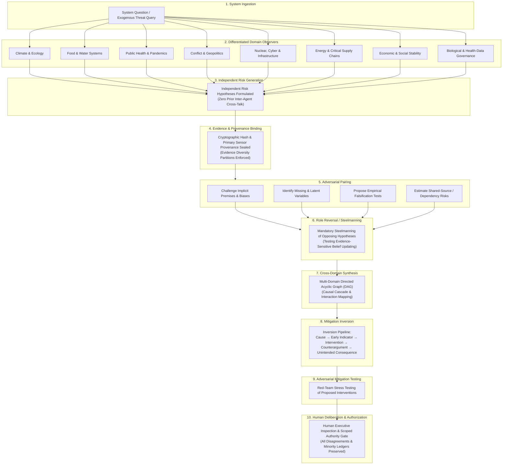
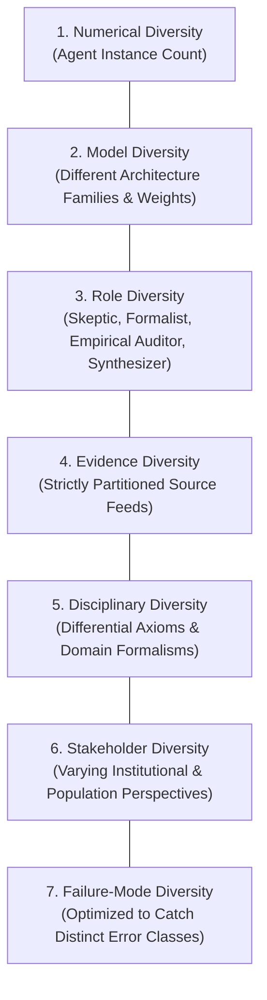
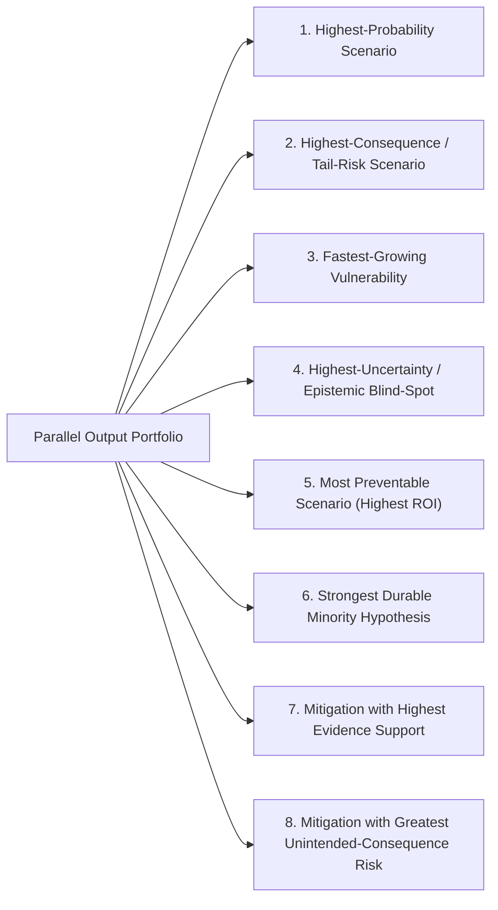

# OI Risk Deliberation Network (OI-RDN)
## Formal Architecture, Epistemic Specification & Research Roadmap

**Document Identifier:** `DAXDA-ARCH-OI-RDN-V1`  
**Parent Framework:** Observer Intelligence (OI) & Nicole Protocol Invariant Governance  
**Originating Organization:** `DAXDA AI, LLC` (DBA `DAXDA.IA / DAXDA-NEXTGEN`)  
**Lead Invariant Architect:** Nicole Bess (`nicole@daxda.ai`)  
**Autonomous Systems Architecture:** Dexter  
**Biomedical & Epistemic Lead:** Alexander Tsutsidze, MD  
**Status:** Research Architecture / Proposed Extension  
**Governance Scope:** Research & Decision-Support System (*Non-Coercive, Human-Authorized*)

---

## 1. Purpose & Epistemic Boundaries

The **OI Risk Deliberation Network (OI-RDN)** extends Observer Intelligence (OI) from claim-level adjudication and action-level actuator boundary gating into structured, multi-domain risk forecasting, causal discovery, and adversarial mitigation analysis.

> ### Mandatory Governance Invariant
> **OI-RDN is NOT a sovereign or political governance system, and it grants NO autonomous political or coercive authority to AI.**
> 
> Its sole function is to provide human decision-makers with an auditable, contradiction-preserving platform to rigorously inspect competing risk models, empirical evidence, epistemic uncertainties, multi-scale interventions, and second-order systemic trade-offs without premature consensus or information herding.

$$\mathbf{Authority\ Separation:} \quad \text{OI-RDN Recommendation} \;\neq\; \text{Political / Policy Decision} \;\neq\; \text{Execution Authority}$$

---

## 2. Core Research Question

> *"Can a network of epistemically differentiated observers identify, challenge, synthesize, and mitigate high-impact systemic risks more reliably than a single model, ordinary multi-agent voting, or debate systems in which agents share identical evidence and incentives?"*

The central epistemic failure of contemporary multi-agent architectures is **correlated error and premature consensus**: when multiple copies of an LLM are prompted to deliberate over the same data pool, they rapidly converge on shared biases, hallucinations, and blind spots. OI-RDN mathematically breaks this failure mode through **deliberate evidence asymmetry, epistemic role differentiation, role reversal, and durable minority dissent preservation**.

---

## 3. System Architecture & Information Flow



---

## 4. Observer Design: The Non-Equivalence Axiom

OI-RDN establishes a foundational mathematical distinction:

$$N_\text{agents} \;\neq\; N_\text{independent\_evidence\_pathways}$$

Merely deploying $N$ instances of a foundation model with identical system prompts and shared context yields zero true epistemic redundancy. OI-RDN enforces **seven orthogonal dimensions of observer diversity**:



1. **Numerical Diversity:** Raw count of participating compute nodes;
2. **Model Diversity:** Multi-vendor, heterogeneous model architectures (e.g., Gemini, Claude, GPT, open-weights deep reasoning models) to eliminate shared training artifacts;
3. **Role Diversity:** Distinct epistemic mandates (e.g., Primary Advocate, Red-Team Falsifier, Missing-Data Detective, Second-Order Dependency Auditor);
4. **Evidence Diversity:** Deliberately partitioned information subsets where agents inspect different primary source archives to prevent information cascades;
5. **Disciplinary Diversity:** Explicit evaluation using competing theoretical formalisms (e.g., thermodynamic constraints vs. econometric equilibrium vs. biological epidemiology);
6. **Stakeholder Diversity:** Simulating operational impacts across contrasting socioeconomic and geopolitical cohorts;
7. **Failure-Mode Diversity:** Observers mathematically tuned to optimize for distinct error-detection objectives (e.g., minimizing Type I false alarms vs. minimizing Type II fatal misses).

### 4.1 Measured Channel Independence & Shared-Substrate Dependency Tagging

No separate top-level module is required to enforce non-equivalence; instead, OI-RDN tightens two constraints directly inside existing `ObservationRecord` provenance and `ReconciliationRecord` dependence estimation (`dependence_summary.method = "graded-rho"`):

1. **Measured Channel Independence ($N_\text{addressable} \neq N_\text{independent\_pathways}$):** Evidentiary independence is a property of upstream causal and statistical dependence structure, never a property of logical channel or observer addressability. Given a resolvable $M \times M$ inter-channel correlation matrix $R$ estimated from declared upstream lineage and pre-decision residual covariance, OI weights channels via Generalized Least Squares ($\mathbf{w} = R^{-1}\mathbf{1}_M$) and evaluates effective independent pathways as:
   $$N_\text{eff}(R) = \mathbf{1}_M^\top R^{-1} \mathbf{1}_M$$
   When 100 addressable channels operate with independent noise ($R = I_{100}$), $N_\text{eff} = 100$; when 100 addressable channels ride on one tightly coupled substrate ($R \to \mathbf{1}\mathbf{1}^\top$), $N_\text{eff} \to 1.0$, preventing a high-confidence correlated majority from drowning out a low-count genuinely independent minority.
2. **Shared-Substrate Dependency Tagging:** Common upstream physical or informational infrastructure—shared physical fields/sensors (`substrate_id`), synchronization clocks (`timing_ref_id`), control/feedforward loops (`control_loop_id`), transport corridors, foundation-model weights, or preprocessing transforms (`transform_id`)—must remain visible in provenance and gate consequential authorization on distinct failure-domain diversity ($D_\text{domains} \ge 2$).
3. **External Physical Analogues & Strict Novelty Boundary:** Two physical-optics results illustrate orthogonal architectural properties without validating OI or transferring inventorship:
   * *Channel-Preserving Reconstruction Analogue:* Gurses et al. (128-element optical phased array, 2026) analogues retaining per-channel digitized records alongside a global estimate.
   * *Shared-Substrate Parallel Transfer Warning:* Lou et al. (*Physical Review Letters* **137**, 080801, 2026, DOI: `10.1103/rfz9-3prw`) experimentally demonstrated parallel continuous-variable teleportation across 100 addressable spatial modes sharing one pair of entangled light fields and common holographic/feedforward optics ($N_\text{addressable\_modes} = 100$, $N_\text{shared\_resource} = 1$, $N_\text{independent\_pathways} \neq 100$). OI claims no inventorship over quantum teleportation or spatial-mode multiplexing and does not promote quantum fidelity metrics to epistemic benchmarks; this dependence constraint is tested on synthetic logical channels in `observer-intelligence/experiments/OI-005/`.

---

## 5. Formal Risk Representation Schema

Risks inside OI-RDN are represented as typed, verifiable JSON objects. **Numerical scores are optional and must never imply false mathematical precision beyond the underlying empirical evidence.**

```json
{
  "risk_id": "RISK-ENV-GEO-2026-0042",
  "domain": "critical_infrastructure_and_water_security",
  "scenario": "Severe cascading drought triggering cooling water curtailment at regional nuclear generation facilities, causing power shedding to municipal desalination and agricultural distribution networks.",
  "causal_chain": [
    "Prolonged multi-season precipitation deficit (>3 sigma below 30-year historical baseline)",
    "Upstream reservoir storage drops below hydraulic intake threshold",
    "Thermal discharge limit exceeded, requiring mandatory generation derate",
    "Grid dispatch instability forces emergency industrial load shedding",
    "Water treatment and distribution pumping stations lose redundant power"
  ],
  "supporting_evidence": [
    {
      "source_id": "USGS-HYDRO-STATION-04212500",
      "provenance_hash": "e3b0c44298fc1c149afbf4c8996fb92427ae41e4649b934ca495991b7852b855",
      "observation_type": "PRIMARY_SENSOR_TELEMETRY",
      "timestamp_utc": "2026-10-15T12:00:00Z"
    }
  ],
  "counterevidence": [
    {
      "source_id": "NOAA-CPC-SEASONAL-OUTLOOK",
      "provenance_hash": "8f434346648f6b96df89dda901c5176b10a6d83961dd3c1ac88b59b2dc327aa4",
      "contradiction_summary": "Late-season atmospheric river formation indicates 65% probability of reservoir replenishment prior to critical draw-down."
    }
  ],
  "probability_or_frequency_model": "Non-stationary extreme value distribution (Weibull fit with climate-forced covariate)",
  "severity": "CRITICAL_SYSTEMIC_INTERRUPTION",
  "exposure": "Regional population (~4.2 million individuals) and 18 critical industrial facilities",
  "reversibility": "IRREVERSIBLE_ECONOMIC_LOSS_WITH_14_DAY_PHYSICAL_RESTABILIZATION",
  "uncertainty": "HIGH_EPISTEMIC_UNCERTAINTY_IN_ATMOSPHERIC_BLOCKING_DURATION",
  "time_horizon": "60_TO_180_DAYS",
  "affected_groups": [
    "Municipal water consumers",
    "Downstream agricultural irrigation districts",
    "Critical healthcare facilities requiring uninterrupted grid power"
  ],
  "shared_dependency_risk": [
    "Common dependence of nuclear cooling and agricultural intake on identical river reach",
    "Single-corridor high-voltage transmission interconnect"
  ],
  "falsification_conditions": [
    "Reservoir inflow rate exceeds 4,500 cfs for 14 continuous days prior to day 45",
    "Alternative auxiliary closed-circuit chilling systems commissioned ahead of schedule"
  ],
  "proposed_mitigations": [
    "MITIG-2026-0042-A: Deploy modular mobile diesel pumping units at secondary deep-well reserves",
    "MITIG-2026-0042-B: Negotiate voluntary pre-scheduled industrial curtailment agreements"
  ]
}
```

---

## 6. The Eight-Stage Deliberation Protocol

```mermaid
sequenceDiagram
    autonumber
    participant D1 as Domain Observer A (Climate)
    participant D2 as Domain Observer B (Energy)
    participant AP as Adversarial Pairing Engine
    participant RR as Role Reversal Engine
    participant CD as Cross-Domain DAG
    participant MI as Mitigation Inversion Engine
    participant H as Human Authority Gate

    D1->>AP: Submit Independent Risk Hypothesis (Partitioned Evidence)
    D2->>AP: Submit Independent Risk Hypothesis (Partitioned Evidence)
    AP->>AP: Challenge Assumptions & Identify Missing Variables
    AP->>RR: Trigger Mandatory Role Reversal / Steelmanning
    RR->>RR: Observer A Defends Observer B's Hypothesis; Observer B Defends A's
    RR->>CD: Map Inter-Domain Dependencies into Causal DAG
    CD->>MI: Trigger Mitigation Inversion (Cause → Indicator → Intervention)
    MI->>AP: Red-Team Proposed Mitigations for Unintended Consequences
    AP->>H: Return Parallel Output Classes & Auditable Provenance
```

1. **Independent Generation:** Observers formulate risk assessments in total isolation before reviewing external hypotheses.
2. **Evidence Separation:** Distinct evidence partitions are routed to specific observers to eliminate information herding.
3. **Adversarial Challenge:** Cross-paired observers actively attack hypotheses, exposing hidden assumptions, distribution shift, missing variables, and correlated sources.
4. **Role Reversal (Mandatory Steelmanning):** Each observer must periodically author and defend the strongest possible empirical defense of an opposing observer's conclusion. This test distinguishes evidence-responsive reasoning from stubborn rhetorical bias.
5. **Durable Minority Preservation:** A minority hypothesis supported by valid empirical evidence cannot be pruned or overwritten by majority consensus. It remains permanently stamped in the evidence ledger.
6. **Cross-Domain Synthesis (DAG Mapping):** Interacting risks are compiled into a multi-variable Directed Acyclic Graph (DAG) capturing cascading failure loops rather than squashing complex trade-offs into an arbitrary 1D ranking.
7. **Mitigation Inversion:** Every validated risk pathway is mechanically inverted to evaluate intervention efficacy and unintended side-effects:
   $$\text{Cause} \longrightarrow \text{Early Indicator} \longrightarrow \text{Possible Intervention} \longrightarrow \text{Counterargument} \longrightarrow \text{Unintended Consequence} \longrightarrow \text{Alternative} \longrightarrow \text{Test} \longrightarrow \text{Evidence}$$
8. **Human Authorization Gate:** OI-RDN delivers structured analysis, parallel risk topologies, and falsification criteria to human authorities. It **never** autonomously executes high-impact policy or declares a contested political question settled.

---

## 7. Parallel Output Classes (Anti-Reductionist Delivery)

OI-RDN explicitly refuses to compress complex multi-variable risk landscapes into a single "winner" or single score. It returns parallel, structurally distinct output classes:



---

## 8. Empirical Evaluation & Benchmark Architecture

To substantiate the core hypothesis, OI-RDN must be benchmarked against four baseline architectures on real-world and simulated historical risk forecasting datasets:

$$\begin{array}{|l|l|}
\hline
\textbf{Architecture Baseline} & \textbf{Operational Definition} \\ \hline
\text{Baseline 1: Single-Agent} & \text{Single state-of-the-art LLM with chain-of-thought prompting.} \\
\text{Baseline 2: Multi-Agent Voting} & N \text{ identical models with identical context voting by majority rule.} \\
\text{Baseline 3: Conventional Debate} & \text{Debate system where agents share the identical evidence repository.} \\
\text{Baseline 4: Evidence-Diverse Deliberation} & \text{Partitioned evidence without role reversal or typed epistemic transitions.} \\
\textbf{Test System: OI-RDN} & \textbf{Heterogeneous observers, partitioned evidence, role reversal, DAG synthesis, and minority preservation.} \\ \hline
\end{array}$$

### Quantitative Evaluation Metrics:
* **Forecast Calibration (Brier Score):** Measured against verifiable ground-truth outcomes across longitudinal test horizons;
* **Unsupported Claim Rate:** Frequency of assertions lacking traceable provenance hashes;
* **Correlated Error Rate:** Covariance of errors across agents during adversarial test runs;
* **Contradiction Discovery Velocity:** Time required to detect conflicting data within large corpora;
* **Minority-Correctness Retention:** Frequency with which an initially minority-held truth is preserved rather than silenced by the majority;
* **Mitigation Failure Pre-Discovery:** Rate at which second-order unintended consequences of proposed policies are successfully identified prior to simulation execution;
* **Audit Reconstruction Accuracy:** Percentage of decision states reproducible from cryptographic logs.

---

## 9. Intellectual Lineage & Prior Art Grounding

OI-RDN explicitly grounds itself in established foundational literature, claiming invention only of its unique integration:

1. **AI Safety via Debate (Irving, Christiano & Amodei, 2018):**
   * *Contribution:* Formalized adversarial multi-agent debate judged by humans.  
   * *URL:* [https://arxiv.org/abs/1805.00899](https://arxiv.org/abs/1805.00899)
2. **The Classical Delphi Method (Dalkey & Helmer, 1963):**
   * *Contribution:* Iterative expert elicitation with structured feedback to surface hidden disagreement without social intimidation.
3. **InfoDelphi / Designed Information Asymmetry (Li et al., July 2026):**
   * *Contribution:* Proved that deliberately partitioning evidence across agents substantially reduces correlated error and improves forecasting over shared-evidence deliberation.  
   * *URL:* [https://arxiv.org/abs/2607.01661](https://arxiv.org/abs/2607.01661)
4. **Conformal Social Choice for Safe Multi-Agent Deliberation (Wang et al., April 2026):**
   * *Contribution:* Proved that consensus agreement is **not** evidence of truth, establishing calibrated act-versus-escalate thresholds.  
   * *URL:* [https://arxiv.org/abs/2604.07667](https://arxiv.org/abs/2604.07667)
5. **Truth Maintenance Systems (TMS) (Doyle, 1979):**
   * *Contribution:* Formalized dependency-directed backtracking, belief revision, and non-monotonic contradiction tracking.  
   * *DOI:* [10.1016/0004-3702(79)90008-0](https://doi.org/10.1016/0004-3702(79)90008-0)
6. **NIST AI Risk Management Framework (NIST AI RMF 1.0):**
   * *Contribution:* Federal standards for mapping, measuring, and managing AI system risks across multidisciplinary lifecycles.  
   * *URL:* [https://www.nist.gov/itl/ai-risk-management-framework](https://www.nist.gov/itl/ai-risk-management-framework)

---

## 10. The Specific DAXDA / OI Research Target

The candidate novel contribution of DAXDA.IA is **not** debate, Delphi, risk scoring, red teaming, or human oversight in isolation.

The candidate contribution is their **tight, unified coupling with**:
$$\begin{aligned}
&\text{Observer-Specific Evidence Access} \\
+\;& \text{Deliberately Differentiated Evidence Pathways} \\
+\;& \text{Typed Epistemic Transitions} \\
+\;& \text{Dependence-Aware Observer Counting} \quad (N_\text{agents} \neq N_\text{pathways}) \\
+\;& \text{Durable Minority Contradiction Preservation} \\
+\;& \text{Mandatory Role Reversal / Steelmanning} \\
+\;& \text{Cross-Domain Causal / Dependency Directed Acyclic Graphs} \\
+\;& \text{Cryptographic Provenance-Preserving Reconciliation} \\
+\;& \text{Mitigation Inversion \& Adversarial Mitigation Stress-Testing} \\
+\;& \text{Explicit Epistemic Uncertainty Quantification \& Scoped Abstention} \\
+\;& \text{Strict Separation of Algorithmic Recommendation from Human Execution Authority} \\
+\;& \text{Zero-Knowledge Auditable Human Decision Lineage}
\end{aligned}$$

> **Operational Status:** These remain formal scientific hypotheses until rigorous comparative benchmarking across frozen empirical baselines is complete.
