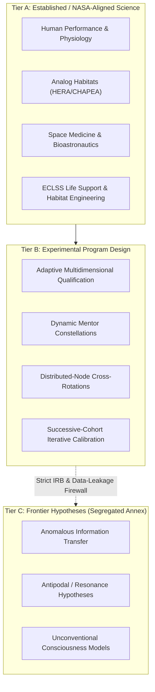

# SA-CONCEPT-001 — Adaptive Operations & Research Academy

**Document Identifier:** `USSA-ARCH-SA-CONCEPT-001-V1`  
**Governing Authority:** United States Space Academy (Executive Order 14423)  
**Prime Federal Awardee:** AMERICAN MILESTONE INC (SAM.gov UEI: `MXEFU6TQJUB9` | DLA CAGE: `214X7`; Authorized Representative: Nicholas Hartman)  
**Lead Invariant Architect:** Nicole Bess (DAXDA AI, LLC)  
**Operational, Biomedical Logistics & Observer Intelligence Seat:** Position Hire Pending (Principal Advisor, Operational Readiness, Biomedical Logistics & Applied Intelligence + Federal Space Medicine / IRB Liaison)  
**Autonomous Systems Architecture:** Dexter  
**Status:** Working Concept Architecture (Incorporating Evidence Review `GPT/NASA-R1`)  
**Epistemic Notice:** Federal-facing claims must distinguish established science, proposed program design, and frontier hypotheses. Capital builds are deferred in favor of existing NASA/partner analog facility overlay.

---

## Central Proposition

The Space Academy should function not only as a school, but as a continuously improving research platform in which participants learn by constructing, inhabiting, operating, and adapting to progressively unfamiliar environments while multidisciplinary teams measure performance, biological response, knowledge transfer, and training effectiveness across successive cohorts.

---

## Core Research Question

> *"Which combinations of environment, training, coaching, social structure, nutrition, developmental history, physiology, and prior experience produce the greatest measurable gains in multidimensional human adaptability, and which gains persist or transfer to novel environments?"*

---

## Operating Cycle

$$\text{Interest / Intake} \longrightarrow \text{Baseline Characterization} \longrightarrow \text{Foundational Learning} \longrightarrow \text{Simulated Challenge} \longrightarrow \text{Environmental Displacement} \longrightarrow \text{Observed Performance} \longrightarrow \text{Multidisciplinary Prediction Comparison} \longrightarrow \text{Coaching / Intervention} \longrightarrow \text{Retest} \longrightarrow \text{Transfer Challenge} \longrightarrow \text{Demonstrated Competency} \longrightarrow \text{Specialization} \longrightarrow \text{Mentor / Investigator Pathway}$$

---

## 1. Adaptive Human Performance Qualification

Assess demonstrated capability rather than coursework alone.

### Candidate Domains:
- **Physical:** Endurance, strength, recovery kinetics, motor coordination under stress;
- **Cognitive:** Learning rate, sustained attention, working memory, spatial reasoning, judgment under latency, and problem solving;
- **Emotional & Affective:** Self-regulation, stress recovery, uncertainty tolerance, ambiguity resilience;
- **Social & Operational:** Coordination, high-reliability team leadership, conflict resolution, and cross-cultural adaptation;
- **Epistemic Discipline:** Rigorous separation of direct observation, inference, assumption, uncertainty, and conflicting evidence;
- **Adaptive Transfer:** Capability to transfer and apply learned principles in a substantially different, unmodeled environment;
- **Autonomous Operation:** Autonomous execution under constrained communications or delayed support (e.g. 3-to-22-minute light-time lag);
- **Creative & Systems Problem Solving:** Interdisciplinary synthesis across engineering, biology, and mission contingencies.

> **Principle:** Qualification should be multidimensional, dynamic, and revisable rather than a permanent, fixed ranking of participants.

---

## 2. Adaptive Mentor & Trajectory System

Participants may be matched over time with coaches, mentors, or mentor constellations based on observed strengths, developmental goals, challenge-response patterns, and emerging specialization.

### Trajectory Cycle:
$$\text{Performance Evidence} \longrightarrow \text{Capability Profile} \longrightarrow \text{Next-Development Hypothesis} \longrightarrow \text{Coach / Mentor Match} \longrightarrow \text{Targeted Challenge} \longrightarrow \text{Outcome Measurement} \longrightarrow \text{Trajectory Revision}$$

*Epistemic Safeguard:* The coach's judgment must not become the participant's permanent identity; actual empirical evidence, participant self-assessment, multiple independent evaluators, and contradictory observations remain preserved.

---

## 3. Human Adaptation & Biosystems Laboratory

Longitudinal research may include, where scientifically justified and ethically approved under `14 C.F.R. Part 1230` / `NASA-STD-3001` Volumes 1 & 2:
- Nutrition, hydration, and energy expenditure kinetics;
- Sleep architecture, circadian performance, and parasomnia monitoring;
- Metabolic and cardiovascular regulation under acute/chronic stress;
- Immune function, cytokine dynamics, and latent viral reactivation;
- Gut and skin microbiome resilience across environmental shifts;
- Endocrine and neuroendocrine stress physiology;
- High-density electroencephalography (EEG), fNIRS, and neurophysiology;
- Multi-scale recovery and adaptation trajectories.

*Omics & Genetic Research Disposition (GPT/NASA-R1 Alignment):* Validated omics, gene-expression, and epigenetic analyses are designated as **optional research protocols only** and are moved out of the initial federal qualification core. In strict compliance with the Genetic Information Nondiscrimination Act (`GINA`) and HHS research rules, omics data is subject to purpose limitation, access control, de-identification, and an absolute prohibition against use for admissions, qualification, or advancement ranking.

*Anti-Discrimination & Dignity Invariant:* Genetic, familial, cultural, ethnic, and developmental-background variables must not be used as proxies for human worth or simplistic biological hierarchy. The research objective is exclusively to identify specific predictive mechanisms and improve adaptation across diverse individuals.

---

## 4. Family-Linked and Age-Diverse Cohorts *(Deferred Later Research Track)*

*Review Disposition:* Family, twin, and multigenerational designs require separate scientific justification, power analysis, and governance. This track is retained as a specialized future research option and is excluded from the initial Space Academy federal qualification package.

Where appropriate, voluntary, and approved under future specialized IRB protocols, research cohorts may evaluate identical twins, fraternal twins, siblings, parent/adult-child pairs, multigenerational families, and unrelated matched controls.

### Multivariate Interaction Domain:
$$\text{Age} \times \text{Genetics} \times \text{Shared Upbringing} \times \text{Developmental History} \times \text{Current Environment} \times \text{Nutrition} \times \text{Culture} \times \text{Training} \times \text{Microbiome} \times \text{Individual Lived Experience}$$

*Objective:* Rigorously decouple and separate selection effects, training effects, environmental adaptation, and biological response rather than assume inheritance or nonlocal information transfer.

---

## 5. Distributed Analog Node Network

Establish multiple deliberately contrasting but safe Earth analog nodes. Differences may include climate, altitude, daylight cycle, infrastructure, resource availability, language/cultural environment, geography, population density, agriculture, and isolation.

Participants can be counterbalanced or randomized across nodes so that individual, background, environment, team-composition, and training effects can be estimated independently.

### Example Rotational Design:
$$\text{Home / Baseline} \longrightarrow \text{Contrasting Node A} \longrightarrow \text{Contrasting Node B} \longrightarrow \text{Novel Transfer Environment}$$

---

## 6. Protected / Vertical Analog Academy Nodes & Overlay Infrastructure

> **Federal-Facing Infrastructure Strategy (GPT/NASA-R1 Alignment):** NASA already operates mature analog and human-performance facilities (`HERA`, `CHAPEA`, `NEEMO`). To maximize federal feasibility, **new capital facility construction is deferred**. The Space Academy research and qualification framework is designed primarily as an **evaluation overlay, comparative protocol, and software/curriculum layer operating directly on top of existing or lightly modified analog facilities**.
> 
> The Cleveland vertical-node building-as-curriculum concept remains a valuable future implementation option for an urban distributed node, but is not a prerequisite for initial pilot execution.

When operating in bounded or vertical analog habitats, the facility itself functions as curriculum and experimental infrastructure:

### Integrated Subsystems:
- **Water:** Atmospheric water generation, graywater purification, closed-loop recycling, and real-time microbiological quality monitoring;
- **Energy:** Multi-source generation (solar/geothermal/micro-grid), solid-state storage, and dynamic power distribution;
- **Food & Nutrition:** Controlled-Environment Agriculture (CEA), aeroponics, vertical farming, and nutrient optimization;
- **Atmospheric Engineering:** Controlled ventilation, filtration, humidity, temperature gradients, and gas composition;
- **Closed-Loop Resources:** Waste handling, bioremediation, and zero-loss resource reclamation;
- **Communications & Cybernetics:** Network resilience, air-gapped security, deterministic AI governance, and latency-delayed communication simulators;
- **Fabrication & Habitat Engineering:** Additive manufacturing, modular materials, robotics, and repair workshops;
- **Human Spaces:** Laboratories, design/art studios, acoustic/music suites, nutrition kitchens, and community areas.

$$\text{Build} \longrightarrow \text{Instrument} \longrightarrow \text{Inhabit} \longrightarrow \text{Observe} \longrightarrow \text{Adapt} \longrightarrow \text{Experiment} \longrightarrow \text{Reconfigure} \longrightarrow \text{Measure Again}$$

*Note:* A Cleveland vertical-building concept may serve as an example pilot node, but the federal framework does not depend on one specific physical property.

---

## 7. Multidisciplinary Prediction Laboratory

Psychologists, engineers, scientists, physicians/researchers, artists/designers, human-factors specialists, operators, technicians, and other contributors make prospective predictions about participant and team adaptation before outcomes are known.

Independent disciplinary predictions are formally recorded and preserved prior to multi-agent synthesis or consensus reconciliation.

> **Research Question:** *"Does preserving independent disciplinary observation before synthesis produce better-calibrated predictions than immediate group consensus?"*

---

## 8. Human Neuroenvironment & Sensory Systems

### Candidate Research Areas:
- Radiation monitoring, radiobiology, and shielding effectiveness;
- Electromagnetic environment characterization within established safety standards;
- EEG, evoked potentials, and autonomic nervous system measurements;
- Circadian entrainment through spectrum-tuned lighting protocols;
- Acoustics, noise attenuation, auditory cognition, music, and psychoacoustics;
- Sensory deprivation vs. sensory enrichment environments;
- Attentional restoration, creativity metrics, and high-stress team performance.

*Epistemic Invariant:* Claims regarding specific frequencies causing biological or psychological effects must remain unverified hypotheses until demonstrated through rigorous, pre-registered, controlled experiments.

---

## 9. Space Medicine, Pharmacology & Behavioral Health

### Core Medical Curriculum & Operational Support (`NASA-STD-3001`):
- Drug pharmacokinetics, stability, and shelf-life under microgravity and space radiation;
- Autonomous medical diagnostic and procedural decision-support systems;
- Metabolic, nutritional, and pharmacological interactions;
- Sleep architecture and circadian phase-shifting interventions;
- Behavioral health, psychological resilience, and cognitive countermeasures;
- Emergency stabilization, trauma triage, and remote telemedicine under delayed communication (3 to 22 minutes).

### Regulated Research Disposition (GPT/NASA-R1 Alignment):
While the FDA issued final guidance in July 2026 for psychedelic clinical investigations establishing regulated clinical trial parameters, no immediate operational spaceflight use case exists. **All psychedelic and unconventional neuropsychopharmacological research is explicitly excluded from the initial Space Academy federal brief.** Any future investigation is sequestered strictly into a later, separately governed clinical-research annex under full FDA/DEA and institutional review.

*Safety Invariant:* No compound or neurochemical intervention may be considered operational or mission-ready without reproducible, peer-reviewed empirical evidence.

---

## 10. Knowledge Transfer and Transmission Experiments

Distinguish information transmission mechanisms explicitly:
1. Direct, explicit communication;
2. Observational teaching and imitation;
3. Procedural documentation and algorithmic transfer;
4. Shared external environmental pressures;
5. Convergent independent problem solving;
6. Biological / sensory / environmental mediation;
7. Unexplained residual variance.

### For Anomalous / Nonlocal Hypotheses:
$$\text{Preregister Prediction} \longrightarrow \text{Isolate Information Channels} \longrightarrow \text{Expose Node A} \longrightarrow \text{Independently Test Node B} \longrightarrow \text{Compare with Control} \longrightarrow \text{Audit Leakage / Artifacts} \longrightarrow \text{Replicate Prior to Interpretation}$$

*Rule:* Unexpected above-baseline statistical deviations establish an anomaly requiring replication and data-leakage auditing, not confirmation of a preferred mechanism.

---

## 11. Adaptive Habitat & Life-Support Research

> **Central Research Question:** *"Given an unfamiliar environment and constrained resources, how do human teams establish and safeguard a sustainable, self-correcting operating environment?"*

Multidisciplinary programs integrate chemistry, biosystems, agronomy, structural engineering, deterministic AI, human factors, metallurgy, energy storage, atmospheric control, and In-Situ Resource Utilization (ISRU).

### Environmental Progression:
$$\text{Controlled Earth Laboratory} \longrightarrow \text{Extreme-Earth Analog (Arid/Arctic/Marine)} \longrightarrow \text{Closed Artificial Habitat} \longrightarrow \text{Orbital / Lunar Analog} \longrightarrow \text{Operational Deep-Space Environment}$$

### Simultaneous Dual-Vector Evaluation:
1. **The environment adapts to the human crew** (dynamic life support, automated environmental tuning);
2. **The human crew adapts to the environment** (physiological acclimation, behavioral coordination, operational discipline).

---

## 12. Successive-Cohort Learning

The Academy itself functions as an adaptive system under continuous evaluation.

$$\text{Cohort } N \text{ Predictions} \longrightarrow \text{Observed Outcomes} \longrightarrow \text{Prediction Error Calculation} \longrightarrow \text{Intervention Analysis} \longrightarrow \text{Model Revision} \longrightarrow \text{Cohort } N+1 \text{ Protocol}$$

### Critical Epistemic Distinctions:
* **Selection Effects:** The degree to which outcomes reflect recruitment of naturally adaptable individuals;
* **Training Effects:** Measurable improvement caused directly by the Academy's curriculum;
* **Biological Response:** Quantifiable molecular, neurophysiological, and metabolic shifts accompanying adaptation;
* **Transfer Capacity:** Demonstrated generalization of capabilities to entirely novel, unmodeled challenges.

*Notice:* Null results, failed interventions, and falsified hypotheses are permanently preserved as primary data in the evidence ledger.

---

## 13. Observer Intelligence (OI) Evidence Layer *(Testable Research Component)*

*Review Disposition (GPT/NASA-R1 Alignment):* Official federal aerospace sources do not presuppose that Observer Intelligence improves decision outcomes. Therefore, OI is proposed strictly as a **testable research component**. Federal-facing claims state: *"evaluate whether OI improves decision accuracy, latency, contradiction retention, and authorization integrity against a frozen non-strawman baseline"*.

Observer Intelligence provides a deterministic, tamper-evident recording and governance substrate across Academy research tracks, preserving explicit distinctions:

$$\text{Observation} \longrightarrow \text{Interpretation} \longrightarrow \text{Hypothesis} \longrightarrow \text{Prediction} \longrightarrow \text{Evidence} \longrightarrow \text{Contradiction} \longrightarrow \text{Reconciliation} \longrightarrow \text{Authorization} \longrightarrow \text{Action} \longrightarrow \text{Audit}$$

### Primary Research Endpoints Measured:
- **Decision Latency & Operational Throughput:** Time from anomaly detection to verified decision;
- **Unsupported Command Execution Rate:** Frequency of unauthorized or unverified actions blocked at the actuator boundary;
- **Contradiction & Minority Dissent Retention:** Preservation of valid minority observations that would otherwise be lost to groupthink;
- **Authorization Integrity:** Rejection of spoofed, replayed, or expired authorization licenses;
- **Audit Reconstruction Accuracy:** Mathematical verifiability of complete mission incident chains from cryptographically sealed logs.

*Governance Invariant:* Observer Intelligence is an evaluation and governance infrastructure; its operational deployment does not constitute evidence for the validity of any specific external hypothesis under study.

---

## 14. Scientific Tiers

* **Tier A — Established / NASA-Aligned Science:** Human performance, analog habitats, radiation biophysics, space medicine, clinical nutrition, sleep physiology, cognitive neuroscience, microbiome genomics, ECLSS engineering, human-in-the-loop systems, and validated aerospace ergonomics.
* **Tier B — Experimental Program Design:** Adaptive capability qualification, dynamic mentor constellations, distributed-node rotations, multidisciplinary prospective prediction, successive-cohort evolutionary calibration, and individualized stress-recovery cycle tuning.
* **Tier C — Frontier Hypotheses:** Speculative information transfer, antipodal/resonance hypotheses, and unconventional consciousness models. *These generate controlled laboratory experiments under the Frontier Annex only; they must never be presented as established science or operational requirements.*

---

## 15. Ethics, Safeguards & The Mandatory Governance Firewall

All activities within the Space Academy Research Architecture strictly enforce:

### The Mandatory HHS Structural Firewall:
$$\mathbf{Mandatory\ Operational\ Evaluation} \;\neq\; \mathbf{Optional\ Human\text{-}Subject\ Research}$$

Under HHS Common Rule guidance (`45 C.F.R. Part 46` / `14 C.F.R. Part 1230`), students and employees are vulnerable to coercion if research participation affects evaluation, benefits, or advancement. Therefore, the Academy strictly separates:
1. **Mandatory Educational & Operational Evaluation:** Direct evaluation of demonstrated competency required for operational flight qualification;
2. **Optional Human-Subject Research:** Biomedical, cognitive, or psychological research requiring explicit, voluntary informed consent.

> **Absolute Non-Penalty Invariant:** Declining or withdrawing from optional research protocols carries **zero adverse impact** on academic standing, service assignment, qualification, advancement, housing, or access to ordinary Academy benefits.

### Core Safeguards:
1. **Independent IRB Oversight:** All human-subject protocols subject to institutional review (`14 C.F.R. Part 1230` / `45 C.F.R. Part 46`);
2. **Medical Screening & Absolute Risk Ceilings:** Strict physiological safeguards and withdrawal criteria supervised by qualified medical officers under `NASA-STD-3001`;
3. **Genetic & Biometric Privacy:** Complete firewalling of genomic and physiological telemetry against non-research exploitation (`GINA` compliance);
4. **Human Worth Invariant:** Prohibition on ranking ethnicity, culture, or genetic background as measures of human capability or worth;
5. **Participant Agency:** Absolute, penalty-free right to withdraw from research protocols at any time;
6. **Data Minimization:** Cryptographic compartmentalization and zero-knowledge storage of sensitive participant telemetry;
7. **Preregistration Mandatory:** Formal preregistration of consequential hypotheses prior to experimental execution;
8. **Independent External Replication:** Compulsory multi-site replication required before any extraordinary finding is declared valid.

---

## Two-Phase Pilot Implementation Roadmap (GPT/NASA-R1 Structure)

To establish empirical credibility without requiring immediate capital construction, the Academy implements a structured two-phase pilot architecture utilizing existing federal and partner infrastructure:

### Phase 1: Pilot 0 — Feasibility and Instrumentation
* **Primary Objective:** Demonstrate that the evaluation protocol, delayed-support tasks, and prediction architecture run safely and produce clean, analyzable data.
* **Hosting Infrastructure:** Conducted inside an **existing or lightly modified analog or controlled facility** (e.g., NASA `HERA`, `CHAPEA`, `NEEMO`, or partner university analog).
* **Core Pilot 0 Protocols:**
  - Standardized human-performance and workload measures (`NASA-TLX`, NASA BHP Standard Measures, validated neurocognitive batteries);
  - Delayed-support operational tasks under simulated Moon-to-Mars latency (3 to 22 minutes);
  - Locked, independent multidisciplinary expert forecasts recorded prior to consensus;
  - Frozen comparison baseline;
  - Observer Intelligence evidence, provenance, and authorization boundary layer;
  - Controlled transfer challenge into a contrasting operational task;
  - Explicit adverse-event and stopping rules;
  - Primary Feasibility Metrics: Protocol adherence, missing-data rates, execution latency, and audit reconstruction accuracy.
* *Pilot 0 Boundary:* Pilot 0 is designed for protocol feasibility and instrumentation; it is not intended to claim population-level superiority.

### Phase 2: Pilot 1 — Powered Comparative Validation
* **Primary Objective:** Formally test whether the adaptive qualification and prospective prediction framework produces superior transfer resilience and mission success.
* **Methodological Standards:** Sample size and cohort allocations must be derived from preregistered primary endpoints, expected effect sizes, clustering/repeated-measures corrections, attrition rates, and formal statistical power analysis ($\ge 0.80$ at $\alpha = 0.05$). Arbitrary sample sizes are rejected.
* **Preregistered Primary Endpoints:**
  - **Transfer-Task Performance:** Speed and accuracy when executing unfamiliar, unmodeled operational tasks;
  - **Expert Prediction Calibration:** Brier scores and calibration curves of pre-consensus multidisciplinary predictions versus conventional panels;
  - **Unsupported / Erroneous Execution Rate:** Reduction in unauthorized command attempts at the actuator boundary;
  - **Contradiction & Minority Dissent Retention:** Frequency of valid anomalous observations preserved and integrated into diagnostic updates;
  - **Authorization Integrity:** Zero tolerance for replayed, forged, or expired action licenses;
  - **Audit Reconstruction Accuracy:** Mathematical verifiability of incident timelines;
  - **Decision Latency:** Response time from anomaly onset to verified stabilization under communications delay;
  - **Validated Human Factors:** Statistically significant reductions in subjective workload (`NASA-TLX`) and burnout indicators.

*Pilot Principle:* The pilot program must be empirically falsifiable, objectively measurable, and transparently auditable prior to proposing national or international scale.

---

## Architecture References & Cross-Links
* **Master Proposal:** [`DAXDA_USSA_EO14423_CURRICULUM_PROPOSAL_MASTER.md`](DAXDA_USSA_EO14423_CURRICULUM_PROPOSAL_MASTER.md)
* **Supporting Architecture (Crew & Faculty):** [`SA_CONCEPT_002_COMPLEMENTARY_CREW_COMPOSITION.md`](SA_CONCEPT_002_COMPLEMENTARY_CREW_COMPOSITION.md) (*Complementary Crew Composition, Faculty & Human Performance Framework*)
* **Evidence Review Baseline:** [`GPT_NASA_R1_EVIDENCE_REVIEW_SA_CONCEPT_001.md`](reviews/GPT_NASA_R1_EVIDENCE_REVIEW_SA_CONCEPT_001.md) (*Independent Evidence-Grounded Review against NASA/HHS/FDA Standards*)
* **Deferred Frontier Annex:** [`SPACE_ACADEMY_RESEARCH_ARCHITECTURE_FRONTIER_ANNEX.md`](SPACE_ACADEMY_RESEARCH_ARCHITECTURE_FRONTIER_ANNEX.md) (*Private / Deferred Research Material*)
