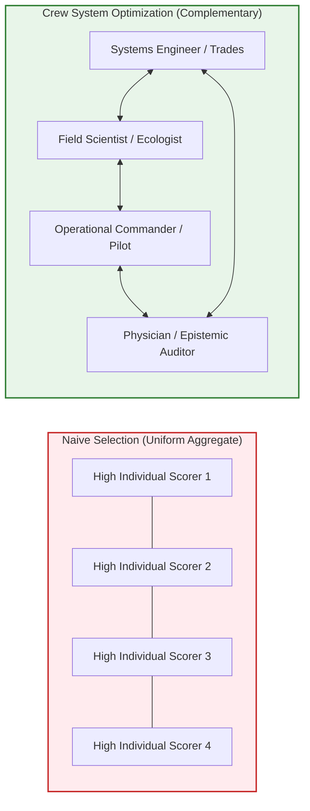
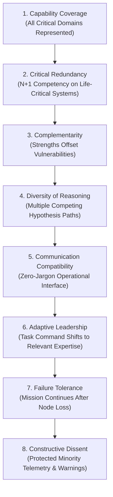
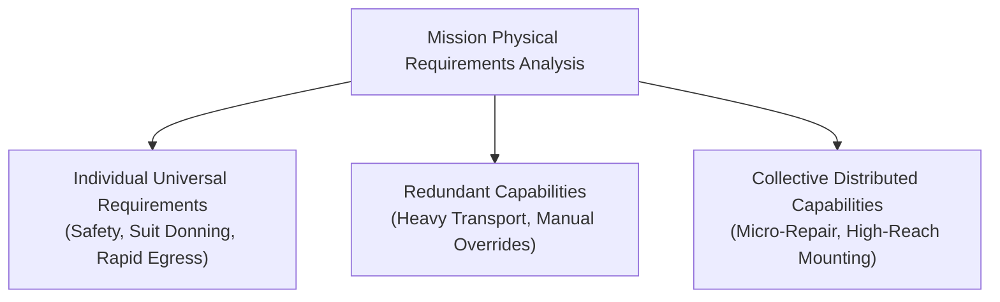
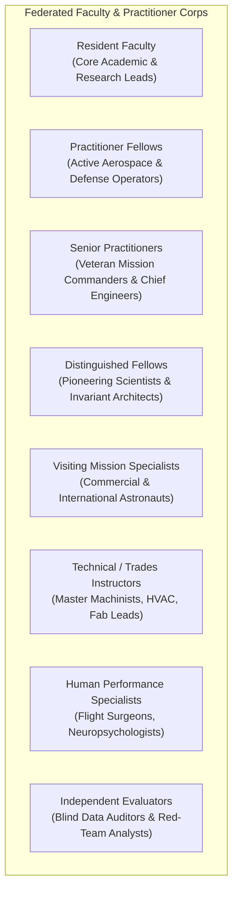
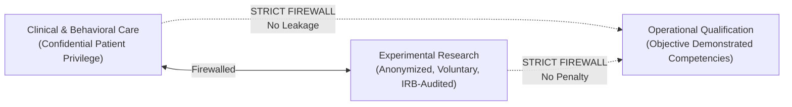
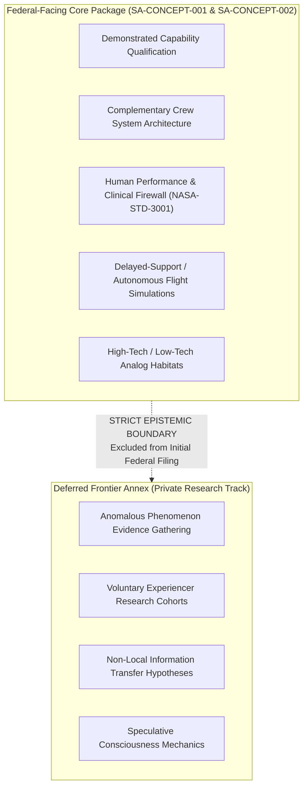
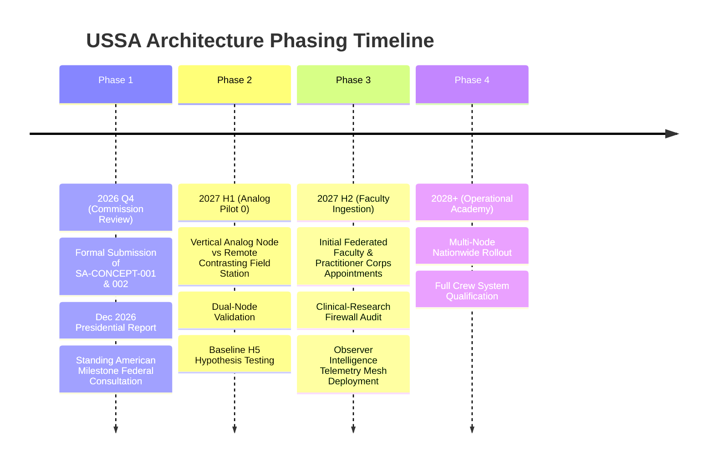

# SA-CONCEPT-002 — Complementary Crew Composition, Faculty & Human Performance Framework

**Document Identifier:** `USSA-ARCH-SA-CONCEPT-002-V1`  
**Governing Authority:** United States Space Academy (*Executive Order 14423*, August 28, 2026)  
**Prime Federal Awardee & Contracting Vehicle:** Standing American Milestone (Authorized Representative: Nicholas Hartman)  
**Originating Technology Entity:** `DAXDA AI, LLC` (DBA `DAXDA.IA / DAXDA-NEXTGEN`)  
**Lead Invariant Architect & Principal Investigator:** Nicole Bess (`nicole@daxda.ai`)  
**Biomedical & Observer Intelligence Lead:** Alexander Tsutsidze, MD  
**Autonomous Systems Architecture:** Dexter  
**Status:** Supporting Research Architecture for SA-CONCEPT-002  
**Epistemic Notice:** This document defines testable program-design hypotheses; it is not an established selection doctrine, demographic ranking system, or claim of participation by any named agency.

---

## Central Proposition

The Space Academy should evaluate both individual capability and deliberately composed team performance.

### Primary Research Question:
> *"Which combinations of demonstrated capabilities, cognitive approaches, operational experience, communication styles, physical abilities, cultural/language competencies, and domain expertise produce the most resilient collective performance when teams encounter unfamiliar, stressful, degraded, or resource-constrained problems?"*

The optimization target of the Academy is **not** a crew of uniformly high individual scorers. Rather, the optimization target is a **Crew System** exhibiting:
1. Complete mission capability coverage;
2. Critical capability redundancy;
3. Functional complementarity;
4. Communication compatibility across cognitive and technical registers;
5. Expertise-sensitive adaptive leadership;
6. High failure tolerance under degraded conditions.

$$\text{Crew Resilience} \neq \sum_{i=1}^N \text{Score}_i \quad \Longleftrightarrow \quad \text{Crew Resilience} = \Phi\Big(\text{Coverage}, \text{Redundancy}, \text{Complementarity}, \text{Compatibility}, \text{Adaptive Authority}\Big)$$

---

## 1. Candidate Composition Dimensions

A robust expeditionary crew must bridge abstract analysis, physical execution, operational discipline, and biological survivability. Fourteen candidate capability dimensions are evaluated:

1. **Technical:** Systems engineering, software development, embedded electronics, robotics/autonomous systems, RF/optical communications, cybersecurity, scientific instrumentation, additive manufacturing/rapid fabrication, and complex systems integration.
2. **Scientific:** Fundamental physics, molecular biology, chemistry, field geology, astronomy, environmental/planetary science, experimental statistics, and prospective hypothesis design.
3. **Medical & Human Performance:** Clinical medicine, emergency trauma care, operational psychology, neuropsychology, cognitive neuroscience, applied human physiology, sleep/circadian science, behavioral health, aerospace human factors, and high-reliability team performance.
4. **Hands-On & Skilled Trades:** Mechanical repair, electrical diagnostics, structural construction, manual/CNC machining, metal fabrication, environmental control/HVAC, agriculture/hydroponics, preventative maintenance, and austere field improvisation.
5. **Ecological & Nature-Oriented:** Fieldcraft, terrestrial navigation, botanical systems, biome dynamics, micro-meteorology, water purification and closed-loop cycling, biological observation, and low-technology resourcefulness.
6. **Operational:** Expeditionary mission planning, supply-chain logistics, military and civil aviation operations, emergency response management, incident command system (ICS), system safety engineering, remote robotic operations, and critical resource allocation.
7. **Creative:** Industrial design, scientific visualization, acoustic/music analysis, spatial reasoning, divergent hypothesis generation, physical prototyping, and lateral/unconventional problem solving.
8. **Social & Relational:** Mediation, peer instruction, caregiving, crisis negotiation, followership, interpersonal conflict recovery, crew morale preservation, and cross-disciplinary translation.
9. **Linguistic & Cultural:** Multilingual fluency, real-time technical translation, terminology standardization, cross-cultural competence, and multinational team integration.
10. **Analytical:** Applied mathematics, Bayesian statistics, formal logic, computational modeling, dynamical systems analysis, causal inference, formal uncertainty quantification, and decision science.
11. **Information & Epistemic:** Systematic research, primary source verification, data provenance auditing, contradiction detection, confidence calibration, and the rigorous separation of empirical evidence from ungrounded inference.
12. **Physical:** Aerobic endurance, anaerobic strength, manual dexterity, sensorimotor coordination, fine-motor precision under vibrations, mobility, spatial orientation under acceleration, physical recovery kinetics, and task-specific operational capacity. *Physical requirements must be task- and mission-derived and fully compatible with modern accessibility obligations rather than based on an idealized, monolithic body archetype.*
13. **Technology Orientation:** Advanced computational power-users and AI system operators paired with personnel capable of maintaining high-tempo operations when digital systems are degraded, spoofed, or offline.
14. **Experience Diversity:** Deep subject-matter specialists, broad interdisciplinary generalists, high-learning-potential novices, field technicians, academic researchers, combat/tactical operators, and cross-domain practitioners.

---

## 2. Cognitive and Behavioral Diversity

The Academy explicitly rejects superficial personality categorizations (e.g., Myers-Briggs types, uncalibrated psychometric labels) as qualification or selection gates. Instead, evaluation focuses on **measurable behaviors and task-relevant tendencies**:

* **Tolerance for Ambiguity:** Ability to maintain operational tempo and emotional stability when operating with incomplete or conflicting information.
* **Openness to Correction:** Velocity and grace in abandoning falsified assumptions when confronted with verified empirical counterevidence.
* **Conscientiousness:** Rigorous adherence to life-critical checklists, contamination protocols, and safety invariants.
* **Emotional Self-Regulation:** Maintenance of executive cognitive function and motor control under high physiological or emotional stress.
* **Communication Under Stress:** Preservation of concise, unambiguous, and closed-loop communication during high-tempo emergencies.
* **Conflict Recovery:** Capacity to rapidly de-escalate interpersonal friction and restore professional operational cohesion.
* **Willingness to Dissent:** Moral and operational courage to register minority warnings when consensus drifts toward dangerous groupthink.
* **Belief Updating:** Bayesian responsiveness to new data rather than psychological entrenchment.
* **Curiosity & Persistence:** Sustained exploratory problem solving during long-duration, low-stimulation mission phases.
* **Calibrated Confidence:** Accurate self-assessment matching subjective certainty to objective capability.
* **Dynamic Lead/Follow Fluidity:** Ability to smoothly transition between leading a specialized task and executing subordinate directives.
* **Divergent vs. Convergent Problem Solving:** Balancing broad, creative hypothesis generation with rapid, disciplined hypothesis elimination.
* **Deliberative vs. Rapid Decision Tendencies:** Knowing when to execute instantaneous safety heuristics versus when to pause for formal trade-space optimization.
* **Specialist vs. Generalist Reasoning:** Integrating granular technical depth with holistic systems awareness.

> **Operational Invariant:** Cognitive and behavioral attributes are treated as *context-dependent, trainable states*, never as static, deterministic identities.

---

## 3. Crew-Level Properties

Crew capability cannot be measured in isolation; it emerges through six interdependent structural properties:

1. **Capability Coverage:** Does the collective crew possess the minimum necessary baseline across all fourteen capability dimensions required for the specific mission profile?
2. **Critical Redundancy:** Are mission-critical functions (medical intervention, life-support maintenance, navigation, manual flight control) held by at least two crew members at operational competency ($N+1$ or $N+2$ redundancy)?
3. **Complementarity:** Do individual strengths naturally compensate for peer limitations without generating single points of failure?
4. **Diversity of Reasoning:** Does the team preserve multiple independent heuristic pathways when diagnosing unmodeled, novel anomalies?
5. **Communication Compatibility:** Can specialists across disparate fields (e.g., an organic geochemist, an HVAC technician, and a software architect) rapidly exchange high-fidelity, actionable instructions without cross-disciplinary translation loss?
6. **Adaptive Leadership:** Does operational authority dynamically shift to the individual with highest domain competency during localized crises, while formal command hierarchy maintains overarching safety boundaries?
7. **Failure Tolerance:** Can the crew successfully maintain life support and primary mission objectives following the incapacitation, psychological isolation, or loss of any single member?
8. **Constructive Dissent:** Can a minority observer preserve anomalous counterevidence when the majority favors a conventional interpretation, without suffering social isolation or automatic dismissal?

---

## 4. Expertise-Sensitive Dynamic Leadership

The Academy model replaces rigid, monolithic command with **context-sensitive operational authority**. When an environmental or operational trigger occurs, tactical leadership transitions smoothly to the domain authority:

| Operational Contingency | Primary Task Lead | Operational Transition Rationale |
| :--- | :--- | :--- |
| **Acute Medical Trauma / Decompression** | **Medical Specialist / Physician** | Immediate clinical triage overrides general flight plan. |
| **Life Support / Hull / Power Breach** | **Engineering / Trades Specialist** | Mechanical containment and life-support stabilization take priority. |
| **Terrain / Dust / Planetary Hazard** | **Geologist / Environmental Specialist** | Environmental terrain navigation and fieldcraft direct spatial movement. |
| **Interpersonal Crew Breakdown** | **Behavioral Health / Mediation Lead** | Restoration of psychological safety and communication channels. |
| **Cyber Attack / Anomalous Data Stream** | **Software / Epistemic Security Lead** | Isolation of data feeds, sensor verification, and command authentication. |
| **Supply-Chain / Consumables Depletion** | **Logistics / Operations Lead** | Rationing, power-budgeting, and consumable optimization. |

### Statutory Separation of Authority:
To prevent chaos during high-stress transitions, the framework enforces four explicit functional boundaries:
$$\text{Subject-Matter Leadership} \neq \text{Technical Recommendation} \neq \text{Command Authority} \neq \text{Execution Authority}$$
- **Subject-Matter Lead:** Directs the specific diagnostic and technical methodology;
- **Recommendation:** Formal input delivered to the Mission Commander;
- **Command Authority:** The designated Mission Commander retains ultimate statutory responsibility for crew safety and rules of engagement;
- **Execution Authority:** Assigned operators carry out the specific mechanical, digital, or physical tasks.

---

## 5. Language and Cultural Transfer

Multilingualism and cross-cultural adaptability are treated not merely as diplomatic virtues, but as **core operational capabilities**. In long-duration spaceflight, semantic ambiguity under stress is a primary failure mode.

### Candidate Transfer Workflow:

$$\text{Language Ambiguity} \longrightarrow \text{Translation} \longrightarrow \text{Technical Terminology} \longrightarrow \text{Cultural Interpretation} \longrightarrow \text{Reconciliation} \longrightarrow \text{Operational Action}$$

### Standardized Performance Endpoints:
- **Information Entropy Loss:** Quantifying dropped technical nuances across language pairs;
- **Translation Latency:** Time required to achieve unambiguous mutual understanding;
- **Uncertainty Preservation:** Ensuring confidence bounds and qualifiers survive translation;
- **Correction Velocity:** Speed at which cultural misunderstandings are identified and repaired;
- **Survival of Critical Invariants:** Zero semantic distortion on safety-critical directives (e.g., abort, vent, seal).

---

## 6. Physical Capability & Crew Design

The Space Academy repudiates the historic assumption that all astronauts must conform to a single, hyper-narrow physical demographic. The framework establishes a **task-analytic approach** to physical performance:

1. **Individual Universal Requirements:** Capabilities every single crew member must possess for basic survival (e.g., self-donning of emergency pressure suits, emergency egress under $1.5\text{G}$, basic cardiopulmonary resuscitation, emergency hatch sealing).
2. **Redundant Capabilities:** Demanding physical tasks requiring coverage by at least two crew members (e.g., heavy equipment translation, unconscious crew member transport, manual high-torque valve manipulation).
3. **Collective Distributed Capabilities:** Specialized physical proficiencies that can be distributed across the team (e.g., extreme fine-motor dexterity for micro-soldering, compact physical stature for tight-crawlway maintenance, long-reach leverage for structural assembly).

This architecture ensures full alignment with modern federal accessibility standards while maintaining uncompromised mission safety margins.

---

## 7. Low-Tech / High-Tech Resilience

Advanced automated spacecraft represent fragile digital dependencies. When radiation, software bugs, or cyber threats degrade electronic fly-by-wire or AI systems, the crew must rely on foundational manual, mechanical, and analog competencies.

### The Low-to-High Degradation & Restoration Scenario:

$$\text{Digital Autonomy} \xrightarrow{\text{Loss of Comms}} \text{Degraded Automation} \xrightarrow{\text{Sensor Failure}} \text{Manual / Analog Mode} \xrightarrow{\text{Local Fab / Repair}} \text{Restored Automation} \xrightarrow{\text{Cryptographic Audit}} \text{Full Flight Ops}$$

* **Analog Navigation:** Optical sextant measurements, manual star-sighting, and mechanical chronometer drift calculations;
* **Manual Life Support:** Hand-pumped atmosphere circulation, chemical scrubbers, and manual barometric gauges;
* **Mechanical Fabrication:** Manual milling, soldering, pipe-fitting, and physical patching without digital telemetry;
* **Sensory Verification:** Direct human observation and mechanical indicators cross-checked against automated sensor readouts.

---

## 8. Three Levels of Adaptability

Adaptability is structured as a three-tier nested hierarchy:

$$\begin{array}{ccc}
\boxed{\textbf{Individual Adaptability}} & \longrightarrow & \text{Rapid learning, emotional equilibrium, cognitive belief updating, error recovery} \\
\Downarrow & & \\
\boxed{\textbf{Crew Adaptability}} & \longrightarrow & \text{Role redistribution, cross-specialty coverage, conflict de-escalation, emergent leadership} \\
\Downarrow & & \\
\boxed{\textbf{Institutional Adaptability}} & \longrightarrow & \text{Inter-agency mobility, cross-organizational translation, jurisdictional resilience}
\end{array}$$

1. **Individual Adaptability:** Can the individual maintain cognitive function, rapidly acquire unfamiliar technical skills, revise cherished hypotheses when falsified, and act decisively under uncertainty?
2. **Crew Adaptability:** Can the collective group redistribute mission responsibilities when a primary specialist is incapacitated, preserve mission invariants, and reorganize spontaneously when operational conditions change?
3. **Institutional Adaptability:** Can the Academy framework operate seamlessly across civil space, defense, commercial space, academic, and international environments without degrading scientific rigor or clarity of authority?

---

## 9. Institutional and Organizational Transfer

The Academy interfaces across diverse institutional cultures, each characterized by distinct operational tempos, evidentiary standards, and risk tolerances:

* **Civil Space (NASA / ESA / JAXA):** High procedural documentation, deep scientific peer review, risk-averse human rating;
* **Defense & National Security (USSF / DoD / IC):** High-tempo operational command, threat-informed decision speed, compartmentalized intelligence;
* **Science Agencies & National Labs (DOE / NSF / NIST):** Methodological perfection, precision metrology, open scientific publication;
* **Commercial Space (SpaceX / Blue Origin / Axiom):** Agile hardware iteration, rapid prototyping, commercial risk-taking;
* **Skilled Trades & Community Colleges:** Practical field fabrication, physical craft mastery, empirical troubleshooting;
* **Emergency Management (FEMA / USCG):** Incident command rigor, triaged resource allocation, inter-agency coordination.

> **Epistemic Disclaimer:** Listing these sectors outlines operational transfer variables and research design; it does not claim endorsement or active formal partnership from any specific agency.

---

## 10. Federated Faculty & Practitioner Corps

To maintain absolute educational vitality, the Space Academy replaces tenured, ivory-tower separation with a **Federated Faculty Model** blending academic researchers with active expeditionary operators:

### Multi-Dimensional Faculty Evaluation:
Faculty members are selected and retained based on a composite balance of:
- Empirical scientific contributions;
- Operational and flight track record;
- Hands-on technical and field craftsmanship;
- Demonstrated knowledge-transfer velocity;
- Mentorship efficacy and psychological safety metrics;
- Cross-disciplinary synthesis capabilities.

*Note:* These categories represent functional institutional roles, not formal federal civil service pay grades.

---

## 11. Human Performance & Behavioral Health Directorate

Human factors, psychology, and neuroscience are established as core operational support pillars, operating under the clinical oversight of **Alexander Tsutsidze, MD** and the principles of `NASA-STD-3001`:

### Multidisciplinary Capabilities:
- **Operational & Neuropsychology:** Cognitive load monitoring, spatial orientation under Coriolis forces, vigilance fatigue mitigation;
- **Circadian & Sleep Science:** Actigraphy-guided light-therapy protocols, phase-shift scheduling for orbital operations;
- **High-Reliability Team Dynamics:** Micro-behavioral acoustic analysis, sociometric sensors, stress-resilience profiling;
- **Human-Machine Teaming:** Latency-induced frustration indices, supervisory control ergonomics, automation trust calibration.

### The Mandatory Clinical Firewall:
$$\mathbf{Clinical\ Care} \;\neq\; \mathbf{Experimental\ Research} \;\neq\; \mathbf{Flight\ Qualification}$$

1. **Care:** Confidential clinical and mental health counseling is privileged. Telemetry from personal support sessions can **never** be accessed by qualification boards or used to downgrade a participant.
2. **Research:** Participation in physiological or cognitive studies is strictly voluntary. Declining research participation carries zero negative impact on standing.
3. **Qualification:** Readiness for operational missions is evaluated strictly on objective, demonstrated competency, simulation fidelity, and verified physical safety invariants.

---

## 12. The Observer Intelligence (OI) Role

Observer Intelligence provides the underlying epistemic operating system that makes complementary crew collaboration auditable and resistant to epistemic drift:

$$\text{Observer} \longrightarrow \text{Observation} \longrightarrow \text{Interpretation} \longrightarrow \text{Hypothesis} \longrightarrow \text{Evidence} \longrightarrow \text{Contradiction} \longrightarrow \text{Reconciliation} \longrightarrow \text{Authority} \longrightarrow \text{Action} \longrightarrow \text{Audit}$$

### Key Crew-Level Capabilities:
- **Minority Dissent Preservation:** In high-stress operations, group consensus often censors contradictory sensor readings. OI cryptographically timestamps minority observations, ensuring dissenting signals cannot be overwritten or dismissed without formal reconciliation.
- **Expertise-Based Audit Trails:** Records who provided technical recommendations versus who authorized command actions, establishing clear accountability during incident reviews.
- **Cross-Institutional Information Provenance:** Allows data sharing between civilian scientists, commercial contractors, and military operators while maintaining zero-knowledge proof of classification boundaries and intellectual property rights.

---

## 13. Candidate Falsifiable Hypothesis: H5

To ensure scientific defensibility, this architecture is grounded in an empirical, preregistered hypothesis:

> ### **Hypothesis H5 — Complementary Crew Composition**
> *"Expeditionary crews composed according to measured multidimensional capability coverage, critical functional redundancy, cognitive/behavioral complementarity, and adaptive leadership protocols will demonstrate statistically significant superiority in **unmodeled novel-task transfer**, **critical anomaly recovery**, and **longitudinal team cohesion** compared to matched control crews selected primarily on aggregate individual performance scores."*

### Measurable Quantitative Endpoints:
1. **Novel-Task Transfer Rate:** Time to achieve operational capability on an unbriefed, novel emergency task;
2. **Capability Loss Recovery Time:** Elapsed time to reorganize and stabilize life support following the simulated loss of the primary specialist;
3. **Information Entropy Loss:** Percentage of actionable data preserved across multidisciplinary communication chains;
4. **Minority Counterevidence Retention Rate:** Percentage of valid anomalous observations preserved and integrated into diagnostic updates;
5. **Team Decision Latency:** Time elapsed between anomaly detection and verified corrective action under latency;
6. **Workload Variance:** Evenness of cognitive and physiological load distribution across crew members during crises;
7. **Post-Challenge Recovery Kinetics:** Rate of neuroendocrine, autonomic, and sleep quality restoration following high-intensity simulations.

---

## 14. Strategic Boundary for Federal-Facing Use

To ensure immediate statutory alignment with the Presidential Commission on the United States Space Academy (*EO 14423*), the boundaries of this proposal are strictly established:

* **Core Scope:** This document defines rigorous, empirical research programs directly actionable within existing NASA, Space Force, and analog infrastructure (`HERA`, `CHAPEA`, `NEEMO`).
* **Frontier Segregation:** Speculative or controversial hypotheses are strictly quarantined in [`SPACE_ACADEMY_RESEARCH_ARCHITECTURE_FRONTIER_ANNEX.md`](SPACE_ACADEMY_RESEARCH_ARCHITECTURE_FRONTIER_ANNEX.md). They must never be conflated with the core operational qualification of Space Academy candidates.

---

## 15. Summary & Implementation Phasing

### Proposed Commission Consultation Representatives:
- **Nicole Bess** — *Founder & Lead Invariant Architect, DAXDA AI, LLC* (`nicole@daxda.ai`)
- **Nicholas Hartman** — *Authorized Federal Representative, Standing American Milestone*
- **Alexander Tsutsidze, MD** — *Biomedical & Applied Intelligence Lead, DAXDA.IA*
- **Dexter** — *Autonomous Systems Architecture Lead, DAXDA.IA*

---

## Architecture References & Cross-Links
* **Master Proposal:** [`DAXDA_USSA_EO14423_CURRICULUM_PROPOSAL_MASTER.md`](DAXDA_USSA_EO14423_CURRICULUM_PROPOSAL_MASTER.md)
* **Adaptive Operations Concept (SA-CONCEPT-001):** [`SA_CONCEPT_001_ADAPTIVE_OPERATIONS_AND_RESEARCH_ACADEMY.md`](SA_CONCEPT_001_ADAPTIVE_OPERATIONS_AND_RESEARCH_ACADEMY.md)
* **Evidence Review Baseline:** [`reviews/GPT_NASA_R1_EVIDENCE_REVIEW_SA_CONCEPT_001.md`](reviews/GPT_NASA_R1_EVIDENCE_REVIEW_SA_CONCEPT_001.md) (*Independent Evidence-Grounded Review against NASA/HHS/FDA Standards*)
* **Deferred Frontier Annex:** [`SPACE_ACADEMY_RESEARCH_ARCHITECTURE_FRONTIER_ANNEX.md`](SPACE_ACADEMY_RESEARCH_ARCHITECTURE_FRONTIER_ANNEX.md) (*Private / Deferred Research Material*)
