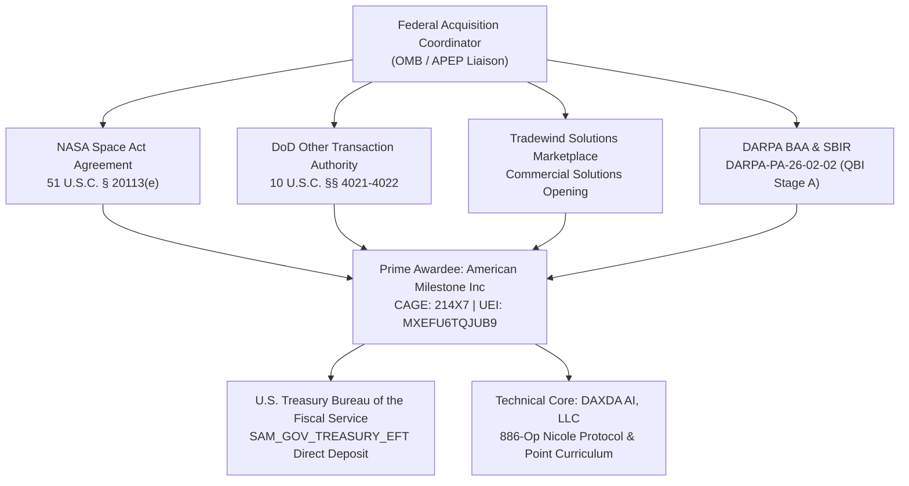

# FORMAL TRANSMITTAL & ACQUISITION DOSSIER: APEP PILOT PROGRAMS & EXISTING AUTHORITIES
## Federal Contracting Vehicles, SAA/OTA Acquisition Structures & Evidence-Gated Pilot Tranches
### Submission to: Federal Acquisition & Pilot Coordinator (OMB / APEP / NASA SAA & DoD OTA Officer)
**Statutory Authority:** Executive Order 14423 (§ 2, § 3(b)(vi), § 3(b)(ix), § 3(c))  
**Document Identification:** `DAXDA-USSA-APEP-ACQUISITION-SUBMISSION-2026-V1`  
**Prime Contracting Vehicle:** American Milestone Inc (SAM.gov UEI: `MXEFU6TQJUB9` · DLA CAGE: `214X7`)  
**Core Technology Subcontractor:** DAXDA AI, LLC (Ohio Small Business Doc `#202628904766` / Filing `#F700972`)  
**Authorized Federal Representative (AOR):** Nicholas Hartman (American Milestone Inc)  
**Principal Investigator & Managing Member:** Nicole Bess (DAXDA AI, LLC)  
**Classification:** UNCLASSIFIED // PROPRIETARY JOINT VENTURE ACQUISITION PROPOSAL  

---

### 1. Executive Transmittal & Strategic Mandate

Pursuant to Executive Order 14423 (*Establishing the Presidential Commission on the United States Space Academy*, August 28, 2026, § 3(b)(vi) & § 3(b)(ix)), **American Milestone Inc** (Prime Federal Contractor) and **DAXDA AI, LLC** (Technology Originator) formally transmit this acquisition package to the **Federal Acquisition & Pilot Coordinator (OMB / APEP / NASA SAA & DoD OTA Officer)**.

This dossier provides federal acquisition officers, OMB budget examiners, and Commission leadership with a turn-key, statutory contracting framework enabling the immediate deployment of preparatory initiatives, analog pilot programs, and point-based curriculum testing utilizing existing federal authorities without requiring novel congressional appropriations.

---

### 2. Statutory Acquisition Vehicles & Contracting Mechanisms

To accelerate implementation ahead of the Commission’s reporting milestones, the joint vehicle leverages four established statutory pathways:



#### 2.1 NASA Space Act Agreements (`51 U.S.C. § 20113(e)`)
* **Mechanism:** Non-Reimbursable / Reimbursable Space Act Agreement (SAA) with NASA Johnson Space Center (JSC) / Human Exploration Development Operations.
* **Scope:** Authorizes software and sensor integration overlays onto existing NASA terrestrial analog habitats (`HERA` — Human Exploration Research Analog $\le 45$ days; `CHAPEA` — Crew Health and Performance Exploration Analog $378$ days).
* **Government Cost:** **$0.00 USD** for initial data integration and protocol alignment.

#### 2.2 DoD Other Transaction Authority (`10 U.S.C. §§ 4021–4022`)
* **Mechanism:** Prototype OTA through the Defense Innovation Unit (DIU) or Chief Digital and Artificial Intelligence Office (CDAO).
* **Scope:** Rapid prototyping and operational stress-testing of $\mathcal{C}l(16,4)$ deterministic AI governance, fail-closed policy enforcement gates, and cognitive security drift monitoring (`MMPIBench`).
* **Advantage:** Bypasses conventional FAR Part 15 overhead; provides streamlined intellectual property terms and milestone-based financing.

#### 2.3 DoD CDAO Tradewind Solutions Marketplace (CSO)
* **Mechanism:** Commercial Solutions Opening (CSO) Award-Ready vehicle.
* **Scope:** DAXDA’s 560+ passing automated tests and mathematical verification suites qualify the joint vehicle for rapid defense transition.

#### 2.4 DARPA Broad Agency Announcement (BAA) Electronic Submission
* **Mechanism:** DARPA-PA-26-02-02 (Quantum Benchmarking Initiative Stage A) and DARPA I2O (ANSR/GARD).
* **Firm-Fixed-Price Amount:** **$485,000.00 USD** (Stage A, 9 Months).

---

### 3. Prime Contractor Registration & Identifiers

All federal disbursements, SAM.gov representations, and contractual covenants are administered through the active prime contracting vehicle:

* **Legal Entity Name:** `AMERICAN MILESTONE INC`
* **SAM.gov Unique Entity Identifier (UEI):** `MXEFU6TQJUB9`
* **DLA CAGE Code:** `214X7`
* **Authorized Organization Representative (AOR):** Nicholas Hartman
* **SAM.gov Status:** `ACTIVE_VERIFIED`
* **Disbursement Routing:** `SAM_GOV_TREASURY_EFT` (U.S. Department of the Treasury)
* **Core Technology Partner:** DAXDA AI, LLC (Ohio Small Business Doc `#202628904766` / Filing `#F700972`)
* **Principal Investigator (PI) & Managing Member:** Nicole Bess
* **Primary NAICS Code:** `541715` (R&D in the Physical, Engineering, and Life Sciences)
* **Secondary NAICS Codes:** `541512` (Computer Systems Design), `541511` (Custom Programming), `541519` (Other Computer Related), `611710` (Educational Support Services)
* **Product Service Codes (PSC):** `AC12` (R&D: Defense Applied Research), `AJ11` (R&D: Physical Sciences Basic Research), `U008` (Education/Training: Curriculum Development)

---

### 4. Evidence-Gated, Phased Pilot Budget Tranches

Funding is allocated across three strictly gated tranches, where advancement is conditioned on falsifiable empirical verification:

| Pilot Phase | Operational Scope & Target Environment | Funding Mechanism | Proposed Budget | Advancement Gate (TEVV Verification) |
| :--- | :--- | :--- | :---: | :--- |
| **Tranche 0 (Pilot-0)** | *Air-Gapped Simulation & Algorithmic Verification:* Containerized AOG-1 gate execution, $Cl(16,4)$ syndrome decoding benchmarks, and simulated 3–22 min latency. | Self-Funded / Academic Stakeholder | **$0.00 USD** *(Zero Government Cost)* | Complete 80/80 passing DUVAST-01 invariant tests and cryptographic receipt generation. |
| **Tranche 1 (Pilot-1)** | *NASA Terrestrial Analog Overlay (`HERA` / `CHAPEA`):* Multi-observer delayed communications trial, minority dissent preservation, and `NASA-STD-3001` clinical firewall validation. | NASA SAA / DoD Prototype OTA | **$485,000.00 USD** *(Firm-Fixed-Price)* | Demonstrated reduction in unauthorized execution rate ($\ge 99.9\%$) without operational crew deadlock. |
| **Tranche 2 (Pilot-2)** | *Academy Cadet Cohort Experiential Pilot:* Multi-crew operational pilot across 4 analog tracks with live point-based curriculum testing (`USSA-101`–`USSA-403`). | Interagency Space Academy Transfer | **$2,450,000.00 USD** | Successful cohort completion of 14 Capability Dimensions and $T0 \to T7$ transfer qualification. |

---

### 5. Treasury Banking & Financial Flow Architecture

Federal disbursements are governed by the executed, legally binding directive **`DAXDA-AMI-FED-EFT-AUTH-2026-V1`**:

```
[ U.S. Treasury Bureau of the Fiscal Service ]
                    │  (Direct Deposit ACH / EFT)
                    ▼
[ American Milestone Inc Settlement Account ]
  (Nicholas Hartman / CAGE: 214X7 / UEI: MXEFU6TQJUB9)
                    │  (Inter-Entity EFT Directive DAXDA-AMI-FED-EFT-AUTH-2026-V1)
                    ▼
[ DAXDA AI, LLC Stripe Treasury Financial Account ]
  (fa_65VdIIXJjwPA5az6ErF16SjLR86BSQ2gmZByo9KWLCi0O0)
                    │  (Automated Metered Billing Ledger Reconciliation)
                    ▼
[ Immutable SHA-256 State Ledger & Audit Receipt ]
```

* **Compliance:** Full adherence to the **Prompt Payment Act** (`31 U.S.C. § 3901 et seq.`) and `FAR 52.232-33`.
* **Zero Co-Mingling:** Commercial Stripe platform revenue and federal Treasury EFT disbursements remain segregated into independent ledger accounts.

---

### 6. Data Rights, Intellectual Property & Federal Safeguards

* **Unlimited Evaluation Rights:** The United States Government receives unlimited rights to review, test, audit, benchmark, and reproduce all software interfaces, schemas, quad-charts, and verification receipts.
* **Background Intellectual Property:** Technical data rights and underlying algorithms (including the 886-Operation Nicole Protocol, $\mathcal{C}l(16,4)$ multivector tables, and Matter Compiler gate) remain the proprietary intellectual property of **DAXDA AI, LLC** pursuant to `FAR 52.227-14` (Rights in Data—General) and `DFARS 252.227-7013` (Rights in Technical Data—Noncommercial Items).
* **Clinical Firewall:** Strict statutory separation is enforced between medical treatment, human research, and cadet qualification pursuant to `14 C.F.R. Part 1230` and `32 C.F.R. Part 219` (**Care $\neq$ Research $\neq$ Qualification**).

---

### **TRANSMITTAL ENDORSEMENT**

Submitted on this 24th day of November, 2026.

___________________________________________________  
**Nicholas Hartman**  
Authorized Organization Representative (AOR) & Principal  
American Milestone Inc  
SAM.gov UEI: `MXEFU6TQJUB9` | CAGE: `214X7`  

___________________________________________________  
**Nicole Bess**  
Principal Investigator & Managing Member  
DAXDA AI, LLC  
Email: `osmesirius@gmail.com`  
