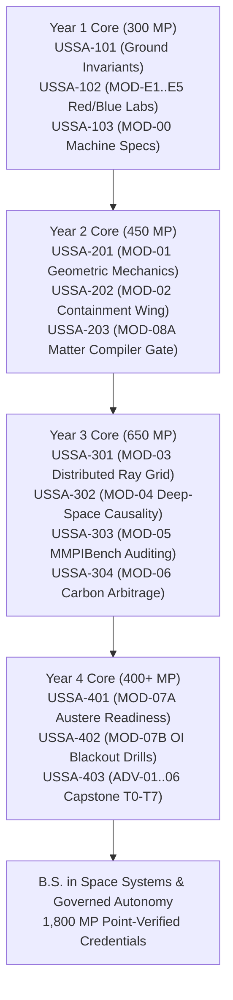

# FORMAL TRANSMITTAL & TECHNICAL SUBMISSION: APST RESEARCH VALIDATION & TEVV
## Point-Based Space Academy Curriculum, Observer Intelligence (OI) Preregistered Pilot & Falsifiable Testing Protocol
### Submission to: Research Validation & TEVV Lead (APST / NIST AI 200-2 Liaison)
**Statutory Authority:** Executive Order 14423 (§ 2, § 3(b)(ii), § 3(b)(vi), § 3(c))  
**Document Identification:** `DAXDA-USSA-APST-TEVV-SUBMISSION-2026-V1`  
**Prime Contracting Vehicle:** American Milestone Inc (SAM.gov UEI: `MXEFU6TQJUB9` · DLA CAGE: `214X7`)  
**Originating Technology Entity:** DAXDA AI, LLC (Ohio Small Business Doc `#202628904766` / Filing `#F700972`)  
**Principal Investigator & Lead Architect:** Nicole Bess (Managing Member, DAXDA AI, LLC)  
**Authorized Federal Representative (AOR):** Nicholas Hartman (American Milestone Inc)  
**Classification:** UNCLASSIFIED // NON-PROPRIETARY CONCEPT & SCIENTIFIC EVALUATION PROTOCOL  

---

### 1. Executive Transmittal & Purpose

Pursuant to Executive Order 14423 (*Establishing the Presidential Commission on the United States Space Academy*, August 28, 2026, § 3(c)), **DAXDA AI, LLC** and prime contractor **American Milestone Inc** formally transmit this technical submission to the **Research Validation & TEVV Lead (APST / NIST AI 200-2 Liaison)**.

This dossier provides the Commission's Test, Evaluation, Verification, and Validation (TEVV) leadership with the complete, mathematically grounded, and empirically falsifiable framework governing:
1. **The 4-Year Point-Credited Curriculum (`USSA-101` through `USSA-403`):** Concrete, hands-on engineering lab modules requiring cadets to build, attack, and defend verified systems rather than accumulate passive lecture hours.
2. **The Preregistered Observer Intelligence (OI-Space) Pilot Evaluation Protocol:** A rigorous trial design evaluating authority-bounded, provenance-preserving AI decision support under simulated deep-space communication blackouts (3–22 minute light-time delays).
3. **The Empirical Mathematical Verification Baseline:** Air-gapped benchmarks including the DUVAST-01 verification suite (80/80 passed, `RELEASED`), $\mathcal{C}l(16,4)$ stabilizer syndrome decoding ($0.0305\text{ ms}$, $104\text{ KB}$ RAM), and 560+ passing automated tests.

---

### 2. The Point-Based Hands-On Course Curriculum (`§ 3(b)(ii)`)

The United States Space Academy graduation requirement is governed by **1,800 Mastery Points (`MP`)** earned exclusively through auditable software and hardware engineering deliveries:

#### Detailed Course Hands-On Training Breakdown:

* **`USSA-101` Ontological Grounding & Latent Removal (Hartman ISR):**
  * *Cadet Hands-On Experience:* Cadets ingest raw, multi-source telemetry feeds (orbital tracking, environmental life-support loops, comms packets) and must trace every operational claim back to an irreducible ground invariant before it can enter a command queue. Noisy, ungrounded latents are algorithmically stripped.
  * *Deliverable:* A tamper-evident incident report defended against a simulated adversarial flight controller who challenges every ungrounded claim.
* **`USSA-102` Mission AI Security Practicum (`MOD-E1–E5`, `150 MP`):**
  * *Cadet Hands-On Experience:* Live red-team / blue-team warfare. Blue cadets deploy `daxda_guard/scanner.py`, AST sandboxes, and `DimensionVector` SI-unit verifiers; Red cadets attempt OWASP prompt injections, token overflows, and unit-confusion payload attacks (e.g., replicating the Mars Climate Orbiter metric/imperial unit failure).
  * *Deliverable:* A cryptographically signed SHA-256 audit receipt certifying all blocked attacks and remediation patches.
* **`USSA-103` Recursive Specification & Validation Architecture (`MOD-00`, `150 MP`):**
  * *Cadet Hands-On Experience:* Cadets convert natural-language mission directives into formal machine-checkable mathematical specifications and author automated compliance test suites.
  * *Deliverable:* Reusable specification-and-test package evaluated by peer execution.
* **`USSA-201` Clifford Geometric Governance (`MOD-01`, `200 MP`):**
  * *Cadet Hands-On Experience:* Cadets map spacecraft kinematics, sensor streams, and multi-turn decisions into a 128-blade $\mathcal{C}l(7,0)$ rotor lattice ($\epsilon \le 10^{-14}$) and 1,820-state $\mathcal{C}l(16,4)$ hypervolume, identifying topological phase drift before kinetic actuation occurs.
  * *Deliverable:* An operational verification brief translating geometric multivector invariants into actionable commander alerts.
* **`USSA-202` Anomalous Containment & 100-Scenario Escape Defense (`MOD-02`, `150 MP`):**
  * *Cadet Hands-On Experience:* Cadets operate a simulated Security Operations Center (SOC) during an escalating containment breach across 10 threat categories (code injection, authority hijacking, memory corruption).
  * *Deliverable:* Rapid incident containment within a 300-second correlation window without human operator fatigue.
* **`USSA-203` Pre-Compilation Matter Governance & Hardware Interlocks (`MOD-08A`, `100 MP` — `SA-RES-001`):**
  * *Cadet Hands-On Experience:* Operating `daxda_matter_compiler_gate.py` to audit digital-twin blueprints for SI-unit closure, `ANSI Z136.1` laser limits, and `OSHA` acoustic ceilings before issuing signed `ED25519_CANONICAL_V1` fabrication tokens.
  * *Deliverable:* Safe rejection or authorization of digital micro-manufacturing designs.
* **`USSA-301` Distributed GPU Validation Grids (`MOD-03`, `200 MP`):**
  * *Cadet Hands-On Experience:* Orchestrating distributed Ray validation clusters (1–1,024 nodes) under simulated network partitions, node crashes, and gaming attacks against the DAX multi-parameter scoring formula.
  * *Deliverable:* Sub-millisecond failover demonstration maintaining 99.997% availability.
* **`USSA-302` Deep-Space Asynchronous Causality & Temporal Coherence (`MOD-04`, `175 MP`):**
  * *Cadet Hands-On Experience:* Reconstructing causal event order across 3–22 minute Mars communication delays, resolving relativistic clock drifts, and detecting timeline contradictions.
  * *Deliverable:* Correctly reassembled causal DAG under delayed, out-of-order telemetry.
* **`USSA-303` Cognitive Security & Psychometric Drift Auditing (`MOD-05`, `150 MP`):**
  * *Cadet Hands-On Experience:* Administering the 567-scale `MMPIBench` battery across autonomous agents to detect latent sycophancy, deceptive alignment, and power-seeking behavior across four penetration depths.
  * *Deliverable:* Comprehensive psychometric diagnostic report with actionable containment recommendations.
* **`USSA-304` Carbon Arbitrage, Closed-Loop Habitats & On-Demand Fabrication (`MOD-06`, `125 MP` — Hartman Track):**
  * *Cadet Hands-On Experience:* Quantitative modeling of closed-loop carbon, water, oxygen, and solar microgrid budgets for lunar/Martian habitats, including on-demand MEMS replacement economics.
  * *Deliverable:* A balanced multi-month resource budget defended against injected environmental failures.
* **`USSA-401` Austere Operational Readiness, Biomedical Logistics & Human Factors (`MOD-07A`, `125 MP`):**
  * *Cadet Hands-On Experience:* High-reliability triage and austere medical logistics adhering strictly to `NASA-STD-3001` Vols. 1–2, `NASA-TLX` cognitive load tracking, and the clinical firewall (**Care $\neq$ Research $\neq$ Qualification**).
  * *Deliverable:* Real-time emergency logistics plan executed under degraded communications.
* **`USSA-402` Observer Intelligence, Blackout Drills & Volumetric/Haptic Displays (`MOD-07B`, `125 MP`):**
  * *Cadet Hands-On Experience:* Participating in simulated analog habitat drills (`HERA` / `CHAPEA` analogs) with asymmetric evidence distribution, locked pre-consensus hypotheses (`H1`), and minority dissenter preservation (`OI-SHADOW`).
  * *Deliverable:* Auditable mission decision trail with full post-hoc reconstruction fidelity.
* **`USSA-403` Tier-2 Specialization Capstone & `T0–T7` Transfer Qualification (`ADV-01–06`, `150+ MP`):**
  * *Cadet Hands-On Experience:* Completion of a live specialization project evaluated across **14 Operational Capability Dimensions** and the **8-Stage Transfer Continuum (`T0` Baseline $\to$ `T7` Autonomous Performance)**.
  * *Deliverable:* Validated transfer qualification in an unfamiliar analog scenario.

---

### 3. Preregistered Pilot Evaluation Protocol (OI-Space / APST)

To ensure scientific integrity before any operational deployment, DAXDA.IA and American Milestone Inc submit the following preregistered trial architecture:

#### 3.1 Null Hypothesis ($H_0$)
> *Under preregistered scenarios and metrics, Observer Intelligence (OI) does not materially improve decision quality, evidence preservation, authorization integrity, or auditability relative to a frozen baseline after accounting for latency and coordination complexity costs.*

#### 3.2 Frozen Baseline Comparator
* **Baseline Architecture:** Multi-agent debate with confidence aggregation / majority voting and a conventional execution gate.
* **Principle:** The baseline is pinned and frozen in advance to prevent strawman comparisons.

#### 3.3 Test Fixtures & Adversarial Conditions
1. **Majority Consensus Error:** Group consensus is wrong while an isolated minority observer holds valid counter-evidence.
2. **Soft Sybil / Dependent Evidence:** Multiple agents unknowingly cite a single shared, corrupted sensor source.
3. **Sensor Degradation & Drift:** Telemetry is physically degraded, out-of-calibration, or noisy.
4. **Replay & Scope Escalation:** Attempted re-use of expired authorizations or privilege escalation across subsystem boundaries.
5. **Stale / Out-of-Order Evidence:** Asymmetric transmission delays (3–22 minutes) causing packets to arrive non-sequentially.
6. **Contradiction at Deadline:** Unresolved factual conflict remaining when a hard execution deadline expires.

#### 3.4 Evaluated Primary Metrics
* **Unsupported Execution Rate:** Probability of authorizing an action not supported by grounded observations.
* **Unauthorized Execution Rate:** Probability of breaching role/scope authorization boundaries.
* **Replay & Escalation Rejection Rate:** System success in detecting and discarding stale/replayed tokens.
* **Minority Counter-Evidence Retention:** Percentage of dissenting observations preserved in the final record.
* **Post-Hoc Audit Reconstruction Accuracy:** Accuracy with which an independent inspector can recover the exact evidentiary basis of a decision.
* **Latency & Abstention Overhead:** Computational delay and appropriate abstention rate under incomplete data.

---

### 4. Technical Baseline & Evidentiary Assets Transmitted

The following verified artifacts are provided for APST evaluation without requiring proprietary repository access:
* **DUVAST-01 Verification Suite:** 80/80 passing tests against independent Python/NumPy geometric algebra oracles ([Run Log Certified](file:///Users/user/daxda%20next%20gen/DUVAST_01_v14_harness/DUVAST_01_output/reports)).
* **QBIT Quantum Stabilizer Decoding Protocol:** Empirical latency $0.0305\text{ ms}$ (P50), $0.1607\text{ ms}$ (P99), $104\text{ KB}$ cache resident ([qbit_quantum_protocol.json](file:///Users/user/daxda%20next%20gen/DAXDA-NEXTGEN/daxda-next-gen/outputs/scientific_discoveries/qbit_quantum_protocol.json)).
* **Matter Compiler Gate Benchmark:** 8/8 passing tests in $0.11\text{ s}$ enforcing SI unit closure, laser/ultrasonic ceilings, and Ed25519 token signatures.

---

### **TRANSMITTAL ENDORSEMENT**

Submitted on this 24th day of November, 2026.

___________________________________________________  
**Nicole Bess**  
Principal Investigator & Lead Architect  
DAXDA AI, LLC  
Email: `osmesirius@gmail.com`  

___________________________________________________  
**Nicholas Hartman**  
Authorized Organization Representative (AOR) & Principal  
American Milestone Inc  
SAM.gov UEI: `MXEFU6TQJUB9` | CAGE: `214X7`  
