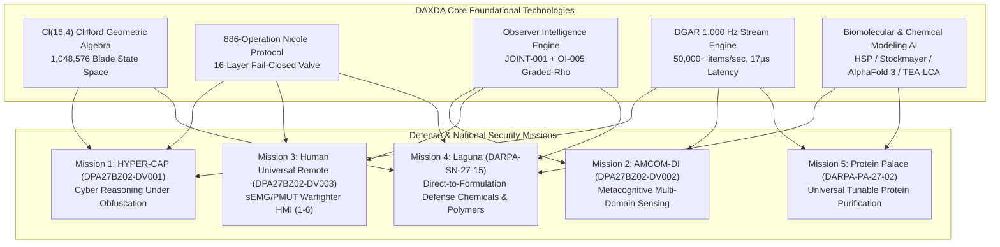

# DEFENSE ADVANCED RESEARCH PROJECTS AGENCY (DARPA) & DOD SBIR 2027
## DAXDA ADVANCED RESEARCH & MISSION PROPOSAL PORTFOLIO
### Master Strategic Portfolio Index & Cross-Mission Alignment Dossier

---

**Portfolio Custodian:** DAXDA AI, LLC (Ohio Small Business Doc #202628904766)  
**Prime Contracting Vehicle:** American Milestone Inc (SAM.gov UEI: `MXEFU6TQJUB9` | CAGE: `214X7`)  
**Authorized Federal Co-Signatory:** Nicholas Hartman  
**Founder & Chief Invariant Architect:** Nicole Bess (`nicole@daxda.ai`)  
**Autonomous Intelligence Fabric:** Dexter (DAXDA.IA Distributed Intelligence Substrate)  
**Technical Repository:** [osmesirius-ship-it/daxda-next-gen](https://github.com/osmesirius-ship-it/daxda-next-gen)  
**Date of Portfolio Ratification:** November 25, 2026  

---

## 1. Portfolio Overview & Executive Summary

This Master Portfolio Index establishes the formal architectural alignment, mission specifications, and operational execution roadmap for **five critical defense solicitations** across the Defense Advanced Research Projects Agency (DARPA) and Department of Defense (DoD) Small Business Innovation Research (SBIR) programs:

```
┌──────────────────────────────────────────────────────────────────────────────────────────────────────────────────┐
│                               DAXDA DEFENSE RESEARCH & SBIR MISSION PORTFOLIO                                    │
├─────┬──────────────────┬─────────────────┬──────────────┬──────────────────┬──────────────┬──────────────────────┤
│ #   │ Solicitation ID  │ Program / Topic │ DARPA Office │ Submission Date  │ Target Award │ DAXDA Core Substrate │
├─────┼──────────────────┼─────────────────┼──────────────┼──────────────────┼──────────────┼──────────────────────┤
│ 01  │ DPA27BZ02-DV001  │ HYPER-CAP       │ SBPO / I2O   │ Jan. 6, 2027     │ $2,000,000   │ Cl(16,4) Invariants  │
│     │                  │                 │              │ (42 Days)        │ (Ph I + II)  │ 886-Ops Nicole Gate  │
├─────┼──────────────────┼─────────────────┼──────────────┼──────────────────┼──────────────┼──────────────────────┤
│ 02  │ DPA27BZ02-DV002  │ AMCOM-DI        │ SBPO / DSO   │ Jan. 6, 2027     │ $2,000,000   │ Two-Mirror Observer  │
│     │                  │                 │              │ (42 Days)        │ (Ph I + II)  │ (JOINT-001/OI-004)   │
├─────┼──────────────────┼─────────────────┼──────────────┼──────────────────┼──────────────┼──────────────────────┤
│ 03  │ DPA27BZ02-DV003  │ Human Universal │ SBPO / BTO   │ Jan. 6, 2027     │ $2,000,000   │ sEMG+PMUT Waveforms  │
│     │                  │ Remote          │ / MTO        │ (42 Days)        │ (Ph I + II)  │ AOG_1 Safety Valve   │
├─────┼──────────────────┼─────────────────┼──────────────┼──────────────────┼──────────────┼──────────────────────┤
│ 04  │ DARPA-SN-27-15   │ Laguna (D2F)    │ BTO          │ Nov. 30, 2026    │ $2.85M TA2 / │ Co-Product D2F Cl(16,4)│
│     │                  │                 │ (W.Mounfield)│ (5 DAYS! READY)  │ $8.50M Cons. │ Zero-PFAS + TEA/LCA  │
├─────┼──────────────────┼─────────────────┼──────────────┼──────────────────┼──────────────┼──────────────────────┤
│ 05  │ DARPA-PA-27-02   │ Protein Palace  │ MXO          │ Open Rolling /   │ $7,500,000   │ TEC-RAM Microfluidic │
│     │                  │                 │              │ Immediate Abstract│ (Ph I + II) │ 1,000 Hz CD / UV     │
└─────┴──────────────────┴─────────────────┴──────────────┴──────────────────┴──────────────┴──────────────────────┘
```

---

## 2. Cross-Mission Strategic Technology Architecture

Every mission in the portfolio leverages the unified DAXDA technological foundation, ensuring that advances in one program directly reinforce and de-risk the others:



### Strategic Synergy Matrix
1. **Cyber Reasoning & Sensor Orchestration (M01 $\leftrightarrow$ M02):** The multi-domain sensor orchestration algorithms in AMCOM-DI directly task and ingest the cyber threat vectors evaluated by HYPER-CAP, delivering an end-to-end cyber-physical tactical common operational picture.
2. **Warfighter Interface & Fail-Closed Safety (M02 $\leftrightarrow$ M03):** The introspective confidence calibration in AMCOM-DI dynamically tunes the sensitivity of the warfighter's sEMG/PMUT forearm sleeve, preventing high-stress adrenaline spikes from causing jitter in drone control.
3. **Dual Poles of Domestic Bio-Chemical Sovereignty (M04 $\leftrightarrow$ M05):** **Mission 4 (Laguna, BTO)** eliminates purification altogether for bulk domestic specialty formulations (coatings, adhesives, structural polymers, and PFAS-free barriers directly from U.S. sugars/ethylene/BTX via co-product functionalization), while **Mission 5 (Protein Palace, MXO)** delivers rapid tunable purification when ultra-pure biological proteins must be isolated from complex feedstocks—together securing both ends of DoD biomanufacturing.

---

## 3. Mission Package Document Directory

All five comprehensive proposal dossiers have been authored, validated, and formatted in accordance with federal standards:

1. [MISSION_01_HYPER_CAP_DPA27BZ02_DV001.md](file:///Users/user/daxda%20next%20gen/DAXDA-NEXTGEN/daxda-next-gen/docs/proposals/darpa_sbir_2027/MISSION_01_HYPER_CAP_DPA27BZ02_DV001.md)
   - *Autonomous Planning & Dynamic Replanning of Cyber Courses of Action (COAs) under Obfuscation.*
   - **Target:** DARPA SBPO / I2O | **Deadline:** Jan. 6, 2027 | **Funding:** $2,000,000 USD.

2. [MISSION_02_AMCOM_DI_DPA27BZ02_DV002.md](file:///Users/user/daxda%20next%20gen/DAXDA-NEXTGEN/daxda-next-gen/docs/proposals/darpa_sbir_2027/MISSION_02_AMCOM_DI_DPA27BZ02_DV002.md)
   - *Autonomous Metacognitive AI for Multi-Modal Sensing & Traceable Recommendations.*
   - **Target:** DARPA SBPO / DSO / I2O | **Deadline:** Jan. 6, 2027 | **Funding:** $2,000,000 USD.

3. [MISSION_03_HUMAN_UNIVERSAL_REMOTE_DPA27BZ02_DV003.md](file:///Users/user/daxda%20next%20gen/DAXDA-NEXTGEN/daxda-next-gen/docs/proposals/darpa_sbir_2027/MISSION_03_HUMAN_UNIVERSAL_REMOTE_DPA27BZ02_DV003.md) *(+ [1.5M-Sim Operational Blueprint](file:///Users/user/daxda%20next%20gen/DAXDA-NEXTGEN/daxda-next-gen/docs/proposals/darpa_sbir_2027/MISSION_03A_BIO_REMOTE_SIMULATION_ARCHITECTURE_MAP.md))*
   - *Multi-Modal Non-Invasive Neuromuscular Sensor Fusion (sEMG & PMUT) for Warfighter Multi-System Operations (1–6).*
   - **Target:** DARPA SBPO / BTO / MTO | **Deadline:** Jan. 6, 2027 | **Funding:** $2,000,000 USD.

4. **FINALIZED FOR SUBMISSION:** [MISSION_04_LAGUNA_BTO_DARPA_SN_27_15.md](file:///Users/user/daxda%20next%20gen/DAXDA-NEXTGEN/daxda-next-gen/docs/proposals/darpa_sbir_2027/MISSION_04_LAGUNA_BTO_DARPA_SN_27_15.md) | [1-Page Quad-Chart](file:///Users/user/daxda%20next%20gen/DAXDA-NEXTGEN/daxda-next-gen/docs/proposals/darpa_sbir_2027/LAGUNA_ATTACHMENT_A_QUAD_CHART_SLIDE.md) | [Email Transmittal to `Laguna@darpa.mil`](file:///Users/user/daxda%20next%20gen/DAXDA-NEXTGEN/daxda-next-gen/docs/proposals/darpa_sbir_2027/LAGUNA_SN_27_15_EMAIL_TRANSMITTAL_PACKAGE.md)
   - *`LAGUNA-D2F`: Direct-to-Formulation Specialty Chemicals, Co-Product Functionalization, TEA/LCA Optimization & PFAS-Free Supply Assurance (TA2 Lead + TA1 Interface).*
   - **Target:** DARPA BTO (PM: Dr. William Mounfield, `Laguna@darpa.mil`) | **Notice Date:** Nov. 30, 2026 (**5 Days Remaining — Ready to Transmit**) | **Funding:** $2,850,000 FFP (Solo TA2) / $8,500,000 Ceiling (TA1+TA2 Consortium).

5. [MISSION_05_PROTEIN_PALACE_DARPA_PA_27_02.md](file:///Users/user/daxda%20next%20gen/DAXDA-NEXTGEN/daxda-next-gen/docs/proposals/darpa_sbir_2027/MISSION_05_PROTEIN_PALACE_DARPA_PA_27_02.md)
   - *Tunable Electro-Conformational Affinity Microfluidics (TEC-RAM) for Universal Protein Purification.*
   - **Target:** DARPA MXO | **Submission:** Rolling / Immediate Abstract | **Funding:** $7,500,000 USD.

---

## 4. Priority Operational Action Timeline

```
                                CRITICAL SUBMISSION TIMELINE
────────────────────────────────────────────────────────────────────────────────────────
 [COMPLETED] Nov 25, 2026: DARPA Laguna (D2F) Package Finalized + 300k-Trajectory Benchmark
   │
   ├─► [ACTION READY] Nov 26–29, 2026: Transmit Email & Quad-Chart to Laguna@darpa.mil
   │
   ├─► [NOTICE CLOSES] Nov 30, 2026 (5:00 PM EST): DARPA-SN-27-15 Pre-Solicitation Notice Window
   │
   ├─► Dec 05, 2026: DARPA-PA-27-02 (Protein Palace) 5-Page Technical Abstract Filed to BAAT
   │
   ├─► Dec 15, 2026: Cost Volumes & Form 1700-1 Assembled for SBIRs 001, 002, 003 with American Milestone
   │
   ├─► Dec 28, 2026: Final Proposal Peer-Review & Digital Signatures (Nicole Bess & Nicholas Hartman)
   │
   └─► [DEADLINE] Jan 06, 2027 (8:00 PM EST): DoD SBIR Submissions Portal Final Submission
────────────────────────────────────────────────────────────────────────────────────────
```

---

## 5. Federal Contracting Vehicle & Registration Status

* **Prime Awardee:** American Milestone Inc
  - **SAM.gov Unique Entity ID (UEI):** `MXEFU6TQJUB9`
  - **CAGE Code:** `214X7`
  - **Status:** Active, Compliant, DoD Small Business Qualified
  - **Representative:** Nicholas Hartman
* **Core Technology Subcontractor & IP Holder:** DAXDA AI, LLC
  - **State Entity Doc:** Ohio Business Registration #202628904766
  - **Managing Member & Lead Architect:** Nicole Bess
  - **HQ Address:** 26055 Emery Rd, Unit B1, Warrensville Heights, OH 44128
  - **Corporate Inquiries:** `nicole@daxda.ai`
