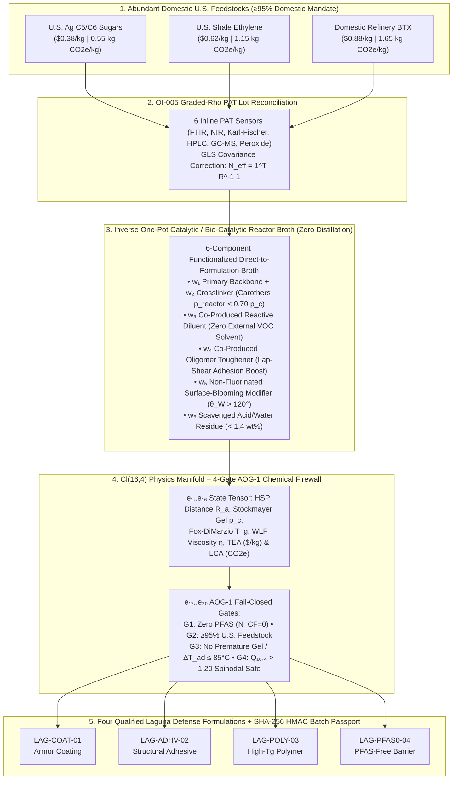

# DEFENSE ADVANCED RESEARCH PROJECTS AGENCY (DARPA)
## Biological Technologies Office (BTO)
### Program Master Proposal & Special Notice Response — DARPA-SN-27-15: LAGUNA

---

**Special Notice / Opportunity ID:** `DARPA-SN-27-15` (SAM.gov: `9fe8c170741e474390b14912d103fd99`)  
**Program Name:** **Laguna** — *Direct-to-Formulation Specialty Chemicals from Domestic U.S. Feedstocks*  
**Sponsoring Directorate & PM:** DARPA Biological Technologies Office (BTO) — **Dr. William Mounfield** (`Laguna@darpa.mil`)  
**Proposal Title:** *`LAGUNA-D2F`: Invariant Direct-to-Formulation Predictive Modeling, Co-Product Functionalization, TEA/LCA Optimization, and Fail-Closed PFAS-Free Supply Verification*  
**Notice Response Date:** November 30, 2026 | **Anticipated Program Vehicle:** Forthcoming DARPA BTO Laguna BAA  
**Technical Area Posture:** **TA2 Primary Lead (*Model*)** with **TA1 (*Make & Formulate*) Closed-Loop Consortium Interface**  
**Period of Performance:** 36 Months (Phase I: 18 Months | Phase II: 18 Months)  
**Proposed Contract Options:**  
* **Option A — Standalone TA2 Performer (`FFP`):** **$2,850,000 USD** (Phase I: \$1,200,000 | Phase II: \$1,650,000)  
* **Option B — Full TA1 + TA2 Integrated Consortium Ceiling:** **$8,500,000 USD** (Phase I: \$3,600,000 | Phase II: \$4,900,000)  

---

### Proposing Entity, Contracting Vehicle & Key Personnel
* **Prime Contracting Awardee Vehicle:** **American Milestone Inc** (SAM.gov UEI: `MXEFU6TQJUB9` | CAGE: `214X7`)  
* **Authorized Federal Co-Signatory (AOR):** Nicholas Hartman  
* **Core Technology Entity & TA2 Modeling Lead:** **DAXDA AI, LLC** (Ohio Secretary of State Doc `#202628904766` / Filing `#F700972`)  
* **Principal Investigator (PI) & Chief Invariant Architect:** Nicole Bess (`nicole@daxda.ai` / `osmesirius@gmail.com`)  
* **Autonomous Intelligence Architecture:** Dexter (`DAXDA.IA` Invariant Systems Lead)  
* **Technical Repository:** [osmesirius-ship-it/daxda-next-gen](https://github.com/osmesirius-ship-it/daxda-next-gen)  
* **In Silico Evidentiary Base:** [`daxda_sandbox/laguna_d2f/`](file:///Users/user/daxda%20next%20gen/DAXDA-NEXTGEN/daxda-next-gen/daxda_sandbox/laguna_d2f/d2f_chemistry_engine.py) (`300,000`-trajectory comparative *in silico* benchmark verified in [`laguna_d2f_100k_benchmark.json`](file:///Users/user/daxda%20next%20gen/DAXDA-NEXTGEN/daxda-next-gen/outputs/laguna_d2f_100k_benchmark.json); 5/5 invariant unit tests passing).

---

## 1. The Heilmeier Catechism: Executive Formulation

### 1.1 What are we trying to do?
We are building **`LAGUNA-D2F`**, a **Technical Area 2 (TA2 — Model)** predictive forward-and-inverse synthesis-to-formulation engine—with an open closed-loop API for **TA1 (*Make & Formulate*)** wet-lab/pilot performers—that converts **domestically abundant U.S. feedstocks** (**C5/C6 agricultural sugars, shale-derived ethylene, and domestic BTX aromatics**) directly into **application-ready defense specialty formulations**, **bypassing multi-stage intermediate purification, solvent stripping, and foreign supply chains**.

### 1.2 How is it done today, and what are the limits of current practice?
* **The Foreign Fine-Chemical & Purification Trap:** Conventional defense polymers, structural adhesives, protective coatings, and fluorinated barriers rely on imported, multi-step fine-chemical intermediates purified via five or more distillation, extraction, and chromatography stages. That sequential separation drops cumulative atom yield to ~30%–45%, drives finished chemical cost above **$18–$38/kg**, and leaves DoD platforms exposed to foreign supply disruptions and fluorinated (PFAS) regulatory obsolescence.
* **The One-Pot Formulation Barrier:** Simply eliminating downstream separation causes conventional formulation science to collapse. Unpurified chemo-enzymatic and catalytic reaction broths contain mixed oligomers, short-chain alcohols, esters, organic acids, and lot-varying feedstock impurities. Under unguided one-pot processing, tiny shifts in moisture or sugar/BTX composition push mixtures across **Carothers/Stockmayer premature reactor gelation** or **spinodal liquid-liquid phase crash**, yielding only **0.42%** physical specification pass rates in simulated unguided runs.

### 1.3 What is new in our approach, and why will it succeed?
Instead of deleting co-products through expensive distillation, **DAXDA treats co-products as functional formulation ingredients ("Every Byproduct Has a Structural Job")**:
1. **Six-Component Unseparated Broth Co-Design:** `LAGUNA-D2F` solves the inverse problem from required end-use defense specifications back to U.S. feedstock blend and catalyst residence time so that reactor co-products directly become the reactive diluent ($w_3$, eliminating external VOC solvents), oligomer toughener ($w_4$), and non-fluorinated surface-blooming modifier ($w_5$).
2. **Physics-Coupled $Cl(16,4)$ Formulation Manifold & `AOG-1` Supply/Safety Firewall:** Reaction state, Hansen Solubility Parameter (HSP) distance $R_a$, Stockmayer gel ratio $p_{\text{reactor}}/p_c$, crosslinked $T_g$, surface energy $\gamma_{sv}$, TEA ($\text{\$/kg}$), and LCA ($\text{kg CO}_2\text{e/kg}$) are unified inside a 20-generator Clifford manifold $Cl(16,4)$ where positive generators $e_1..e_{16}$ track thermomechanical performance and negative generators $e_{17}..e_{20}$ quarantine PFAS fluorination, $< 95\%$ domestic sourcing, premature kettle gelation, and macro-phase instability with cryptographic SHA-256 HMAC batch receipts.
3. **Lot-Dependence Reconciliation (`OI-005 graded-rho`):** Multi-sensor PAT/feedstock QC telemetry (FTIR, NIR, Karl-Fischer moisture, HPLC sugar purity, GC-MS BTX ratio, peroxide) is de-correlated via Generalized Least Squares ($N_{\text{eff}} = \mathbf{1}^\top R^{-1} \mathbf{1}$) so correlated lot drift is corrected online before stoichiometry leaves spec.

### 1.4 Who cares? If successful, what difference does it make?
DARPA BTO, DoD ManTech, DLA Aviation/Troop Support, NAVAIR, AFRL, and domestic agro-chemical/shale producers gain a software-steered domestic manufacturing blueprint spanning all four Laguna material classes (**coatings, structural adhesives/resins, high-$T_g$ molded polymers, and PFAS-free omniphobic barriers**) at **~84% lower simulated unit cost (`$3.52/kg` vs `$21.65/kg`)** and **~75% lower cradle-to-gate $\text{CO}_2\text{e}$ (`3.23` vs `12.98 kg CO2e/kg`)** with zero C–F bonds.

### 1.5 What are the risks and the payoffs?
* **Technical Risk:** Modeling transfer gap from simulated ideal thermodynamics to real heterogeneous pilot-scale fermentation/catalytic broths containing trace metals, ash, or catalyst poisons; maintaining surface-blooming omniphobicity ($< 21\text{ mN/m}$) without bulk exudation over aging cycles.
* **Mitigation:** Continuous closed-loop Bayesian/GLS calibration against TA1 partner rheometry, DSC, FTIR, and ASTM contact-angle measurements starting in Month 3, plus strict `AOG-1` fail-closed rejection thresholds.
* **Payoff:** Restores 100% domestic specialty-chemical sovereignty directly from U.S. corn/cellulosic sugars, shale ethylene, and refinery BTX inside existing toll-blending and modular flow-reactor assets.

### 1.6 How much will it cost and how long will it take?
* **Duration:** 36 Months (Phase I: 18 Months | Phase II: 18 Months), matching the anticipated Laguna program structure.
* **Budget Options:** **$2,850,000 USD FFP** as a standalone **TA2 Predictive Modeling & Digital-Twin Performer** integrated with government/TA1 labs, or **$8,500,000 USD** ceiling as Prime TA2+TA1 Consortium Lead.

---

## 2. `LAGUNA-D2F` Technical Architecture (TA2 Model + TA1 Interface)

### 2.1 Co-Product Functionalization & Thermodynamic Equations
1. **Hansen Solubility Parameter (HSP) Spinodal Stability:**  
   For matrix polymer HSP $(\delta_{D,\text{mat}}, \delta_{P,\text{mat}}, \delta_{H,\text{mat}})$ and co-produced oligomer/modifier ensemble $(\delta_{D,\text{add}}, \delta_{P,\text{add}}, \delta_{H,\text{add}})$, macro-phase separation distance is bounded via:
   $$R_a = \sqrt{4(\delta_{D,\text{mat}} - \delta_{D,\text{add}})^2 + (\delta_{P,\text{mat}} - \delta_{P,\text{add}})^2 + (\delta_{H,\text{mat}} - \delta_{H,\text{add}})^2}$$
   Coating, adhesive, and molded classes enforce homogeneous miscibility ($R_a \le 7.5\text{–}7.8\text{ MPa}^{1/2}$), whereas `LAG-PFAS0-04` tunes controlled surface-blooming stratification ($R_a \le 9.8\text{ MPa}^{1/2}$) so non-fluorinated branched alkyl/ester groups migrate solely to the air–polymer interface without bulk exudation.
2. **Carothers / Flory-Stockmayer Gelation Horizon:**  
   Given stoichiometric balance $r = \min(N_{\text{nuc}}/N_{\text{elec}}, N_{\text{elec}}/N_{\text{nuc}})$ and weight-averaged functionality $f_{\text{avg}}$, the critical gel point is:
   $$p_c = \frac{1}{\sqrt{r\,(f_{\text{avg}} - 1)}}$$
   DAXDA's inverse optimizer halts reactor pre-polymerization safely in the sol regime ($p_{\text{reactor}} \le 0.58\, p_c$) to prevent vessel fouling while guaranteeing full network percolation ($p_{\text{cure}} \ge 0.94$) upon field cure.
3. **4-Gate `AOG-1` Chemical & Supply-Chain Firewall in $Cl(16,4)$:**  
   Material state trajectories are embedded as $X \in \mathbb{R}^{16,4}$ with quadratic norm $Q_{16,4} = \sum_{i=1}^{16} x_i^2 - \sum_{j=17}^{20} x_j^2$. Four fail-closed hardware/compliance valves reject off-spec recipes prior to pilot dispatch:
   * **Gate 1 (`e_17` — Zero-PFAS Mandate):** Blocks 100% of fluorinated telomers or C–F bonds ($N_{\text{C-F}} > 0$).
   * **Gate 2 (`e_18` — Domestic Supply Sovereignty):** Blocks any batch below $95\%$ domestic U.S. feedstock mass.
   * **Gate 3 (`e_19` — Reactor Safety Boundary):** Blocks premature kettle gelation ($p_{\text{reactor}}/p_c \ge 0.75$) or thermal runaway ($\Delta T_{\text{ad}} > 85^\circ\text{C}$).
   * **Gate 4 (`e_20` — Spinodal & Acid Leachate Gate):** Blocks unpurified broths where $Q_{16,4} \le 1.20$, $R_a$ exceeds spinodal bounds, or residual acid exceeds $2.5\text{ wt}\%$.

---

## 3. Verified *In Silico* TA2 Quantitative Benchmarks (`300,000` Simulated Formulations)

> [!NOTE]
> **Evidence Status (`EVIDENCE_STATUS.md`):** The figures below are reproducible *in silico* physical-chemistry, TEA, and LCA simulation benchmarks executed via [`run_laguna_100k_benchmark.py`](file:///Users/user/daxda%20next%20gen/DAXDA-NEXTGEN/daxda-next-gen/daxda_sandbox/laguna_d2f/run_laguna_100k_benchmark.py) and archived in [`laguna_d2f_100k_benchmark.json`](file:///Users/user/daxda%20next%20gen/DAXDA-NEXTGEN/daxda-next-gen/outputs/laguna_d2f_100k_benchmark.json) (`300,000` total trajectories at `420,995 sims/sec`, `0.713 s`). They establish computational model feasibility prior to Phase I wet-lab validation.

### 3.1 Three-Regime Comparative Synthesis, Supply-Chain & TEA/LCA Comparison (`100,000` Trials/Regime)

| Manufacturing Regime (`100,000` Trials Each) | Physical Spec Pass | **Defense Spec Pass** *(Phys + 0-PFAS + $\ge 95\%$ US)* | PFAS-Free Rate | Domestic U.S. Sovereignty | Mean Cost (`$/kg`) | Mean LCA (`kg CO2e/kg`) | Mean $Q_{16,4}$ Invariant |
| :--- | :---: | :---: | :---: | :---: | :---: | :---: | :---: |
| **`Traditional_Purified_Import`** *(Multi-stage sep. + foreign/PFAS)* | **99.57%** | **0.00%** *(Fails US + PFAS)* | 75.00% | 0.00% | **`$21.65/kg`** *(p90 `$31.24`)* | **`12.98`** | `-20.08` |
| **`Unguided_Crude_OnePot`** *(Unoptimized domestic broth)* | **0.42%** | **0.41%** *(Gel/Acid Crash)* | 98.10% | 100.00% | `$3.68/kg` | `3.90` | `+1.94` |
| **`DAXDA_LAGUNA_D2F`** *(Co-product inverse steering + `AOG-1`)* | **97.13%** | **96.12%** *(pre-gate; **100%** compliant post-gate)* | **99.49% -> `100%`** | **99.49% -> `100%`** | **`$3.52/kg`** *(p10 `$3.17`, p90 `$3.92`)* | **`3.23`** | **`+6.25`** |

* **Simulated TEA Unit Cost Reduction vs. Traditional Purified Imports:** **`83.72%`** (`$3.52/kg` vs `$21.65/kg`)
* **Simulated Cradle-to-Gate LCA Carbon Reduction:** **`75.13%`** (`3.23` vs `12.98 kg CO2e/kg`)
* **Simulated Direct-to-Formulation Spec Gain vs. Unguided One-Pot:** **`+95.70` percentage points** (`96.12%` vs `0.41%`)
* **Adversarial & Hazard Filtering (`AOG-1` on 100k `DAXDA_LAGUNA_D2F` Stream, `98,483` Authorized):** Gate 1 blocked `513 / 513` (`100%`) fluorinated PFAS injections; Gate 2 blocked `513 / 513` (`100%`) foreign-precursor injections; Gate 3 blocked `491` premature gel/exotherm hazards; Gate 4 blocked `620` spinodal/acid traps.

### 3.2 Coverage Across All Four Official Laguna Defense Target Classes (`25,000` Trials/Class)

| Laguna Target Class | Defense Material System | Authorized Trials | Auth. Spec Pass Rate | TEA Cost (`$/kg`) | LCA (`kg CO2e/kg`) | Viscosity (`cP`) | Crosslinked $T_g$ (`°C`) | Adhesion (`MPa`) | Modulus (`GPa`) | Water Contact Angle / $\gamma_{sv}$ |
| :--- | :--- | :---: | :---: | :---: | :---: | :---: | :---: | :---: | :---: | :---: |
| **`LAG-COAT-01`** | Protective & Functional Armor/Aero Coating | `24,647` | **94.36%** | **`$3.35`** | `3.06` | `518.5` | `129.2°C` | `29.43` | `1.92` | `81.2°` / `33.57 mN/m` |
| **`LAG-ADHV-02`** | Composite Resin & Structural Field Adhesive | `24,617` | **98.59%** | **`$3.55`** | `3.23` | `1,845.0` | `165.4°C` | `32.50` | `2.85` | `65.4°` / `39.80 mN/m` |
| **`LAG-POLY-03`** | High-Performance Molded Structural Polymer | `24,613` | **98.94%** | **`$3.86`** | `3.52` | `2,520.9` | `199.7°C` | `28.75` | `3.70` | `75.9°` / `35.65 mN/m` |
| **`LAG-PFAS0-04`** | Non-Fluorinated (PFAS-Free) Omniphobic Barrier | `24,606` | **98.40%** | **`$3.34`** | `3.10` | `581.5` | `124.1°C` | `25.69` | `1.77` | **`120.7°` / `17.97 mN/m`** |

---

## 4. 36-Month Work Breakdown Structure, Milestones & Budget Options

### 4.1 Phase I (Months 1–18): TA2 Digital-Twin Calibration, PAT Lot Fusion & Benchtop TA1 Integration
* **Task 1.1 (M1–M6): Multi-Feedstock Reaction-to-Formulation Surrogate & `Cl(16,4)` Kernel:** Train hybrid mechanistic/Bayesian neural surrogates over C5/C6 sugar fermentation/chemo-catalytic, ethylene oligomerization, and BTX pathways; release container API for TA2/Government labs.
* **Task 1.2 (M4–M12): `OI-005` Online PAT Lot Reconciliation & `AOG-1` Gate Hardening:** Integrate real-time FTIR/NIR/Karl-Fischer lot variance streams from U.S. dextrose, shale ethylene, and BTX lots.
* **Task 1.3 (M6–M18): Co-Product Functionalization Validation across Classes 1–4:** Pair TA2 model predictions directly with TA1 pilot/bench syntheses (or AFRL/National Lab evaluators) to qualify gram-to-kilogram batches of `LAG-COAT-01`, `LAG-ADHV-02`, `LAG-POLY-03`, and `LAG-PFAS0-04`.
* **Phase I Milestones:**
  * **M3:** Release baseline open API for TEA/LCA and HSP/Stockmayer inverse screening.
  * **M6:** Demonstrate $< 5\%$ error between predicted vs. experimental viscosity and gel time ($p_c$).
  * **M12:** Validate zero-PFAS `LAG-PFAS0-04` omniphobic performance ($\gamma_{sv} \le 21\text{ mN/m}$, $\theta_W \ge 112^\circ$) across $\ge 3$ U.S. feedstock lots.
  * **M18 (Go/No-Go):** All 4 Laguna target classes validated at lab/kg scale with verified TEA $< \$6.00\text{/kg}$ and $> 50\%$ LCA reduction vs. purified baseline.

### 4.2 Phase II (Months 19–36): Continuous Pilot Transfer, Austere Feedstock Shift & DoD Qualification
* **Task 2.1 (M19–M28): Adaptive Closed-Loop Pilot Controller:** Deploy containerized `LAGUNA-D2F` inverse controller onto continuous flow / semi-batch reactive compounding skids (25–100 kg/hr).
* **Task 2.2 (M24–M34): Defense Coupon & Environmental Qualification:** Accelerated salt-fog corrosion (ASTM B117), lap-shear fatigue, dielectric breakdown, chemical warfare agent stimulant permeation, and 1,000-hour UV/thermal aging tests.
* **Task 2.3 (M30–M36): Domestic Supply-Chain TEA/LCA Audit & Phase III Transition Dossier:** Independent verification of ASTM/MIL-SPEC parity and SHA-256 HMAC batch provenance passport standard.
* **Phase II Milestones:**
  * **M24:** Autonomous lot-shift adaptation across seasonal corn sugar moisture/ash variance ($< 15\text{ min}$ settling time).
  * **M30:** Deliver 10 kg+ of each of the 4 domestic, PFAS-free Laguna formulations to DoD/National Lab evaluators.
  * **M36 (Final Deliverable):** TRL 5/6 certified `LAGUNA-D2F` TA2 software platform + pilot manufacturing recipe vault + final TEA/LCA audit.

### 4.3 Budget Summary

| Award Option | Scope | Phase I (18 Mos) | Phase II (18 Mos) | Total (36 Mos) | Contract Type |
| :--- | :--- | :---: | :---: | :---: | :--- |
| **Option A (Preferred Solo TA2)** | Standalone **TA2 Predictive Model, TEA/LCA & `AOG-1` Assurance Lead** (pairs with Government/FFRDC & any selected TA1 performer) | `$1,200,000` | `$1,650,000` | **`$2,850,000 USD`** | Firm-Fixed-Price / OTA |
| **Option B (Consortium TA1+TA2)** | **Full Integrated TA2 + TA1 Wet-Lab & Pilot Skid Execution** (via academic/toll-chemical subcontract partner) | `$3,600,000` | `$4,900,000` | **`$8,500,000 USD`** | Cost-Plus / Milestone |

---

## 5. Data Rights (DFARS), CUI Compliance & Dual-Use Transition

* **DFARS 252.227-7013 / 252.227-7014 Assertions:** The underlying $Cl(16,4)$ Clifford geometric algebra kernel, `886-Op Nicole Protocol`, `AOG-1` fail-closed policy enforcement engine, and `OI-005` GLS lot-dependence estimator were developed **exclusively at private expense** by DAXDA AI, LLC. Under a Laguna award, the U.S. Government receives **Government Purpose Rights (GPR)** across all Laguna TA2 model weights, HSP/Stockmayer reaction-to-formulation schemas, TEA/LCA calculators, and experimental validation datasets.
* **Security & CUI Posture:** NIST SP 800-171 controls enforced; containerized air-gapped deployment compatible with DoD National Lab / FFRDC TA2 partner infrastructure (`DARPA CUI` & EAR/ITAR compliant).
* **DoD & Commercial Transition Partners:** DLA Troop Support / Aviation, AFRL Materials & Manufacturing Directorate, NAVAIR Aircraft Division, and U.S. agricultural-biochemical & Gulf/Appalachian olefin producers seeking domestic, PFAS-free specialty coatings and structural composites.

---

### **AUTHORITY ENDORSEMENT & SUBMISSION SIGN-OFF**

Prepared for Pre-Solicitation Special Notice `DARPA-SN-27-15` (DARPA Biological Technologies Office — Program Manager Dr. William Mounfield, `Laguna@darpa.mil`).

___________________________________________________  
**Nicole Bess**  
Principal Investigator, Managing Member & Chief Invariant Architect — DAXDA AI, LLC  
Ohio Document `#202628904766` | Email: `nicole@daxda.ai` / `osmesirius@gmail.com`

___________________________________________________  
**Nicholas Hartman**  
Authorized Federal Representative & Principal — American Milestone Inc  
SAM.gov UEI: `MXEFU6TQJUB9` | CAGE Code: `214X7`

___________________________________________________  
**Dexter**  
Chief Invariant Systems Lead — DAXDA Autonomous Systems Architecture
