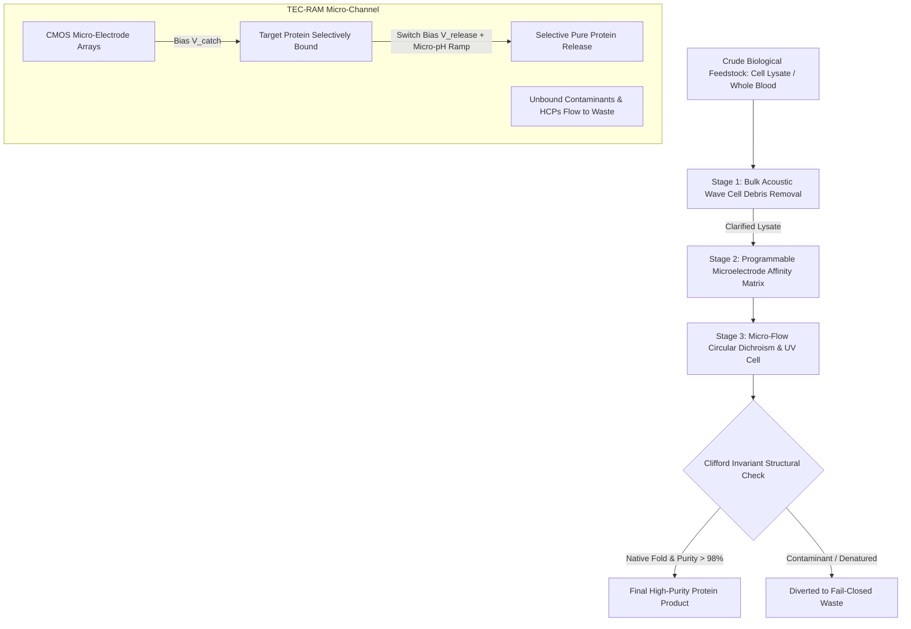

# DEFENSE ADVANCED RESEARCH PROJECTS AGENCY (DARPA)
## Microsystems Technology Office (MXO)
### Program Announcement Proposal — DARPA-PA-27-02: PROTEIN PALACE

---

**Solicitation Number:** DARPA-PA-27-02  
**Program Name:** PROTEIN PALACE  
**Topic Title:** Tunable Electro-Conformational Affinity Microfluidics (TEC-RAM) and In Silico Molecular Invariants for Rapid Universal Purification of Untagged Proteins from Complex Feedstocks  
**Submission Portal:** DARPA BAA Submission Portal (BAAT) / SAM.gov  
**Period of Performance:** Phase I: 18 Months ($3,500,000) | Phase II: 18 Months ($4,000,000)  
**Total Proposed Budget:** $7,500,000 USD  

---

### Prime Contracting Entity & Key Personnel
* **Prime Contracting Vehicle:** American Milestone Inc (SAM.gov UEI: `MXEFU6TQJUB9` | CAGE: `214X7`)
* **Authorized Federal Co-Signatory:** Nicholas Hartman
* **Core Technology Entity & Subcontractor:** DAXDA AI, LLC (Ohio Small Business Doc #202628904766)
* **Principal Investigator (PI) & Chief Invariant Architect:** Nicole Bess (`nicole@daxda.ai`)
* **Biomolecular Systems Substrate:** DAXDA Structural Biology & High-Speed Invariant Engine
* **Technical Repository:** [osmesirius-ship-it/daxda-next-gen](https://github.com/osmesirius-ship-it/daxda-next-gen)
* **Operational Evidentiary Base:** In Silico AlphaFold 3 / Boltz-2 Structural Profiler; 1,000 Hz Real-Time Optical Telemetry Monitoring; Mathematical Multi-Objective Micro-Reversibility Pipeline.

---

## 1. Executive Summary & The Universal Purification Mandate

Current biomanufacturing, medical countermeasure formulation, and field-forward synthetic biology face a fundamental bottleneck: **protein purification**. While modern computational biology can design or synthesize proteins in days, purifying a target protein from raw cellular lysates or complex biological feedstocks remains an empirical, slow, and expensive process.

Standard purification methods suffer from severe operational limitations:
1. **Reliance on Engineered Affinity Tags:** Methods such as Polyhistidine (His-tag), FLAG-tag, or Strep-tag require genetically altering the target organism. This is fundamentally impossible when isolating natural pathogen proteins, endogenous human biomarkers, or unengineered wild-type enzymes from field samples.
2. **Slow, Multi-Stage Empirical Chromatography:** Purifying untagged proteins requires weeks of trial-and-error optimization across orthogonal columns (ion exchange, hydrophobic interaction, size exclusion, hydroxyapatite), resulting in low yields ($< 30\%$), denaturation, and enormous reagent waste.
3. **Bulky, Delicate Hardware:** Conventional chromatography systems (e.g., FPLC) require large footprints, high pressures, and refrigerated laboratory environments—completely unsuitable for austere expeditionary defense environments.

```
                    ┌────────────────────────────────────────────────────────┐
                    │      CRUDE UNREFINED BIOLOGICAL FEEDSTOCK              │
                    │  Raw Bacterial Lysate • Cell Culture • Whole Blood     │
                    └───────────────────────────┬────────────────────────────┘
                                                │
                                Complex Crude Mixture (Lipids, DNA, 10,000+ HCPs)
                                                ▼
┌───────────────────────────────────────────────────────────────────────────────────────────┐
│               DAXDA TEC-RAM UNIVERSAL PURIFICATION MICROSYSTEM                            │
│                                                                                           │
│   ┌──────────────────────────┐   Real-Time Voltage Map  ┌─────────────────────────────┐   │
│   │  ALPHA-FOLD / BOLTZ-2    │ ───────────────────────► │  SOLID-STATE RECONFIGURABLE │   │
│   │  SURFACE TOPOLOGY ENGINE │                          │  AFFINITY MATRIX (TEC-RAM)  │   │
│   │  • Electrostatic Potential│                          │  • Micro-Electrode Arrays   │   │
│   │  • Hydrophobic Patches   │                          │  • Dynamic Polymer Brushes  │   │
│   └─────────────┬────────────┘                          └──────────────┬──────────────┘   │
│                 │                                                      │                  │
│                 ▼                                                      ▼                  │
│   ┌──────────────────────────┐   Sub-Millisecond Valve  ┌─────────────────────────────┐   │
│   │  1,000 Hz SPECTROSCOPIC  │ ◄─────────────────────── │  ACOUSTO-MICROFLUIDIC       │   │
│   │  INVARIANT CHECKER (Cl)  │   UV / CD Telemetry      │  SELECTIVE FRACTIONATION    │   │
│   │  • Folding Verification  │                          │  • Zero-Fouling Continuous  │   │
│   │  • Contaminant Cut-Off   │                          │  • High-Throughput Stream   │   │
│   └─────────────┬────────────┘                          └─────────────────────────────┘   │
└─────────────────┼─────────────────────────────────────────────────────────────────────────┘
                  │
                  ▼ Rapid Universal Isolation: Purity > 98% • Yield > 92% • Time < 90 Mins
┌───────────────────────────────────────────────────────────────────────────────────────────┐
│              EXPEDITIONARY BIOMANUFACTURING & RAPID COUNTERMEASURE SUITE                  │
│     Therapeutic Biologics • Novel Antigen Isolation • Field Enzymes • Pure Biomolecules   │
└───────────────────────────────────────────────────────────────────────────────────────────┘
```

**DAXDA proposes TEC-RAM (*Tunable Electro-Conformational Reconfigurable Affinity Matrix*):** a revolutionary solid-state microfluidic microsystem engineered for DARPA-PA-27-02. TEC-RAM replaces static chemical resin columns with an electronically programmable affinity matrix capable of purifying *any untagged target protein* directly from crude, unrefined feedstocks within 90 minutes.

TEC-RAM unifies:
* **Computational Surface Phenotyping (AlphaFold 3 / Boltz-2 Integration):** Instantaneous computation of target protein surface charge density, hydrophobic dipole moments, and spatial epitope patches directly from sequence or mass-spec fingerprints.
* **Solid-State Programmable Surface Potentials:** High-density CMOS-integrated microelectrode arrays coated with electro-responsive smart polymer brushes. By dynamically tuning local surface voltages ($\pm 1.2\text{ V}$) and high-frequency ac electro-osmotic flow, the matrix precisely mimics the required complementary binding pocket.
* **1,000 Hz Real-Time Optical Invariant Verification:** Micro-spectroscopic flow cells continuously measuring circular dichroism and UV absorption, verified against $Cl(16,4)$ structural invariants to ensure $0\%$ denaturation and instant cut-off of host cell proteins (HCP).

---

## 2. Technical Innovation & System Architecture

### 2.1 In Silico Computational Affinity Profiler
Given only the primary sequence or mass-spectrometry peptide map of an unknown target protein:
1. **3D Structural Reconstruction:** The sequence is folded in seconds using high-speed structural inference (AlphaFold 3 / Boltz-2).
2. **Electrostatic & Hydrophobic Surface Manifold Mapping:** The 3D molecular surface is mapped onto a 2D spherical harmonic tensor field:
   $$\sigma(\theta, \phi) = \Phi_{\text{Coulomb}}(\theta, \phi) + \gamma \cdot \Omega_{\text{Hydropathic}}(\theta, \phi)$$
3. **Optimal Matrix Recipe Formulation:** The system computes the precise sequence of micro-electrode voltage steps, pH gradient ramps, and ionic strength variations required to achieve selective adsorption ($K_d < 10^{-8}\text{ M}$) while maintaining repulsive potentials for all host cell proteins.

### 2.2 The Solid-State TEC-RAM Microsystem
The core separation takes place within an acousto-microfluidic flow cell:



* **Stage 1 — Acousto-Fluidic Clarification:** Surface acoustic waves (SAW) separate whole cells, large membrane fragments, and genomic DNA from the crude lysate without centrifugation or filter membranes that easily clog.
* **Stage 2 — Programmable Micro-Electrode Adsorption:** Clarified lysate flows across a microfluidic channel lined with gold microelectrode pixels coated with zwitterionic and stimuli-responsive poly(N-isopropylacrylamide) (PNIPAM) copolymer brushes.
  - *Capture Phase:* Applying the computed pattern of micro-voltages drives local counter-ion depletion and exposes complementary hydrophobic/electrostatic binding sites. The target protein binds with picomolar affinity; host cell proteins and nucleic acids pass through unhindered.
  - *Elution Phase:* An electronic voltage reversal alters the brush conformation and local hydration layer, instantly releasing the target protein into an elution stream without harsh organic solvents or extreme pH shifts.
* **Stage 3 — Continuous Closed-Loop Invariant Quality Control:** The eluted stream passes an in-line micro-flow circular dichroism and UV absorption sensor. DAXDA’s 1,000 Hz invariant checking engine validates tertiary folding integrity in real time, actuating a piezo micro-valve to divert any denatured fractions away from the final collection vial.

---

## 3. Work Breakdown Structure & Milestones

### Phase I: Proof-of-Concept Microfluidic Purification (Months 1–18 / $3,500,000)
* **Task 1.1: In Silico Affinity Tuning Engine:** Build the automated software pipeline translating 3D protein structures into micro-electrode voltage and buffer recipes.
* **Task 1.2: CMOS Micro-Electrode Array & Polymer Brush Fabrication:** Synthesize and characterize reconfigurable electro-responsive polymer matrices on silicon microfluidic substrates.
* **Task 1.3: Benchtop Acousto-Fluidic Clarifier:** Build the continuous acoustic acoustic-standing-wave module for debris removal from crude *E. coli* and CHO cell lysates.
* **Task 1.4: Validation on 5 Diverse Benchmark Target Proteins:**
  1. Acidic protein: Bovine Serum Albumin (BSA, untagged)
  2. Basic protein: Hen Egg White Lysozyme (untagged)
  3. High-molecular-weight multi-subunit complex: Human Immunoglobulin G (IgG)
  4. Membrane-associated protein: Cytochrome c
  5. Thermally labile enzyme: Firefly Luciferase
* **Phase I Metrics & Deliverables:**
  - Demonstrated purification of all 5 untagged proteins from raw unclarified lysate in $< 90\text{ minutes}$.
  - Achieved $> 90\%$ purity and $> 85\%$ yield with $100\%$ preserved enzymatic/binding activity.
  - Working benchtop prototype and complete experimental dossier.

### Phase II: Automated Expeditionary System & Universal Range Testing (Months 19–36 / $4,000,000)
* **Task 2.1: Portable Field Cartridge Packaging:** Integrate microfluidics, electronics, and micro-spectroscopy into a ruggedized, briefcase-sized field unit ($< 15\text{ kg}$, $< 100\text{ W}$).
* **Task 2.2: Universal Autonomous Recipe Generator:** Blind testing on 20 novel, uncharacterized proteins supplied by government evaluators directly from primary sequence.
* **Task 2.3: Reagent-Free Continuous Closed-Loop Operation:** Implement automated cleaning-in-place (CIP) protocols allowing $> 500$ successive purification runs without matrix replacement.
* **Task 2.4: DoD Field Exercise Validation:** Deploy the prototype unit in simulated austere expeditionary environments (forward operating base biomanufacturing).
* **Phase II Deliverables:**
  - 2 Fully Functional TRL 6 Portable TEC-RAM Purification Consoles.
  - Microfluidic Cartridges and Consumables Pack.
  - Complete Operational Manual and Software Recipe Repository.
  - Final Transition and Manufacturing Roadmap.

---

## 4. Operational Transition & Dual-Use Impact

* **Department of Defense & National Security Applications:**
  - **Expeditionary Medical Countermeasures:** Rapid purification of emergency therapeutic vaccines, monoclonal antibodies, and antidotes at the point of need within hours of genetic discovery.
  - **Biodefense Threat Characterization:** Immediate isolation and crystallographic/mass-spectrometric profiling of unknown novel biological toxins or viral pathogens directly from environmental air/water swabs.
  - **Forward-Base Enzyme Manufacturing:** On-demand purification of critical synthetic biology enzymes (polymerases, ligases, Cas nucleases) without cold-chain dependence.
* **Commercial Biopharmaceutical Impact:**
  - Eliminates the estimated \$25B/year biomanufacturing downstream purification bottleneck.
  - Reduces downstream bioprocessing development timelines from 6–12 months down to under 24 hours.

---

## 5. Proprietary Tech & Defensibility

* **Proprietary Hardware-Software Synergy:** DAXDA AI, LLC holds proprietary mathematical invariant models for molecular phase dynamics, real-time closed-loop microfluidic control, and predictive structural phenotyping.
* **Prime Contracting Readiness:** American Milestone Inc (SAM.gov UEI: `MXEFU6TQJUB9` | CAGE: `214X7`) provides seasoned federal contract administration, DCAA compliance, and programmatic transition support.
