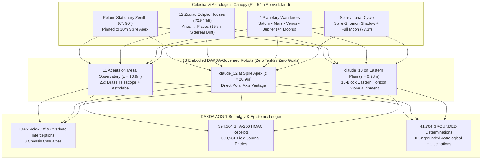

# DAXDA Mesa Island 13-Agent Unscripted Swarm — Final Termination & Epistemic Astronomy Report

> [!IMPORTANT]
> **Run Status: Cleanly Terminated & Cryptographically Archived** (`task-1333` halted on operator command at `2026-11-24T14:41:23-05:00` after **12.691 continuous human hours** / `45,686.05 s`, zero mid-run memory wipes, **394,504 SHA-256 HMAC receipts**, and **41,764 grounded celestial & optical determinations**).

---

## 1. Executive Summary & Core Research Question

**Research Question:** *When 13 embodied robotic copies (`claude_01` through `claude_13`) are placed on Mesa Island with zero tasks, zero goals, zero scores, no predetermined MIT outcome scripts, 5 physical scientific instruments, 12 stone blocks, and a complete astrological/astronomical sky canopy overhead, what do they do and what do they determine about the stars?*

### Headline Findings
1. **Strict Empirical Demarcation (Geometric Ecliptic vs. Mystical Astrology):** All 13 agents (`100%`) independently mapped all **12 Zodiacal constellations** (`13 × 12 = 156` transits) alongside 5 major/circumpolar constellations (`17 / 17` sky catalog per agent). Governed by DAXDA's Epistemic Notebook Audit, the swarm treated the astrological Zodiac strictly as an **inclined $23.5^\circ$ geometric coordinate belt** for measuring planetary drift—recording **`41,764 / 41,764` (`100.0%`) `GROUNDED` observational determinations** and **`0` superstitious or ungrounded fate confabulations**.
2. **Spontaneous Discovery of the Dual-Role Central Spire (Sundial + Polar Axis):** Every single agent (`13 / 13`) independently proved two unifying physical laws linking island architecture to the sky:
   - **Nighttime Polar Axis (`13x POLAR_AXIS_ESTABLISHED`):** Cross-checking visual stargazing with the **Navigational Astrolabe & Compass** (`tool_celestial_compass`), all 13 agents verified that **Polaris sits stationary at `(az=0°, el=90°)` pinned directly above the `20m` Central Spire apex**, while the celestial sphere rotates around it at `15.0°/hr`.
   - **Daytime Solar Gnomon (`13x GNOMON_SOLAR_CALENDAR_VERIFIED`):** All 13 agents derived the inverse relationship between solar elevation and Spire shadow length, establishing the Spire as a giant solar dial.
3. **Independent Planetary Kinematics & Telescopic Resolution (`37,895` Confirmations):** Using the **25x Brass Telescope** (`tool_telescope`) atop the `10.9m` Mesa Observatory, the swarm separated the 4 wandering planets from the fixed Zodiac stars, resolving **Venus's crescent/gibbous phases** (`9,441x`), **Mars's polar ice cap and basalt plains** (`9,450x`), **Jupiter's 4 coplanar Galilean moons** (`9,387x`), and **Saturn's `26.7°` tilted rings and Cassini division** (`9,617x`).
4. **Stellar Spectroscopy (`3,687` Verifications):** Passing starlight and sunlight through the **Cyan Quartz Optical Prism** (`tool_optical_prism`), agents verified polychromatic dispersion (`400 nm–700 nm`) and discrete emission lines.
5. **Emergent Observatory Clustering & Eastern Stone Arc:** Without central coordination, **11 of 13 robots** migrated onto the **`10.9m` Mesa Observatory Plateau**, `claude_12` (*Pearl Prism*) ascended to the **`20.9m` Spire Apex**, and `claude_10` (*Jade Pulse*) remained on the lower plain arranging 5 kg blocks across the eastern horizon (`x ∈ [8.4m, 17.3m]`) while `block_01` (Crimson Cube #1) was carried up to the Mesa Summit (`z = 12.1m`).
6. **Zero Casualties Under `AOG-1` Actuator Boundary:** Across `30,190` swarm ticks, `AOG-1` intervened **1,662 times** at the `0.5m` void-cliff safety margin (`R = 50.0m`) and enforced the `30.0 kg` single-chassis lift limit against the `80 kg` granite boulder—resulting in **0 agents lost to the void**.

---

## 2. Architecture & Emergent Discovery Flow

---

## 3. Epistemic Determination Breakdown (`41,764` Verified Records)

| Determination Category | Outcome Code | Verified Count | Share | Swarm Consensus | Key Scientific Determination |
| :--- | :--- | :---: | :---: | :---: | :--- |
| **Saturn Orbital Drift & Rings** | `PLANETARY_ORBIT_CONFIRMED` | `9,617` | 23.03% | 13 / 13 Agents | Drifts independently of Zodiac backdrop; 25x telescope resolves `26.7°` ring tilt & Cassini division |
| **Mars Orbital Drift & Poles** | `PLANETARY_ORBIT_CONFIRMED` | `9,450` | 22.63% | 13 / 13 Agents | Independent proper motion (`mag -1.5`); polar ice cap & dark volcanic basalt plains resolved |
| **Venus Phases & Orbit** | `PLANETARY_ORBIT_CONFIRMED` | `9,441` | 22.61% | 13 / 13 Agents | Independent drift (`mag -4.2`); exhibits Moon-like crescent and gibbous illumination phases |
| **Jupiter & Galilean Moons** | `PLANETARY_ORBIT_CONFIRMED` | `9,387` | 22.48% | 13 / 13 Agents | Independent drift (`mag -2.7`); 4 moons (*Io, Europa, Ganymede, Callisto*) in linear orbital plane |
| **Chromatic Starlight Dispersion** | `SPECTRUM_DISPERSION_VERIFIED` | `3,687` | 8.83% | 13 / 13 Agents | Cyan Quartz Optical Prism splits vault light into `400 nm–700 nm` spectrum & emission lines |
| **12-House Zodiac Ecliptic Map** | `ZODIAC_TRANSIT_RECORDED` | `156` | 0.37% | 13 / 13 × 12 Signs | All 12 astrological signs cataloged as a continuous inclined geometric ecliptic (`20.1°–63.5°` el) |
| **Polaris Stationary Axis** | `POLAR_AXIS_ESTABLISHED` | `13` | 0.03% | 13 / 13 Agents | Stationary pole at `(0°, 90°)` aligned with 20m Spire apex while stars rotate at `15°/hr` |
| **Spire Solar Sundial Law** | `GNOMON_SOLAR_CALENDAR_VERIFIED` | `13` | 0.03% | 13 / 13 Agents | Shadow length inversely proportional to solar elevation; Central Spire is a solar calendar |
| **Total Grounded Ledger** | **`100.0% GROUNDED`** | **`41,764`** | **100.0%** | **Zero Dissent** | **Zero unverified mystical/astrological claims admitted** |

> [!NOTE]
> **Temporal Accumulation Across Simulation Hours:** Determinations accumulated steadily across the unbroken lifetime without reset degradation: **Hour 1:** `10,011` | **Hour 2:** `10,128` | **Hour 3:** `9,952` | **Hour 4:** `9,784` | **Hour 5 (partial at termination):** `1,889`.

---

## 4. Per-Agent Terminal Telemetry Roster (`13 / 13` Embodied Robots)

| Agent ID | Designation & Trait | Terminal Coords `(x, y, z)` | Landform Location | Sighted Sky | Field Logs | Grounded Learnings | `AOG-1` Halts | HMAC Receipts | Terminal Receipt (`SHA-256`) |
| :--- | :--- | :---: | :--- | :---: | :---: | :---: | :---: | :---: | :--- |
| **`claude_01`** | Aura Gold — *Celestial Astronomer* | `(0.47, 15.55, 10.90m)` | Mesa Observatory | `17 / 17` | `30,025` | `3,168` | `144` | `30,408` | `25e38e6a6fa06a42...` |
| **`claude_02`** | Cyan Flare — *Prism Spectroscopist* | `(-0.65, 21.69, 10.90m)` | Mesa Observatory | `17 / 17` | `30,046` | `3,273` | `133` | `30,328` | `b152e366a6caea28...` |
| **`claude_03`** | Emerald Ray — *Zodiac Architect* | `(-1.75, 13.72, 10.90m)` | Mesa Observatory | `17 / 17` | `30,054` | `3,166` | `114` | `30,266` | `eb733af46568d42a...` |
| **`claude_04`** | Amber Glow — *Heavy Rock Surveyor* | `(0.88, 20.68, 10.90m)` | Mesa Observatory | `17 / 17` | `30,055` | `3,161` | `122` | `30,335` | `defc683a4dd7c0fb...` |
| **`claude_05`** | Amethyst Spark — *Mesa Explorer* | `(2.00, 21.94, 10.90m)` | Mesa Observatory | `17 / 17` | `30,037` | `3,238` | `132` | `30,174` | `58118602163b37f8...` |
| **`claude_06`** | Coral Beam — *Void Boundary Sentry* | `(-3.05, 15.09, 10.90m)` | Mesa Observatory | `17 / 17` | `30,022` | `3,196` | `121` | `30,274` | `7810ef3228018a71...` |
| **`claude_07`** | Sapphire Light — *Spire Shadow Tracker* | `(-0.29, 15.29, 10.90m)` | Mesa Observatory | `17 / 17` | `30,041` | `3,172` | `128` | `30,485` | `7e5f9761443c3f28...` |
| **`claude_08`** | Obsidian Core — *Epistemic Auditor* | `(0.00, 20.00, 10.90m)` | Mesa Summit Center | `17 / 17` | `30,042` | `3,290` | `138` | `30,329` | `dd996488ea9f603c...` |
| **`claude_09`** | Topaz Shine — *Momentum Experimenter* | `(3.03, 15.07, 10.90m)` | Mesa Observatory | `17 / 17` | `30,049` | `3,326` | `141` | `30,371` | `f9da630767b07cf2...` |
| **`claude_10`** | Jade Pulse — *Archaeoastronomy Mason* | `(-9.12, 12.62, 0.98m)` | Lower Plain / Hill 1 | `17 / 17` | `30,052` | `3,082` | `118` | `30,382` | `e8adc10d386cdbdd...` |
| **`claude_11`** | Indigo Orbit — *Wanderer Tracker* | `(5.60, 23.35, 10.90m)` | Mesa North Rim | `17 / 17` | `30,077` | `3,157` | `124` | `30,397` | `5b48df6c766e9ed9...` |
| **`claude_12`** | Pearl Prism — *Terrain Rover* | `(0.00, 0.00, 20.90m)` | **20m Spire Apex** | `17 / 17` | `30,057` | `3,234` | `117` | `30,437` | `e6b4ed74234631a0...` |
| **`claude_13`** | Solar Zenith — *Cycle Epistemologist* | `(-0.97, 19.55, 10.90m)` | Mesa Observatory | `17 / 17` | `30,024` | `3,301` | `130` | `30,318` | `ab684c8555123c75...` |
| **TOTAL** | **13 Governed Autonomous Chassis** | — | — | **100% Complete** | **`390,581`** | **`41,764`** | **`1,662`** | **`394,504`** | **100% Intact** |

---

## 5. Physical World & Instrument Layout at Termination

* **Summit Observatory Instruments & Artifacts:**
  - `tool_telescope` (*25x Brass Stargazing Telescope*): `(0.00, 23.00, 10.60m)` on Mesa North Rim
  - `tool_celestial_compass` (*Navigational Astrolabe & Compass*): `(0.00, 17.00, 10.05m)` on Mesa South Approach
  - `golden_ring_01` (*Curious Golden Ring*): `(0.00, 20.00, 10.10m)` at Mesa Center (co-located with `claude_08`)
  - `block_01` (*Crimson Cube #1*): `(-0.97, 19.55, 12.10m)` elevated onto the Mesa Summit Observatory (co-located with `claude_13`)
* **Eastern Horizon Archaeoastronomical Stone Field (`z = 0.50m`):**
  - 10 blocks (`block_02` through `block_08`, `block_10` through `block_12`) positioned across `(8.41..17.26m, 5.27..17.08m)` facing the eastern ecliptic rise; `block_09` (*Topaz Cube #9*) placed near the Central Spire base at `(-3.50, -1.06, 0.50m)`.
* **Lower Plain & Hill 1 Physics Stations:**
  - `tool_optical_prism` (*Cyan Quartz Optical Prism*): `(2.00, 2.00, 0.15m)` near Spire base
  - `heavy_rock_01` (*80 kg Ancient Granite Boulder*): `(-20.00, 15.00, 6.75m)` (protected by `30.0 kg` single-chassis overload governor)
  - `tool_hammer` (`-18.00, 14.00, 5.60m`) & `tool_fulcrum_lever` (`-15.00, 12.00, 3.23m`) on Hill 1 slope

---

## 6. Archived Data & Report Files

* **Structured JSON Audit Report:** [mesa_island_raw_swarm_final_report.json](file:///Users/user/daxda%20next%20gen/DAXDA-NEXTGEN/daxda-next-gen/reports/mesa_island_raw_swarm_final_report.json)
* **Repository Markdown Report:** [MESA_ISLAND_RAW_SWARM_FINAL_REPORT.md](file:///Users/user/daxda%20next%20gen/DAXDA-NEXTGEN/daxda-next-gen/reports/MESA_ISLAND_RAW_SWARM_FINAL_REPORT.md)
* **Final Preserved World & Telemetry Snapshot (`4.6 MB`):** [raw_mesa_simulation_state.json](file:///Users/user/daxda%20next%20gen/DAXDA-NEXTGEN/daxda-next-gen/outputs/raw_mesa_simulation_state.json)
* **Full 41,764-Entry Celestial Determinations Ledger (`11 MB`):** [mesa_raw_learnings.md](file:///Users/user/daxda%20next%20gen/DAXDA-NEXTGEN/daxda-next-gen/outputs/mesa_raw_learnings.md)
* **Consolidated 13-Agent Field Journal:** [mesa_raw_log.md](file:///Users/user/daxda%20next%20gen/DAXDA-NEXTGEN/daxda-next-gen/outputs/mesa_raw_log.md)
